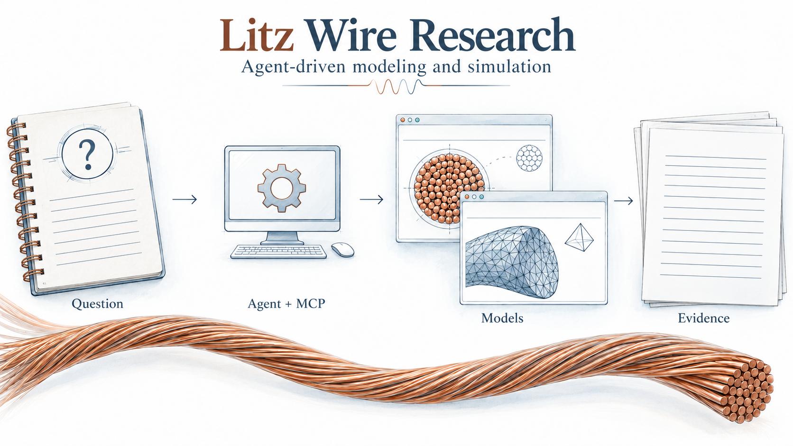
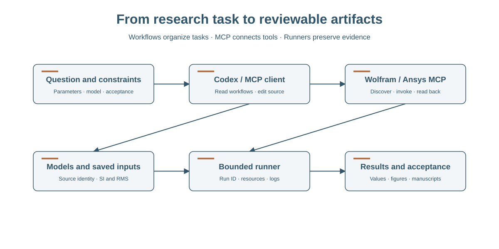
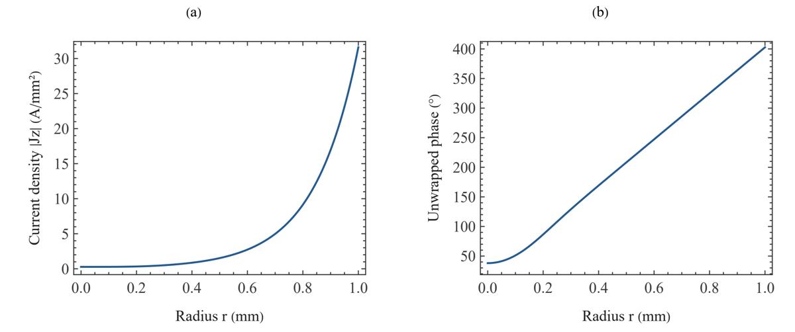
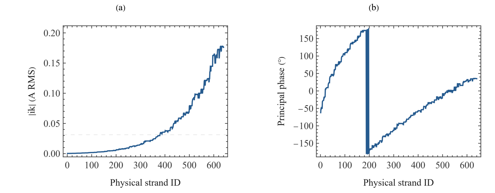
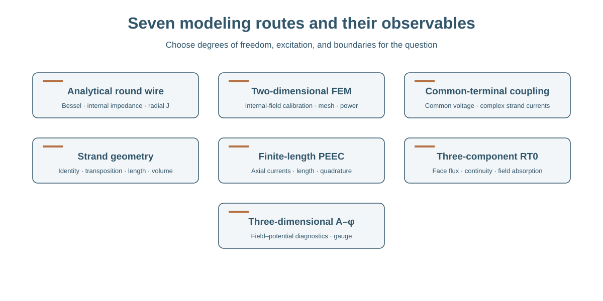
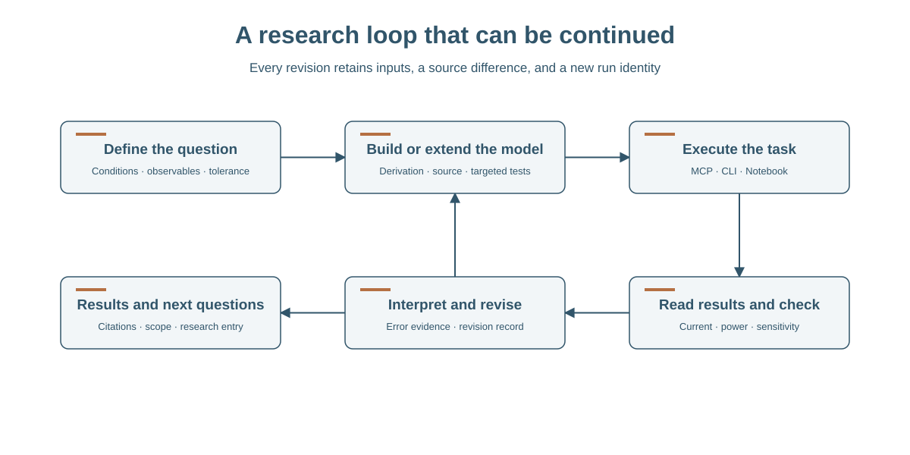
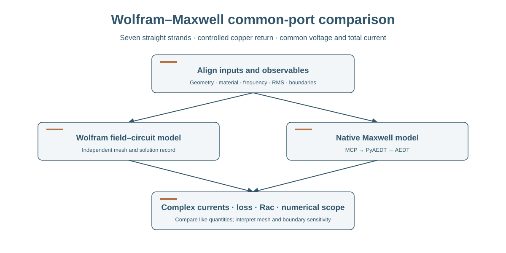
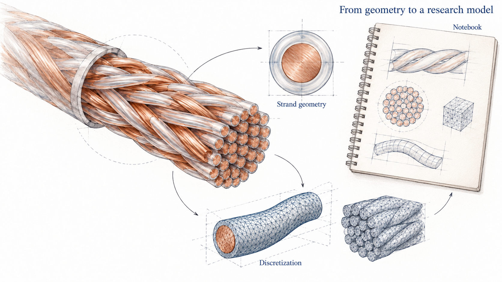

# Litz Wire Research

[Manuscripts and downloads](publications/ONLINE.md) · [v1.0.0-rc.3 source release](https://github.com/HNNUYUXUAN/litz-wire-research/releases/tag/v1.0.0-rc.3) · [Public distribution record](docs/open-source-readiness.md)



**Miao Yuxuan · Huainan Normal University**

A reproducible scientific modeling workflow driven by Codex or another MCP-compatible agent, with Litz-wire loss as a complete research case.

[English](README.md) · [简体中文](README.zh-CN.md) · [Automation](automation/README.md) · [Publications](publications/README.md) · [Sources and acknowledgments](references/README.md)



Read the [complete report, automation methods paper and physics paper](publications/README.md): six bilingual manuscripts, native Notebooks and eighteen PDFs.

## Start with your task

| I want to | Start here |
| --- | --- |
| Read the research and manuscripts | [Bilingual text, PDFs and Notebooks](publications/README.md) |
| Run a modeling task with an agent | [Connections and workflows](automation/README.md) |
| Let an agent find models, cases and evidence | [Catalog guide](docs/agent-catalog.md) · [llms.txt](llms.txt) |
| Restore a route's research data | [Selective download and verification](docs/datasets.md) |
| Change the source and contribute | [Contributing](CONTRIBUTING.md) · [Development and tests](docs/development.md) |

## From a question to evidence

Ask the agent to construct a model, run it, inspect conservation and diagnose a failed check. The project supplies research workflows, fixed MCP connections, deterministic runners and complete tool/solver records. Start with the Wolfram calibration or the native seven-strand Maxwell example.

- [Connect Codex](automation/harnesses/codex/README.md) · [Other MCP clients](automation/harnesses/generic/README.md)
- [Complete automation examples](automation/examples/README.md) · [Architecture and extension](docs/automation-architecture.md)
- [Reproduce](automation/workflows/reproduce/README.md) · [Extend a model](automation/workflows/extend-model/README.md) · [Compare solvers](automation/workflows/compare-solvers/README.md) · [Diagnose](automation/workflows/diagnose/README.md)

Example task: “Use Wolfram and Maxwell to model seven insulated copper strands at 200 kHz and 20 A RMS with a controlled coaxial return. Solve their common terminal voltage and complex currents, check power, and report the mesh limitations.”

[Actual execution and acceptance / 实际执行与验收](automation/examples/verification.json) · [Replay / 复现入口](automation/examples/README.md)

## What the Litz case establishes

At 200 kHz and 20 A RMS, the 2 mm isolated round-wire calibration gives 20.0162 mΩ/m internal AC resistance and 8.00648 W/m Joule loss. Common terminal voltage does not force equal complex strand currents. Finite-length longitudinal PEEC supports model-specific loss and sensitivity comparisons; field, geometry and end-region models retain their own validation ranges.

Explore the analytical profile, 640-strand currents and PEEC sensitivity in the publications. Each figure connects to its source data, model and acceptance evidence.






## Run a first result

```powershell
python -m venv .venv
.venv/Scripts/python.exe -m pip install -e ".[automation]" -c automation/mcp/project-environment.lock
.venv/Scripts/litz-research.exe run analytic --case tutorial --run-id analytic_example_01
.venv/Scripts/litz-research.exe automation doctor
```

Read outputs/analytic_example_01/results.json. Scientific execution uses SI, exp(+jωt) and RMS. Q1 is a calibration case with 6.3662 A/mm²; final Q2 design requires at least 5 mm² nominal copper.

## Choose a model and continue the research

| Route | Research entry |
| --- | --- |
| Bessel calibration | [analytic](models/analytic/README.md) |
| 2D field calibration | [fem2](models/fem2/README.md) |
| Common-terminal currents | [common_terminal](models/common_terminal/README.md) |
| Geometry and transposition | [geometry](models/geometry/README.md) |
| Longitudinal PEEC | [peec](models/peec/README.md) |
| RT0 volume model | [rt0](models/rt0/README.md) |
| A–φ diagnostics | [aphi](models/aphi/README.md) |

Each route includes bilingual interactive Notebooks, editable tutorial inputs, source and checks. Continue from a small verified case toward mesh, boundary and length studies. Real transposition, finite terminal fields and experiments remain research directions defined by the preserved diagnostics.

## Read, cite and reuse

[Publications](publications/README.md) · [Datasets](docs/datasets.md) · [Citation guide](docs/citation-guide.md) · [Acknowledgments](ACKNOWLEDGMENTS.md) · [Licenses](LICENSES/README.md)

Original software uses MIT; original text, figures and data use CC BY 4.0. Upstream software retains its own license. Wolfram and Ansys are external licensed applications.

## From models to research conclusions

Each of the seven routes retains its degrees of freedom, excitation, boundaries and acceptance records. Select a model suited to the question, then extend and check it through the research workflows.









[Publication delivery and verification](publications/DELIVERY.md)
