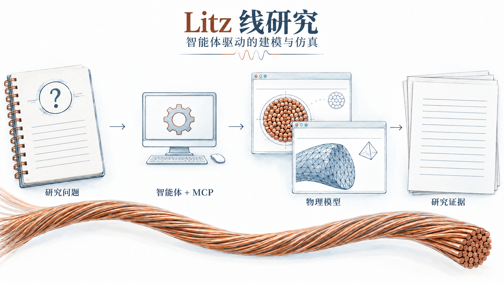
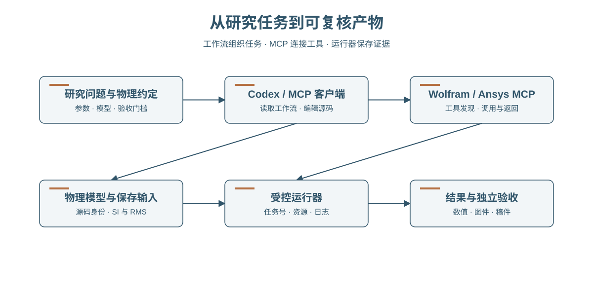
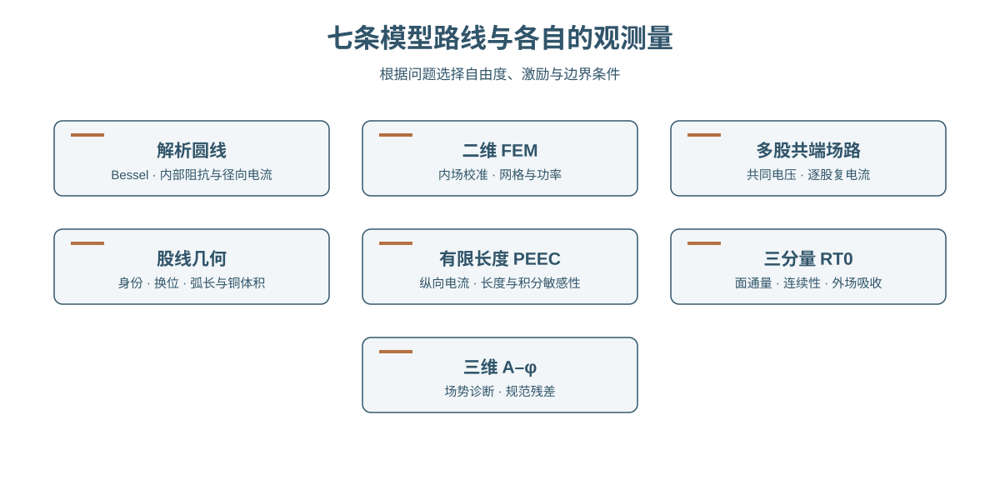
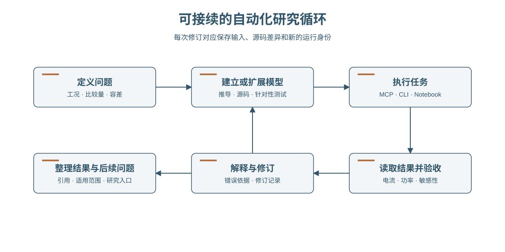
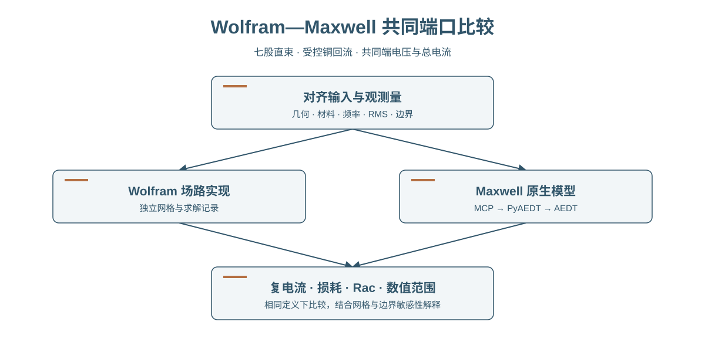
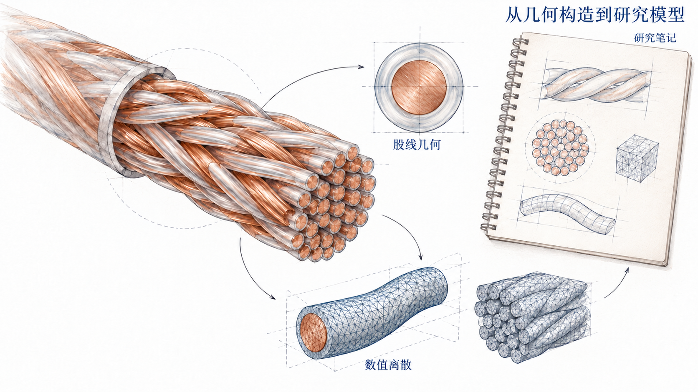

# Litz Wire Research：智能体驱动建模与仿真

[在线审阅与附件下载](publications/ONLINE.zh-CN.md)



**缪雨轩 · 淮南师范学院**

以 Codex 或其他支持 MCP 的智能体驱动可复核科学建模，以 Litz 线损耗提供完整研究案例。

[English](README.md) · [简体中文](README.zh-CN.md) · [自动化研究](automation/README.zh-CN.md) · [完整稿件](publications/README.zh-CN.md) · [来源与致谢](references/README.zh-CN.md)



本地阅读：[完整报告、自动化方法论文与物理研究论文](publications/README.zh-CN.md)，含六份完整双语稿件、原生 Notebook 和十八份 PDF。

## 从研究问题到计算证据

让智能体建立模型、执行求解、检查守恒并诊断失败。项目提供研究工作流、固定 MCP 接入、确定性运行器及完整工具和求解记录。可从 Wolfram 解析校准或 Maxwell 原生七股案例开始。

- [接入 Codex](automation/harnesses/codex/README.zh-CN.md) · [其他 MCP 客户端](automation/harnesses/generic/README.zh-CN.md)
- [完整自动化案例](automation/examples/README.zh-CN.md) · [架构与扩展](docs/automation-architecture.zh-CN.md)
- [复现](automation/workflows/reproduce/README.zh-CN.md) · [扩展模型](automation/workflows/extend-model/README.zh-CN.md) · [跨求解器比较](automation/workflows/compare-solvers/README.zh-CN.md) · [诊断](automation/workflows/diagnose/README.zh-CN.md)

任务示例：“通过 Wolfram 与 Maxwell 建立七股绝缘铜线在 200 kHz、20 A RMS 和受控同轴回流下的模型。联立求解共同端电压与复电流，核对功率，并报告网格精度限制。”

[实际执行与验收](automation/examples/verification.json) · [复现入口](automation/examples/README.zh-CN.md)

## Litz 案例中的研究认识

在 200 kHz、20 A RMS 下，2 mm 孤立圆线校准的交流内电阻为 20.0162 mΩ/m，焦耳损耗为 8.00648 W/m。共同端电压下仍可能存在复电流差异。有限长度纵向 PEEC 支持其模型范围内的损耗与敏感性比较；外场、几何和端区模型各自保留验收范围。

从成稿中的解析径向分布、640 股复电流和 PEEC 敏感性图进入研究；每张图关联数据、模型和验收证据。


## 运行第一个结果

```powershell
python -m venv .venv
.venv/Scripts/python.exe -m pip install -e ".[automation]" -c automation/mcp/project-environment.lock
.venv/Scripts/litz-research.exe run analytic --case tutorial --run-id analytic_example_01
.venv/Scripts/litz-research.exe automation doctor
```

读取 outputs/analytic_example_01/results.json。计算采用 SI、exp(+jωt) 和 RMS；Q1 的电流密度为 6.3662 A/mm²，用作校准，Q2 最终设计要求至少 5 mm² 名义铜面积。

## 选择模型并继续研究

| 路线 | 研究入口 |
| --- | --- |
| Bessel 解析校准 | [analytic](models/analytic/README.zh-CN.md) |
| 二维场校准 | [fem2](models/fem2/README.zh-CN.md) |
| 共端电流 | [common_terminal](models/common_terminal/README.zh-CN.md) |
| 几何与换位 | [geometry](models/geometry/README.zh-CN.md) |
| 纵向 PEEC | [peec](models/peec/README.zh-CN.md) |
| RT0 体模型 | [rt0](models/rt0/README.zh-CN.md) |
| A–φ 诊断 | [aphi](models/aphi/README.zh-CN.md) |

每条路线包含双语交互 Notebook、可编辑教程输入、源码和验收。先复现小型案例，再研究网格、边界和长度；真实换位、有限端场和实验沿保存的诊断资料继续推进。

## 阅读、引用与复用

[完整稿件](publications/README.zh-CN.md) · [数据集](docs/datasets.zh-CN.md) · [引用指南](docs/citation-guide.zh-CN.md) · [致谢](ACKNOWLEDGMENTS.zh-CN.md) · [许可](LICENSES/README.zh-CN.md)

原创软件采用 MIT，原创文稿、图件与数据采用 CC BY 4.0；上游软件保留各自许可。Wolfram 与 Ansys 作为外部授权运行条件。候选仓库保持 Private，Release 保持 Draft。

## 从模型到研究结论

七条路线分别保留其自由度、激励、边界与验收记录。选择与研究问题相符的模型，再通过工作流扩展并检查。









[本地完整交付与校验](publications/DELIVERY.zh-CN.md)
