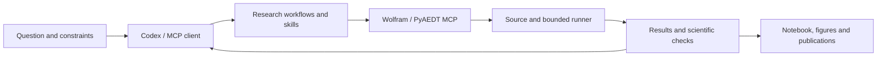

# Agent-driven modeling and simulation

Start with a research question and a checked physical contract. The agent reads the selected model and evidence, uses Wolfram or Ansys MCP to explore and construct the model, saves the source, schedules the bounded solver, evaluates independent checks, and explains the result or next diagnostic step.

Use [Codex setup](harnesses/codex/README.md), [generic MCP setup](harnesses/generic/README.md), and the [fixed upstreams](mcp/upstreams.lock.json). The [examples](examples/README.md) contain actual task and tool evidence. [Workflows](workflows/reproduce/README.md) cover reproduction, extension, comparison, diagnosis and reporting.

Protocol initialization, tool execution, solver execution and physical acceptance have separate records. A fresh model run reproduces saved code and inputs; agent-generated revisions can vary and must satisfy the same scientific checks.
