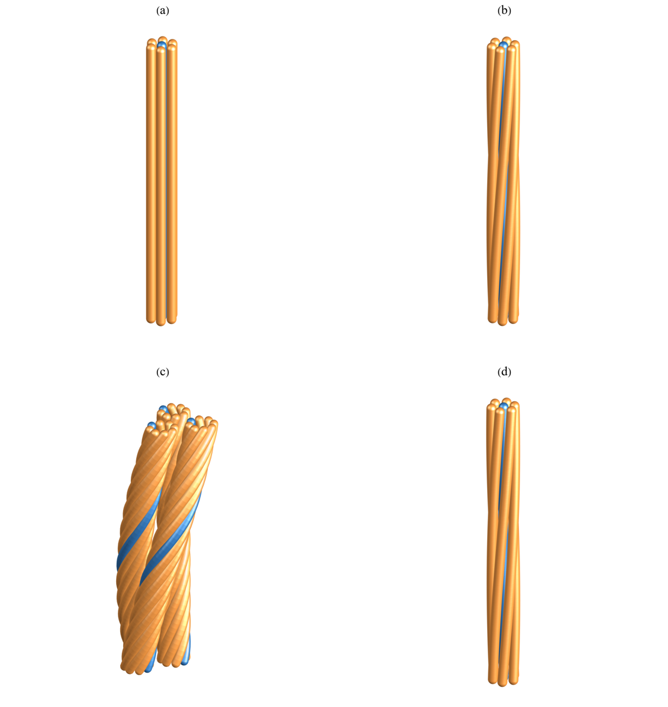
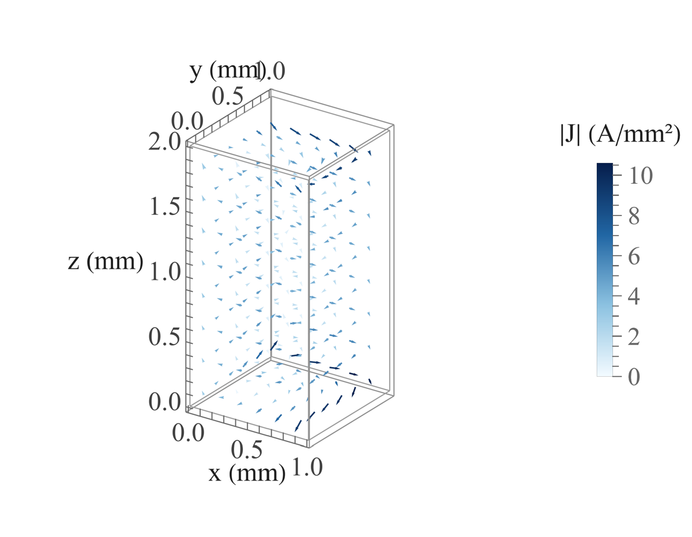
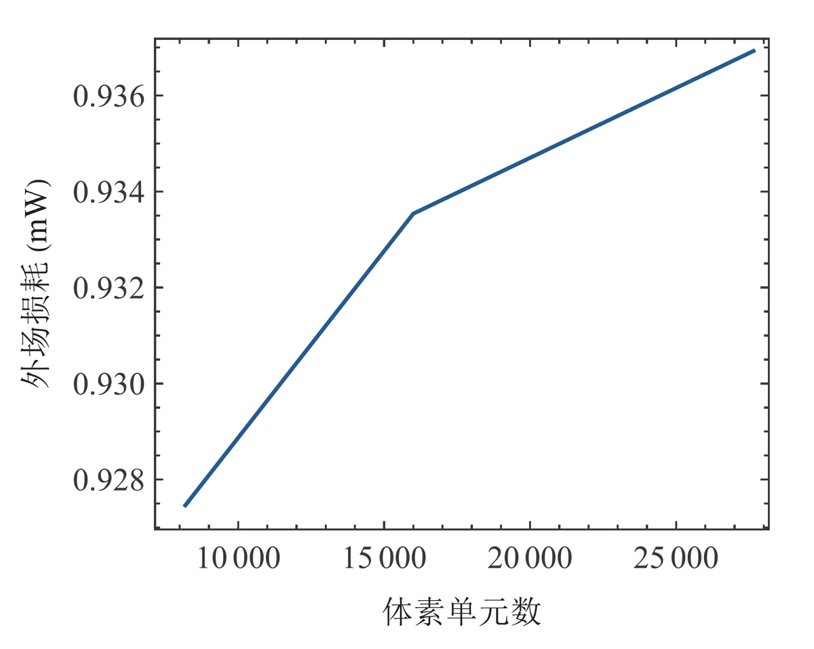
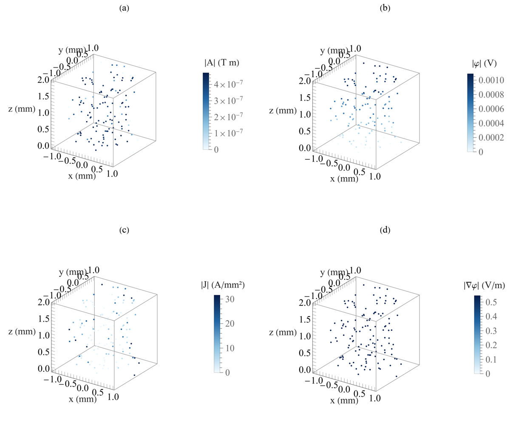
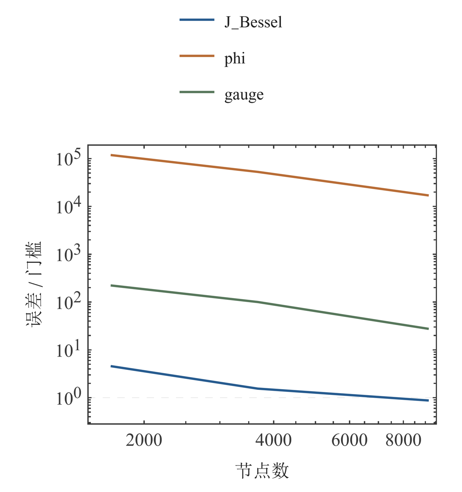
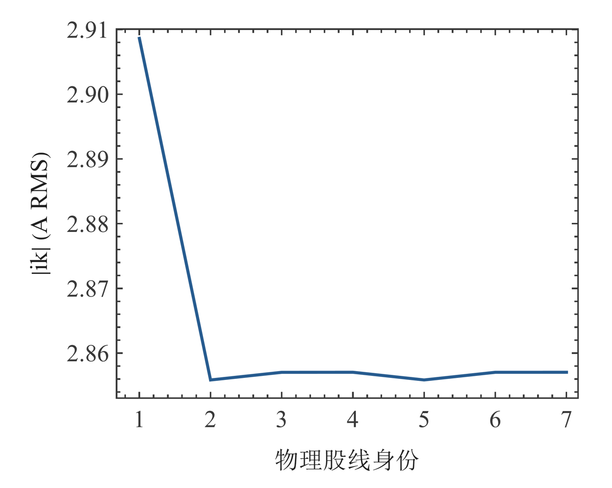
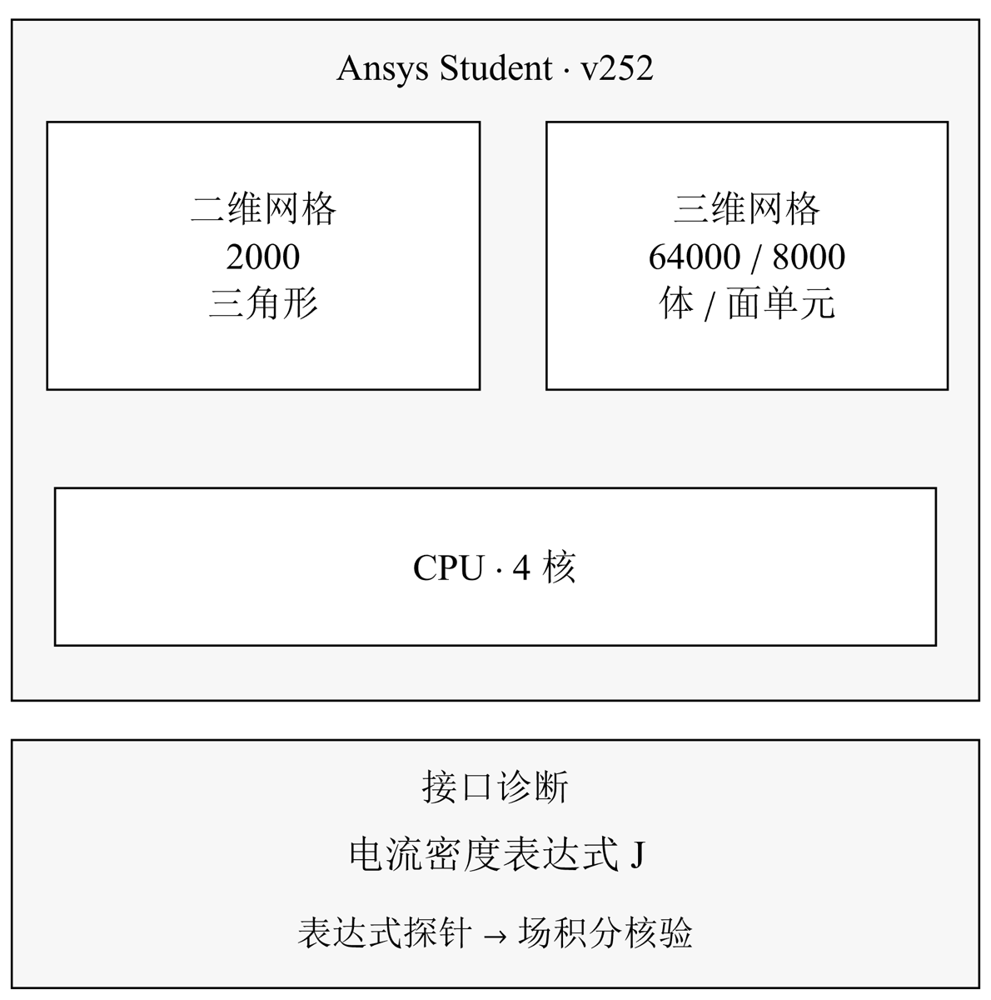

# Litz 线的分层验证、共端复电流分配与有限长度纵向 PEEC · S2 完整敏感性数据

缪雨轩 · 淮南师范学院

[合并稿](../README.md#chapter-S2)

## S2 完整敏感性数据

### 几何、实际弧长与离散换位

保存的直束、单级、传统多级和跨层中心线用于检查股线身份、周期、间隙、曲率、实际弧长和铜体积。400、800、1600 轴向采样与 60 项几何检查支持这些几何量的数值一致性，但旧包装器退出码和未保存的内核实际退出保持原状态。24 股、0.100 mm 铜径样张约有 0.1885 mm² 名义铜面积；它说明几何构造，不等于满足至少 5 mm² 的最终束。三维材质、光照与可旋转视角只用于读图。

当前 DTM/iDTM 演示采用加性离散块 [(7)](../README.md#E06)。同一组带权阻抗块只改变排列顺序，不改变总和；因此该实现中出现的均流不能证明不同真实换位路径等效，或证明跨层结构优于传统多级。与文献 [1, 2] 比较时，应核查沿程换位、层级非交换关系、局部场假设和端接，而不能仅复用方法名称。几何公平、模型充分性和性能改善是分别需要证据的三个问题。

### RT0 三维外场算例

RT0 算例固定为 1×1×2 mm 均质铜长方体、200 kHz、Bz=1 mT RMS 外场和零净输运。三分量电流通过面通量自由度表示，连续性、公共端条件与外场功率分别检查。统一 q14 的 8192、16000、27648 单元损耗为 0.927463、0.933539、0.936927 mW；末两次变化为 0.655090% 和 0.362916%，均低于 1%。末档 q18 对照的损耗相对变化为 1.54941×10⁻⁸，复面通量变化为 1.39291×10⁻⁸，低于 0.1% 积分门槛。

场图由保存的面通量恢复。中心 J 采用相对两面的通量平均除以单元面积；单元平均损耗密度采用完整 RT0 局部重叠积分，不能用中心 |J|²/σ 替代。三维箭头仅显示固定相位零时刻的实部，按统一比例缩放；色标使用复 RMS 范数。切面的实际 z 位置、稀疏矢量抽样和整体积分分别标注，避免把抽样图看成完整场积分或全场最大值。

各档归档的 GMRES 迭代为 35 次，真残差满足 10⁻¹¹ 目标。原 q18 摘要中 null 指标及失败状态仍原样保留，新 CSV 后处理验收另列。旧致密算法的内存拒绝与新版矩阵自由成功求解是不同实现的证据，不能合并为一个状态。当前结论限于固定外场长方体，尚未覆盖曲线 Litz 掩膜、独立边界通量验证或实际输运端接。

### 三维 A–φ 保存场与失败诊断

A–φ 电流应使用实际保存的 A 和 φ 梯度恢复 [(9)](../README.md#E07)，不能把未通过的 φ 替换成解析值。三档圆柱分别为 1683、3672、9108 节点。最细档的径向 J 校准达到其门槛，但 φ 与规范残差在原三档中仍未通过；较粗档 J 本身也未通过。制造解核验检验了指定方程与实现关系，却没有使这些圆柱物理解自动通过。

诊断图使用 128 个具有明确节点身份的保存场及导数样本，分别显示 A、φ、J 和实际 φ 梯度。它们不是从美化表面反推的结果，也不是全场极值。边界、缩放、导数和后处理诊断应区分实现问题与离散误差；达到有限修订上限后，未通过项以触发条件、最小复现和继续研究所需条件封存。直接分解、OOC 与迭代失败路线也保持各自原因。

### Ansys 有限验证与接口边界

七股二维历史有效端口短测使用 704 单元，包含两个电压基解和实际 ±20 A 场解；公共端电压、逐股复电流与独立功率支持该单档算例。它不是三档网格收敛。新固定网格与精度尝试未形成要求的完整验收；原生三维 J 表达式探针也未得到可接受物理解，因此不为其生成场结果图或填造数值。

归档边界采用已核查 v252 Student 的二维 2000 三角形、三维 64000 体单元/8000 面单元及四核限制。接口错误、网格或许可限制和数值误差有不同含义，应分别记录。实际端接、曲线 STL 和足铜大束继续需要相应许可、网格能力及独立验证；有限短测不能用于推荐真实换位性能。

$$
\mathbf J=-\sigma\left(j\omega\mathbf A+\nabla\phi\right).\tag{9}
$$

图 14. 股线中心线的三维结构比较。

面板依次展示直束、单级、传统多级局部和跨层结构。

图 15. RT0 外场电流与损耗切面。

铜长方体为 1×1×2 mm，200 kHz、1 mT RMS 外场、零净输运。 (a) 单元平均损耗密度；(b) 复 RMS 电流范数。

图 16. RT0 重构电流三维矢量。

铜长方体为 1×1×2 mm，200 kHz、1 mT RMS 外场、零净输运。 箭头为固定相位的实部，色标为复 RMS 范数。

图 17. RT0 空间与积分对照。

铜长方体为 1×1×2 mm，200 kHz、1 mT RMS 外场、零净输运。 q14 空间序列与末档 q18 对照使用相同外场工况。

图 18. A–φ 保存场样本。

面板分别给出 A、φ、J 和实际 φ 梯度。

图 19. A–φ 圆柱校准指标。

三档网格与各指标门槛分别展示。

图 20. Ansys 七股二维复电流。

704 单元有效端口短测给出逐股幅值与相位。

图 21. Ansys Student 能力与接口诊断。

Ansys Student v252 的二维三角形、三维体单元与面单元上限分别为 2000、64000 和 8000，计算使用最多 4 核。并列分组表示各项许可限制。电流密度表达式 J 的接口探针与许可规模分别记录，实际求解状态见三维诊断。

q1_fem2_convergence.csv

| nodes | h_over_a | Rac_ohm_per_m | Rac_relative_error |
| --- | --- | --- | --- |
| 353 | 0.24 | 0.02015722 | 0.007045247 |
| 1389 | 0.12 | 0.02002081 | 0.0002302695 |
| 5573 | 0.06 | 0.02001617 | 1.79233e-06 |

peec_length.csv

| filaments | length_m | Rac_ohm_per_axial_m | Rac_over_Rdc |
| --- | --- | --- | --- |
| 1264 | 0.16 | 0.01989922 | 3.647128 |
| 1264 | 0.32 | 0.01995864 | 3.65802 |
| 1264 | 0.64 | 0.01998848 | 3.663488 |
| 5024 | 0.32 | 0.01998302 | 3.639307 |
| 5024 | 0.64 | 0.02001274 | 3.64472 |

rt0_cases.csv

| cells | recomputed_loss_W |
| --- | --- |
| 8192 | 0.0009274631 |
| 16000 | 0.0009335389 |
| 27648 | 0.0009369268 |
| 27648 | 0.0009369268 |

gpu_equivalence.csv

| filaments | L_matrix_relative_error | current_relative_error |
| --- | --- | --- |
| 1264 | 7.075722e-16 | 3.281741e-14 |
| 5024 | 7.481492e-16 | 7.780817e-14 |

## 参考文献

[1] Silvano Cruciani, Tommaso Campi, Francesca Maradei, Mauro Feliziani. Numerical Modeling of Litz Wires Based on Discrete Transpositions of Strands and 2-D Finite Element Analysis. IEEE TPEL 38(5):6710–6719, 2023. https://doi.org/10.1109/TPEL.2023.3240338

[2] Xinsheng Zhang, Fei Xiao, Ruitian Wang, Shunjun Chen, Xuexin Fan, Xin Li. AC Impedance Modeling of Composite Litz Wire With Nonideal Transposition Based on Improved Discrete Transposition Model. IEEE TPEL 41(7):11003–11019, 2026. https://doi.org/10.1109/TPEL.2026.3661080
