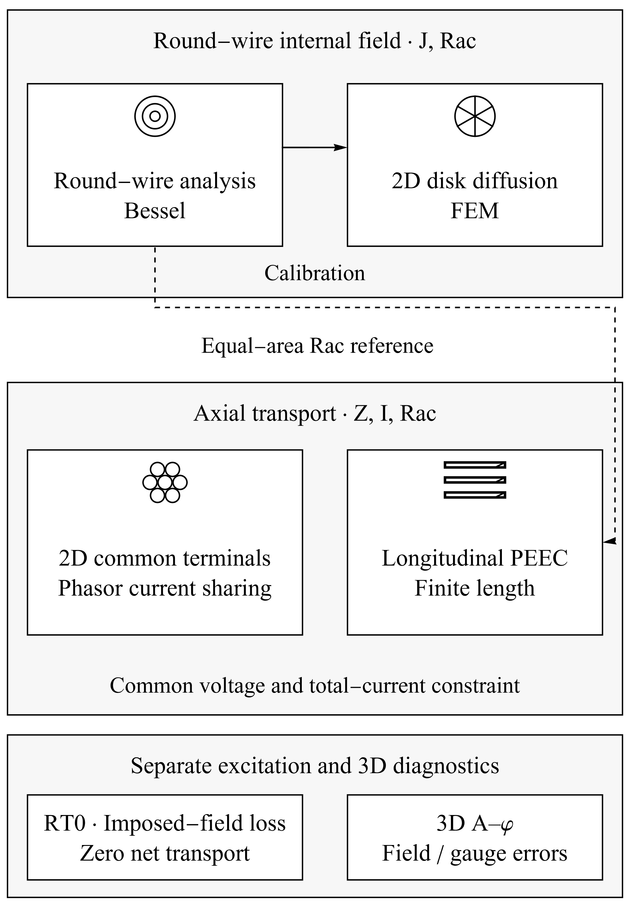
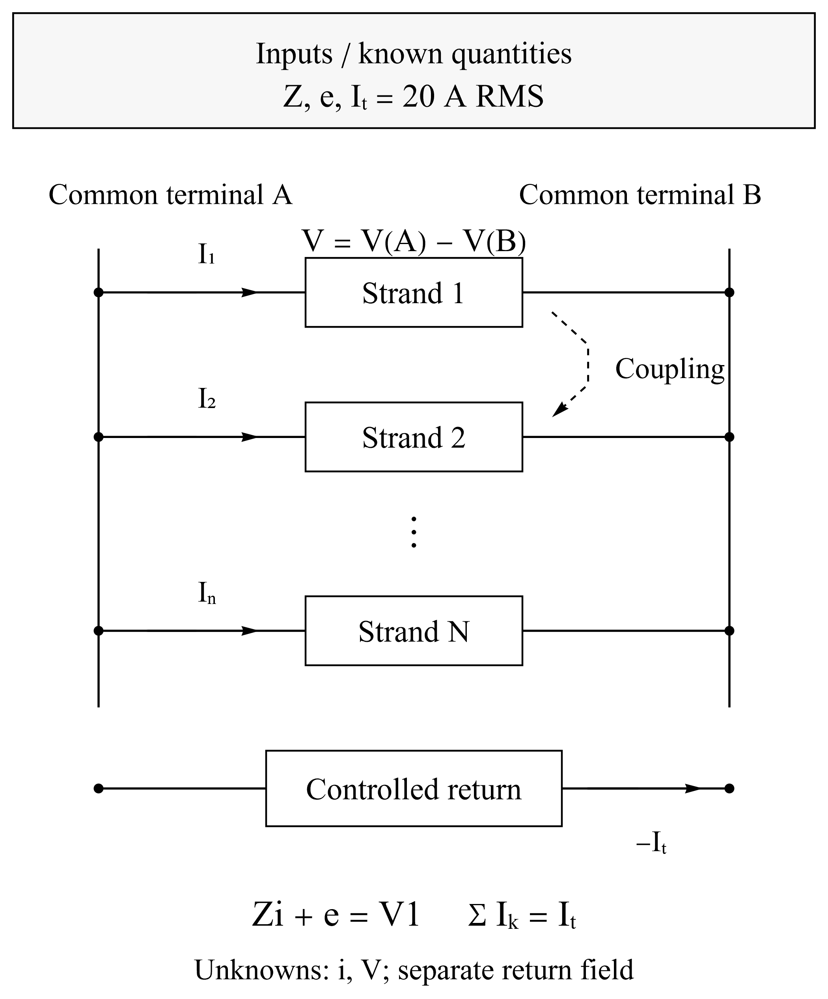
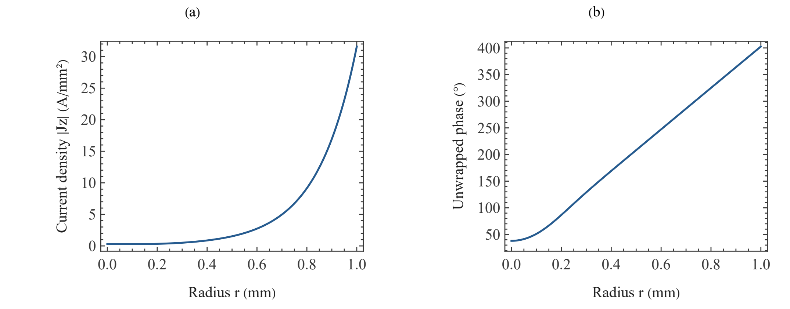
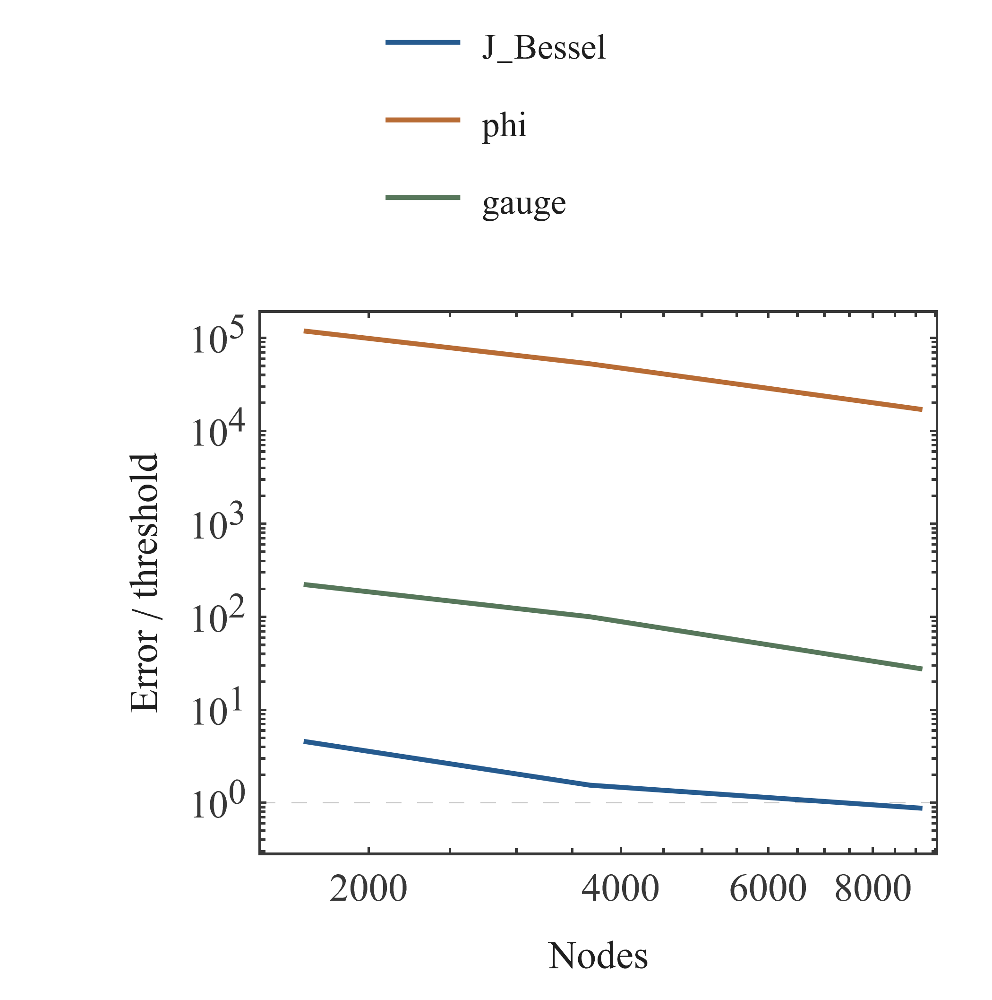
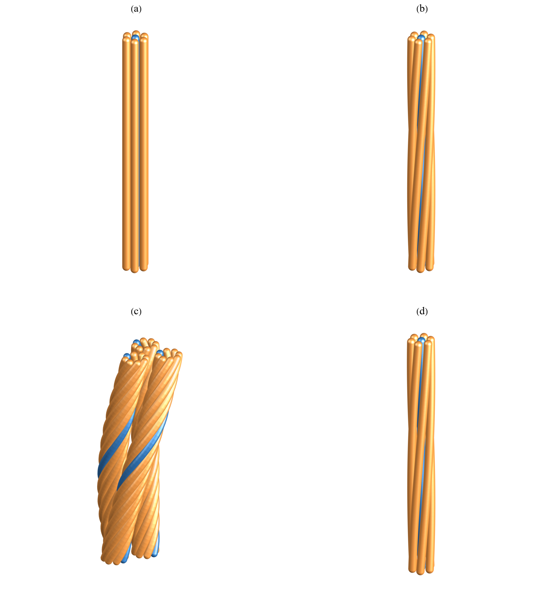

<!-- Generated from manuscript/automation/en/main.tex; edit the LaTeX source. -->

# Agent-Driven Reviewable Modeling and Simulation: A Wolfram--Ansys MCP Workflow with Litz-Wire Cases {#title}

Miao Yuxuan (Huainan Normal University)

## Abstract

This paper presents an agent-driven modeling and simulation workflow built on task identities, saved source, and independent acceptance. Codex, Wolfram, and Ansys MCP connect research questions to traceable computational artifacts. Workflows, execution adapters, and physical models organize tasks, software connections, and numerical implementations through common parameter and result interfaces. Six recorded case classes cover analytical calibration and Notebooks, native Maxwell construction and solution, cross-solver comparison, frequency extension, interface repair, and A--φ failure diagnosis. A seven-strand common-port comparison gives a relative complex-current L2 difference of 0.0106814% and a relative resistance difference of 0.00132823%. These values concern the retained meshes; spatial and boundary convergence require further examination. The cases demonstrate how protocol status, execution status, and physical acceptance jointly support continued research. Workflows, configurations, adapter code, models, and run records provide reusable research materials.

## Keywords

Litz wire; hierarchical verification; skin and proximity effects; common-terminal circuits; finite-length PEEC; reproducible numerical research

## Research questions and method {#chapter:01}

A scientific result typically passes through model selection, parameter interpretation, software calls, solution, postprocessing, and written interpretation. These stages use different representations and success criteria: a working tool connection does not establish a correct model, and a normal solver exit does not establish acceptable current, power, or discretization error. When an agent participates in modeling, natural-language requests must become executable objects, and each decision must connect to evidence that can be saved and examined.

Using Litz wire as a case study, this work combines the Codex client, the Model Context Protocol (MCP), Wolfram Language, and Ansys Electronics Desktop into an automated research workflow. Codex decomposes tasks, edits source, invokes tools, and interprets results; MCP supplies tool discovery and invocation; project runners validate inputs, bind source identities, control process resources, and retain outputs. Independent calculations and explicit tolerances determine physical acceptance. This division turns interactive exploration into research objects that another investigator can execute and extend. [@CODEX; @MCP; @WOLFRAM; @AEDT]

Litz modeling imposes concrete requirements on this workflow. Analytical round-wire, two-dimensional common-terminal, finite-length PEEC, imposed-field RT0, and three-dimensional A--φ models retain different degrees of freedom and excitations, so their results must be interpreted through their respective observables. Literature on transposition and multiscale modeling informs model selection; complex strand currents, actual copper area, and return conditions determine whether implementations can be compared directly. [@P01; @N01; @RUEHLI1974; @RT1977]

This paper addresses three engineering questions: how to share a traceable task identity across client, tool, and solver; how to connect protocol checks with physical acceptance; and how to retain sufficient recovery information during code extension, interface errors, and numerical failure. Evaluation uses six classes of recorded rc.2 cases, and conclusions concern the capabilities exercised by those cases. Client comparisons, manual-effort baselines, and large-sample success rates require separately designed experiments.

<figure id="fig:model_hierarchy" data-latex-placement="!htbp">

<figcaption>Model hierarchy and comparable observables. Transport models are grouped by physical object and observable: round-wire internal fields support analytical and two-dimensional calibration, multistrand field–circuit models resolve common-terminal phasor currents, and longitudinal PEEC examines finite-length effects. Links identify internal-field calibration or equal-area resistance references. RT0 imposed-field loss and three-dimensional A–φ diagnostics occupy separate research scopes.</figcaption>
</figure>

## Software connections and layered architecture {#chapter:02}

The system has three layers: research workflows, execution adapters, and physical models. Workflows define inputs, operation order, checking criteria, and completion conditions; adapters manage connections and execution for Wolfram, AEDT, and numerical backends; models retain equations, discretizations, and route tests. Parameters and artifacts pass through a common task interface, allowing text tutorials, the command line and MCP entry points to refer to the same saved inputs.

The Wolfram connection pins AgentTools 2.2.0 at commit 9c99e2da5286c2ff7ac2298956107cd9334c6e90; the existing validation records use Wolfram kernel 15.0.0. Tools expose code evaluation, testing, and Notebook reading and writing. Returned numerical expressions and TestReport results support current computational checks. The archived rc.2 frontend case separately checked opening, saving, reopening and reading back Notebook graphics. [@AGENTTOOLS]

The Ansys connection pins PyAEDT-MCP 0.2.dev0 at commit 80ae7c3cb47e5de7b744a2898061510299d3bcef, with PyAEDT 1.8.0 for model construction. The server runs in a separate CPython environment. The project runner starts and records its own AEDT Student gRPC session before MCP connects to that session. AEDT's embedded scripting environment and external CPython expose different modules and object interfaces, so call records retain the actual execution location, tool name, and returned value. [@PYAEDTMCP; @PYAEDT; @ANSYSCOMMONMCP]

The default configuration uses local standard input/output transport; the configuration generator also supports local HTTP. Installation materials pin upstream sources, dependencies, and licenses, while connection diagnostics inspect actual paths and available tools. Wolfram, AEDT, and fonts form part of the runtime environment, with versions and license conditions recorded per run. Other MCP clients can use the same task descriptions and protocol interface; the end-to-end records in this paper concern Codex with a standard MCP client bridge.

Research source and software connections have distinct responsibilities, allowing models to run independently through the command line and helping locate the layer in which a failure occurs. Temporary code produced during a client session is saved before formal acceptance; the run manifest binds file hashes and parameters. Later revisions can therefore be traced through a code difference and a new run identity to the original attempt.

## Task identity and physical acceptance {#chapter:03}

A task submission specifies a case, parameter file, run identifier, and resource policy. A long task first returns its identifier and then persists status, logs, and results in its assigned directory. After a client timeout, the client queries that run rather than interpreting a communication failure as solver termination and starting another solve. Results retain both execution status and physical acceptance; cancellation, budget exhaustion, program exceptions, and lack of convergence retain their respective causes.

The runner manages the process tree it creates and binds cancellation and cleanup to process creation identity. The project budget is eight logical processors, 24 GiB of task memory, and an 8 GiB system free-memory reserve. Student cases additionally obey their actual license constraints and request four solver cores. Resource records explain execution capacity and termination causes so that constrained runs can be interpreted separately from completed calculations. [@PSUTIL; @PYTHON]

Recovery first checks the identities of the request, source snapshot, and checkpoint. Existing tutorial recovery reruns saved inputs under a linked new identifier; complete numerical routes use their own checkpoint protocols. Reconnecting a client, restarting a task, and restoring a numerical checkpoint have different meanings, which are retained in parent-task relationships and recovery descriptions.

Physical conventions enter each execution interface through the common parameter file: SI units, exp(jωt), RMS phasors, copper at 20 °C, σ=5.8×10⁷ S/m, and μr=1. The principal transport condition is 200 kHz and 20 A RMS. Strands are insulated along their lengths and connected in parallel at their ends. Common terminal voltage and total current jointly determine complex strand currents through the augmented system below.

$$\begin{bmatrix} Z&-\mathbf1\\ \mathbf1^T&0\end{bmatrix}\begin{bmatrix}\mathbf i\\V\end{bmatrix}=\begin{bmatrix}-\mathbf e\\I_t\end{bmatrix}\tag{1}$$

Here Z is the selected model's coupled impedance matrix, e contains independently induced voltages, and i and V are the unknown complex currents and terminal voltage. Acceptance checks current constraints, power balance, and discretization sensitivity, together with return and boundary conditions. The 2 mm round wire in Q1 serves as an analytical calibration and has a DC current density of approximately 6.366 A/mm²; Q2 candidates require at least 5 mm² nominal copper area. Small-strand port cases validate interfaces and constraints, with their area conditions retained in the case description.

<figure id="fig:common_terminal" data-latex-placement="!htbp">

<figcaption>Multistrand common terminals and return. Strands are insulated along their paths and connected in parallel at both ends; their phasor currents follow from the common voltage and total-current constraints. The coupling matrix Z and excitation term e contain the impedance and field contributions retained by the model. The controlled return carries the opposite total current and has its own terminal field. Known inputs and unknown currents and voltage are identified.</figcaption>
</figure>

## Modeling, extension, and cross-solver comparison {#chapter:04}

### Wolfram calibration and model extension

The archived rc.2 Wolfram case records MCP initialization, tool discovery, and actual calls, connecting analytical calculation, testing, graphics, and Notebook persistence. At 200 kHz, the round-wire reference gives Rac=20.0162 mΩ/m and a loss of 8.00648 W/m. Independent complex-current and Joule-power integrals check normalization and the RMS convention. The analytical reference and native Notebook tooling are supported by the mathematical definitions and the AgentTools interface, respectively. [@BESSEL; @AGENTTOOLS]

<figure id="fig:q1_profile" data-latex-placement="!htbp">

<figcaption>Round-wire radial current magnitude and phase. The copper conductor has diameter 2 mm and carries 20 A RMS at 200 kHz. (a) RMS magnitude; (b) continuously displayed phase. Phase is displayed with a continuous radial lift, while magnitude retains RMS normalization. Radial samples come from preserved Bessel analytical data.</figcaption>
</figure>

The frequency-extension case expands the single-frequency analytical implementation into a frequency study. It retains the source difference, parameters, and new results and checks integrals, the low-frequency limit, and regression against the original case. This example demonstrates how agent edits can enter the research workflow through deterministic checks. Its acceptance covers the analytical implementation and tested frequency conditions; adding material dispersion or thermal coupling would require corresponding physical checks.

### Maxwell construction, solution, and comparison

The Ansys case connects MCP to a runner-owned session and completes material assignment, excitation, solution, and result retrieval for a small seven-strand Maxwell model. The rc2_maxwell_mcp_verified_01 run and its linked recovery pass checks within the port-and-power scope; protocol probes retain their own protocol status. Task cancellation and recovery under a new identifier have separate records, allowing the relationship between task identity and actual AEDT execution to be inspected.

The Wolfram--Maxwell comparison uses seven straight insulated strands, common terminal voltage, a total-current constraint, and a controlled copper return. Alignment checks cover strand count, polygonal cross-section, strand diameter, return inner and outer radii, exterior-domain radius, axial depth, frequency, and total current. The retained comparison gives a relative L2 difference of 0.0106814% in complex strand currents and a relative bundle Rac difference of 0.00132823%; the corresponding resistances are 318.290316 and 318.294544 mΩ per axial metre.

These values describe agreement between implementations for this case. The implementations use independent meshes and interpolation orders, the conductor cross-sections are 42-sided polygons, and return segmentation may differ. Maxwell uses one adaptive pass, with spatial and boundary convergence still to be established. The case's copper area is below the Q2 requirement. The comparison therefore checks the common-port implementation across solvers; further accuracy estimation requires varying meshes and boundaries and analyzing the resulting changes.

## Failure diagnosis and recovery {#chapter:05}

The failure-diagnosis case retains an actual unit-conversion API error and its repair. A transport response from an MCP call does not by itself establish successful application execution: a tool may return an error as an ordinary string while the protocol-level isError flag remains false. Diagnosis therefore examines the returned content, exception context, and expected result structure, corrects the API invocation, and checks the successful response and subsequent solver outputs in a new run.

The repair preserves the original physical parameters and constraints. The failed call, revised call, and linked Maxwell result form a comparison that identifies the interface layer as the site of repair. The protocol report establishes whether the tool performed the intended operation; the physical report remains responsible for port and power acceptance. Run identities connect the two reports.

The A--φ case illustrates a different diagnostic task. The executor reads existing field, potential, and derivative diagnostics and records completed execution while retaining the failed_retained_phi_gauge physical status. Changes to sampling or display parameters alter how the saved field is observed. The original field inputs, sample positions, diagnostic formulas, and acceptance thresholds jointly support interpretation; subsequent repair must address the numerical treatment of potential and gauge conditions. [@FEMDOC]

<figure id="fig:aphi_gates" data-latex-placement="!htbp">

<figcaption>A–φ cylinder calibration metrics. Three grids and their metric targets are shown separately. The three cylinder levels contain 1683, 3672, and 9108 nodes. Errors are normalized by their respective acceptance targets, with the horizontal line indicating a unit ratio.</figcaption>
</figure>

The Wolfram tool record also includes process cleanup after frontend work completed: a save receipt was observed, the owned helper process ultimately exited with code 137, and the cleanup reason was retained separately. Interpreting such a run requires the completion receipt, saved outputs, and process-termination reason together. One exit code cannot fully describe work spanning a frontend and kernel.

Together, the six archived rc.2 case classes cover calibration and Notebook production, native model construction and solution, cross-solver comparison, source extension, interface repair, and interpretation of numerical failure. Their common outputs are identifiable inputs, source, calls, results, and acceptance explanations. A successor can reproduce a problem at the relevant layer and continue the investigation under a new run identity.

## Current-device integration and research discovery {#chapter:07}

The integration on 28 October 2026 separates project, ANSYS and retrieval dependencies into three Conda prefixes. Each uses Python 3.12.16; retrieval includes Node.js 24.22.1, and publication conversion pins Pandoc 3.13. Conda package identities, pip inventories, editable project installation and official MCP commit are recorded separately. All three environments were rebuilt into fresh prefixes and passed dependency and version checks. A fixed non-editable VCS installation is identified by installation metadata; an editable installation additionally requires inspection of the checkout and tracked modifications.

The observed desktop and execution host run Windows Server 2022 Datacenter, version 21H2, build 20348.4405. Codex, Chrome and Explorer were observed in session 1. Windows 10 remains the requested deployment target; the operating system of a possible remote client was not established by the host observation. This validation therefore applies to the observed Server 2022 installation. Windows 10 and Windows 11 require their own device evidence before platform support is claimed.

Candidate MCP configurations are probed before replacing active configuration. After backup, the project and Codex configurations were switched and the MCP services restarted. Native tool responses confirmed the new Conda executable paths, Wolfram kernel 15.0.0 and twelve passing analytical tests. The ANSYS native client connected to a task-owned Student 2025.2.4 session using PyAEDT 1.8.0; disconnect and process cleanup were checked separately using recorded process creation identity. These checks establish connection and execution behavior for this device.

An independent Python 3.13.18 environment reproduced missing Student-edition parameter propagation in the current PyAEDT-MCP upstream. The patch forwards the option through launch, connection and automatic server startup while preserving the default behavior. Nine added regressions failed on the baseline; the patched suite passed 141 tests. Actual Student launch, connection and startup calls also passed, with owned-process cleanup recorded. Pull request 155 was submitted to the official repository and its target branch and diff were read back. Submission is the observed contribution outcome; upstream review and merging are separate events. [@PYAEDTMCP]

Four skills organize research discovery, paper acquisition, capability reuse and research handoff. Broad discovery prefers Tencent Yuanbao; source verification uses publisher pages, academic metadata, repository APIs and the authorized browser. The pinned MIT-licensed academic-search modules normalize records, retain metadata conflicts and acquire open-access files. Existing upstream identity, copyright and tests are preserved. Retrieval access, identity verification, software license and full-text redistribution rights are separate fields. [@ACADEMICSEARCH]

The observed acquisition cases include a Chinese semi-analytical Litz-resistance paper and an English winding-loss paper. PDF parsing, title and DOI matching, and SHA256 establish the downloaded file identities. The Chinese publisher and institutional index expose different publication dates, which remain attributable observations after deduplication. The English accepted manuscript is available from White Rose under CC BY 4.0; the Chinese full text is retained locally with redistribution rights unresolved. The authorized institutional Chrome/WebVPN session subsequently downloaded a six-page PDF through the HTML reader. Its title and DOI passed identity checks; the institutional and publisher copies retain separate hashes. The history also preserves a blocked download, an alternate session requiring authentication, and human verification interventions. [@C01; @ZHU2026]

The handoff example saves a task description and parameters before running the existing round-wire CLI calibration. Twelve checks passed, including independent complex-current and Joule-power integrals. This validates a literature-to-task handoff to an existing model; reproducing the cited winding models requires additional geometry, local-field and convergence work. The small Maxwell replay passed port-current and power checks but retains its single-mesh limitation. A successful tool call and these limited physical checks do not establish a converged Litz performance ranking.

Three paired trials compared live Crossref retrieval with reuse of a hash-verified same-day record for one DOI, using the same deterministic validator and permissions. Median times were 1.102 s and 0.344 ms; network calls were one and zero per trial, respectively. All six trials passed DOI, title, author and publication-date checks. The measurements exclude cache creation and human review. No model ran within these stages, and host tokens were unobservable. Broader efficiency claims require matched end-to-end tasks, model settings and tool permissions, with independent-device validation. LaTeX supplies the manuscript, with strict Pandoc checks on paragraph identities, prose and mathematics.

## Discussion and conclusions {#chapter:06}

Reviewable automated research depends on a continuous association between tasks and evidence. Visible requests, tool events, source differences, and deterministic tests organize the execution records of the cases studied here. Scientific judgment still requires explicit model applicability, comparison quantities, and acceptance tolerances. Executable code, generated graphics, and typeset papers address software execution, result presentation, and document construction, respectively; acceptance steps connect these activities to physical reliability.

The research process involves both editable and stable objects. Parameters, source, and follow-up tasks must remain easy to modify, while the inputs and results supporting conclusions are fixed by hashes. Versioned data directories preserve original file identities, and new runs use separate directories. Redrawn figures record their saved inputs and transformations. Bilingual manuscripts share equation, figure, and citation identities, allowing changes in presentation to be traced to the same scientific content.

This workflow is particularly suitable for progressively richer modeling. Analytical and two-dimensional cases provide inexpensive regressions; small-strand models test common-terminal constraints; finite-length and three-dimensional routes introduce additional degrees of freedom. Saved geometry and field data retain the inputs needed for subsequent three-dimensional interpretation. Actual centerlines retain strand identity, arc length, and local position as inputs for model extension. Structural performance comparisons also require matched copper volume, return, end regions, and numerical uncertainty.

<figure id="fig:geometry_comparison" data-latex-placement="!htbp">

<figcaption>Three-dimensional strand centerline structures. Panels show straight, single-level, local multilevel, and cross-layer structures. The 24-strand structures use a copper diameter of 0.100 mm, and the multilevel panel shows a 3 mm detail. Blue markers preserve selected physical strand identities.</figcaption>
</figure>

This work provides workflows, connection configurations, execution adapters, model source, and traceable cases. The existing records support Codex completing specified modeling tasks through Wolfram and Ansys MCP, extending an analytical implementation, and repairing an interface using error evidence. Cross-solver and A--φ cases further show how acceptance status constrains interpretation. Subsequent methodological evaluation can add independent clients, repeated tasks, and manual baselines to study completion rates, resource costs, and repair stability across task complexities.

Wolfram, AgentTools, PyAEDT-MCP, PyAEDT, and associated open-source numerical and document tools support this implementation. AI assisted source inspection, model and adapter code, call orchestration, diagnostics, and manuscript preparation; the author is responsible for physical assumptions, acceptance criteria, and scientific conclusions. The repository supplies software-environment and upstream-source records, allowing readers to continue through the linked methods, implementations, tests, and results.

## Convergence diagnostics and auditable terminal states

The October 2026 supplementary campaign uses the shared task interface and retains execution status, physical acceptance, source identity and input identity separately. The manufactured solution passed on 208, 756 and 1856 nodes; the largest field and derivative errors were $1.70\times10^{-14}$ and $2.26\times10^{-13}$.

Analytical boundary traces and traces from the discrete two-dimensional solution were recomputed on paired extruded meshes with 1683, 3672 and 9108 nodes. On the finest mesh, the analytical-trace current error was 0.877248%, the $\phi$ error was $1.70939\times10^{-4}$, and the gauge residual was $2.77686\times10^{-2}$. The discrete-trace values were 0.877132%, $1.47596\times10^{-4}$ and $2.77850\times10^{-2}$. Both controls retain the computed $\phi$ and its derivatives. Replacing the boundary trace alone did not satisfy the $\phi$ and gauge limits of $10^{-8}$ and $10^{-3}$. The next minimum experiment is a block-residual test of the extruded discrete operator and its gauge coupling.

The seven-strand Maxwell case used the official mesh-link interface and one evidence-based settings revision. Source and basis designs both contained 1694 actual mesh elements, but exact coordinate identity still failed. Canonicalization permits node and element renumbering only. The retained outcome is a fixed-mesh diagnostic; spatial convergence, boundary sensitivity and a matching cross-solver comparison remain gated. Historical single-mesh agreement retains its original scope.

The machine-readable evidence index is in the repository's provenance/convergence directory. These finite outcomes guide subsequent experiments. Final Q2 design still requires at least $5\,\mathrm{mm^2}$ nominal copper area, a traditional multilevel Litz baseline, and fair actual-length and copper-volume accounting.

## References {#references .unnumbered}

\[CODEX\] OpenAI. Codex. 2026. <https://developers.openai.com/codex/>

\[MCP\] Model Context Protocol contributors. Model Context Protocol. 2026. <https://modelcontextprotocol.io/>

\[WOLFRAM\] Wolfram Research. Wolfram Language and Notebook. 2026. <https://www.wolfram.com/language/>

\[AEDT\] ANSYS, Inc.. Ansys Electronics Desktop / Maxwell. 2026. <https://www.ansys.com/products/electronics/ansys-maxwell>

\[P01\] Silvano Cruciani, Tommaso Campi, Francesca Maradei, Mauro Feliziani. Numerical Modeling of Litz Wires Based on Discrete Transpositions of Strands and 2-D Finite Element Analysis. IEEE TPEL, 38, 5, 6710--6719, 2023. <https://doi.org/10.1109/TPEL.2023.3240338>

\[N01\] Xinsheng Zhang, Fei Xiao, Ruitian Wang, Shunjun Chen, Xuexin Fan, Xin Li. AC Impedance Modeling of Composite Litz Wire With Nonideal Transposition Based on Improved Discrete Transposition Model. IEEE TPEL, 41, 7, 11003--11019, 2026. <https://doi.org/10.1109/TPEL.2026.3661080>

\[RUEHLI1974\] Ruehli, A.E.. Equivalent Circuit Models for Three-Dimensional Multiconductor Systems. IEEE Transactions on Microwave Theory and Techniques, 22, 3, 216--221, 1974. <https://doi.org/10.1109/tmtt.1974.1128204>

\[RT1977\] Raviart, P. A., Thomas, J. M.. A mixed finite element method for 2-nd order elliptic problems. Mathematical Aspects of Finite Element Methods, Springer, 606, 292--315, 1977. <https://doi.org/10.1007/bfb0064470>

\[AGENTTOOLS\] Wolfram Research. Wolfram AgentTools. 2026. <https://github.com/WolframResearch/AgentTools>

\[PYAEDTMCP\] ANSYS, Inc.. PyAEDT-MCP. 2026. <https://github.com/ansys/pyaedt-mcp>

\[PYAEDT\] ANSYS, Inc.. PyAEDT. 2026. <https://github.com/ansys/pyaedt>

\[ANSYSCOMMONMCP\] ANSYS, Inc., contributors. ansys-common-mcp. 0.3.5, 2026. <https://github.com/ansys/pyansys-common-mcp>

\[PSUTIL\] Giampaolo Rodola, contributors. psutil. 2026. <https://github.com/giampaolo/psutil>

\[PYTHON\] Python Software Foundation. Python. 2026. <https://www.python.org/>

\[BESSEL\] NIST. NIST Digital Library of Mathematical Functions, Modified Bessel Functions. 2026. <https://dlmf.nist.gov/10.25>

\[FEMDOC\] Wolfram Research. Wolfram quasistatic magnetic field models. 2026. <https://reference.wolfram.com/language/PDEModels/tutorial/Electromagnetics/QuasistaticMagneticFields.html>

\[ACADEMICSEARCH\] Chengmingyue. Academic Search. 1.4.0, 2026. <https://github.com/ustc-ai4science/academic-search>

\[C01\] 金峰逸, 马玉芳. 基于半解析有限元的利兹线交流电阻分析. 电子学报, 51, 12, 3457--3462, 2023. <https://doi.org/10.12263/dzxb.20230001>

\[ZHU2026\] Wenjun Zhu, Yangyu Sun, Xiao Chen, Jiabin Wang, G. W. Jewell, Ellis Chong, Andreas Reeh. AC Loss Calculation for Litz Wire Windings in Electrical Machines. IEEE Transactions on Transportation Electrification, 12, 1, 21--31, 2026. <https://doi.org/10.1109/TTE.2025.3610369>
