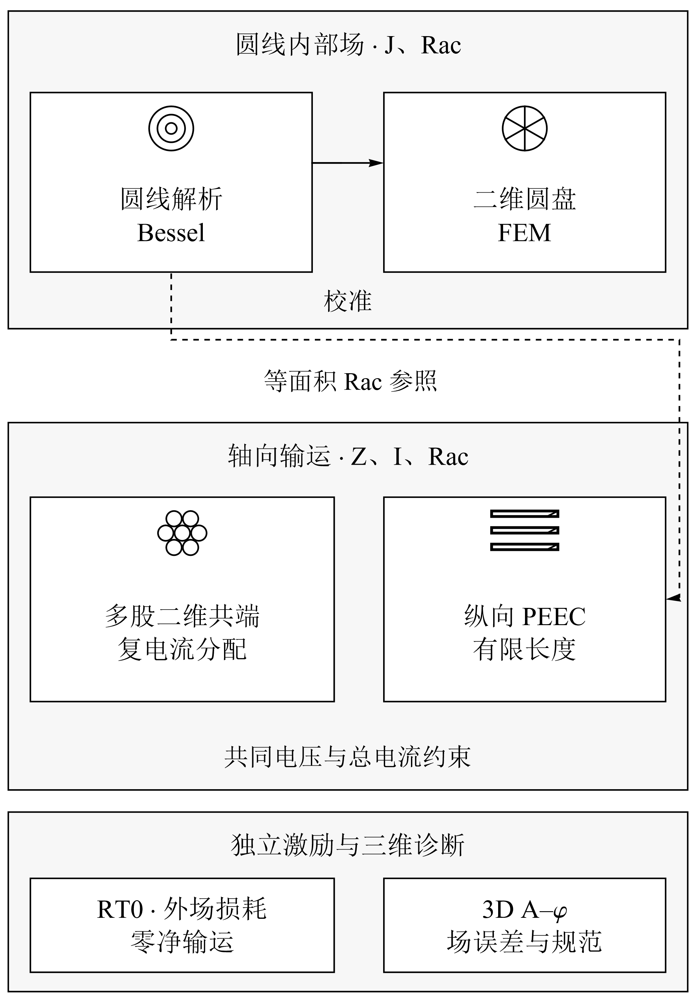
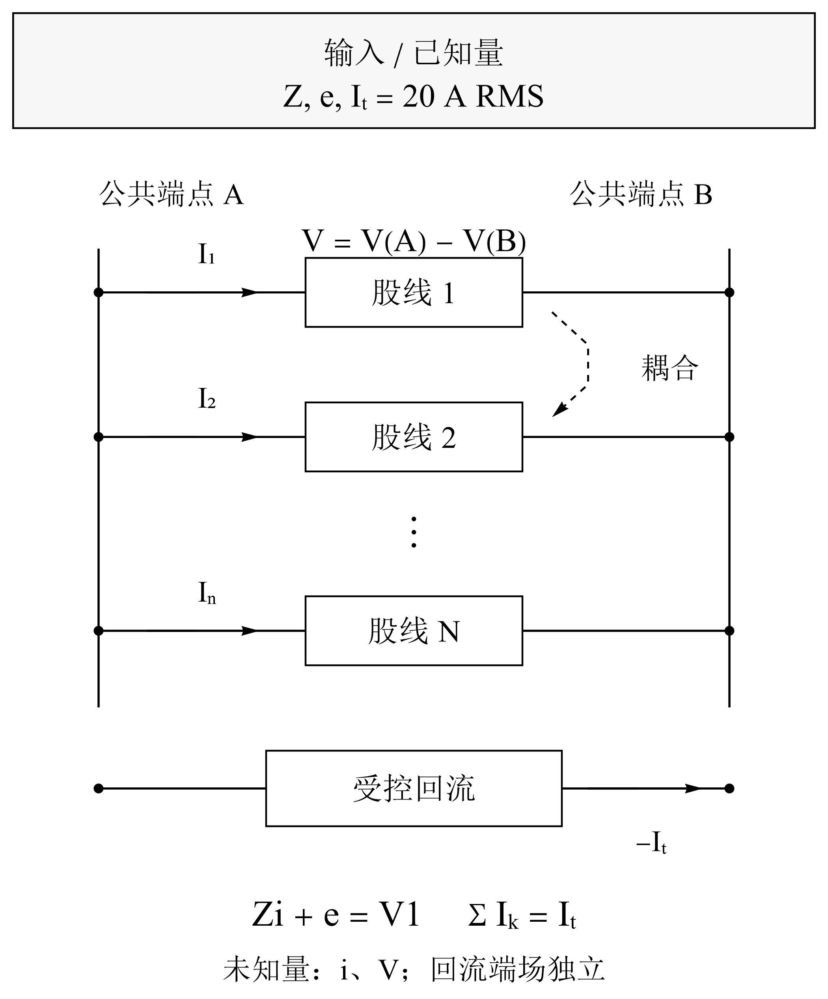
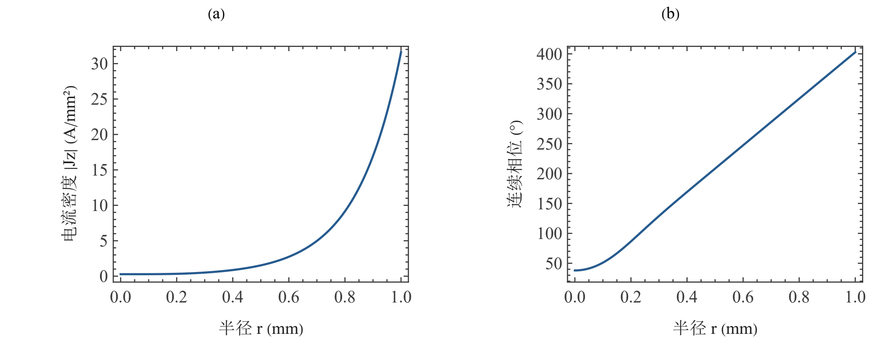
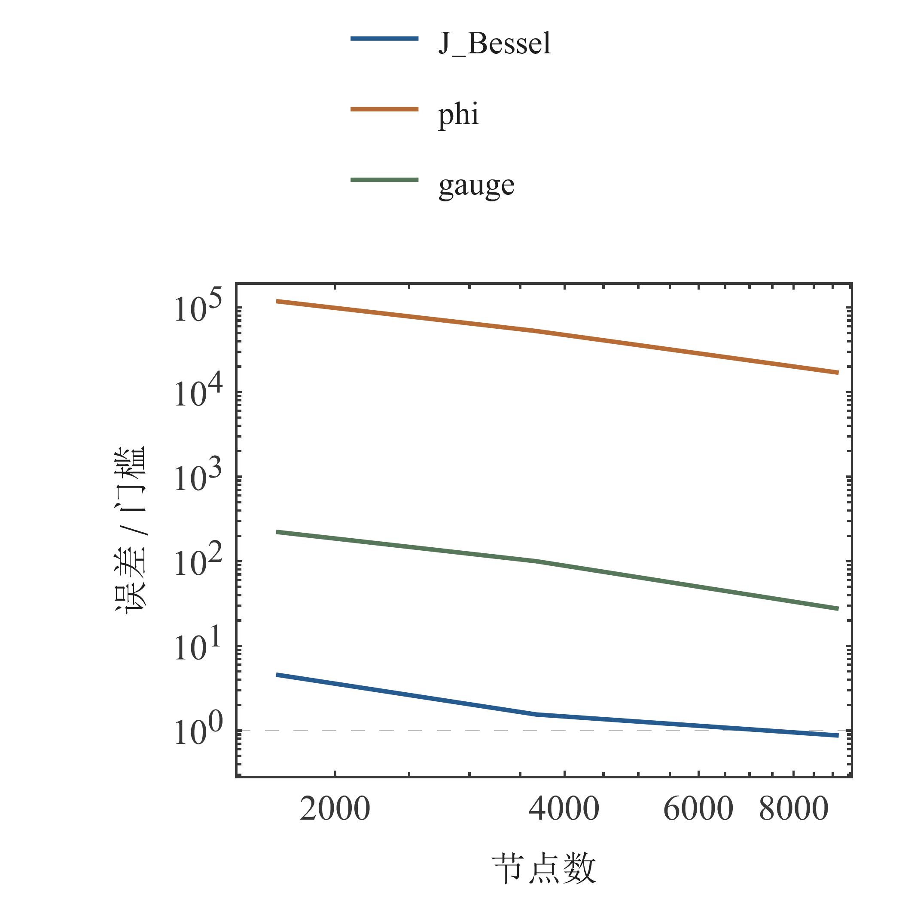
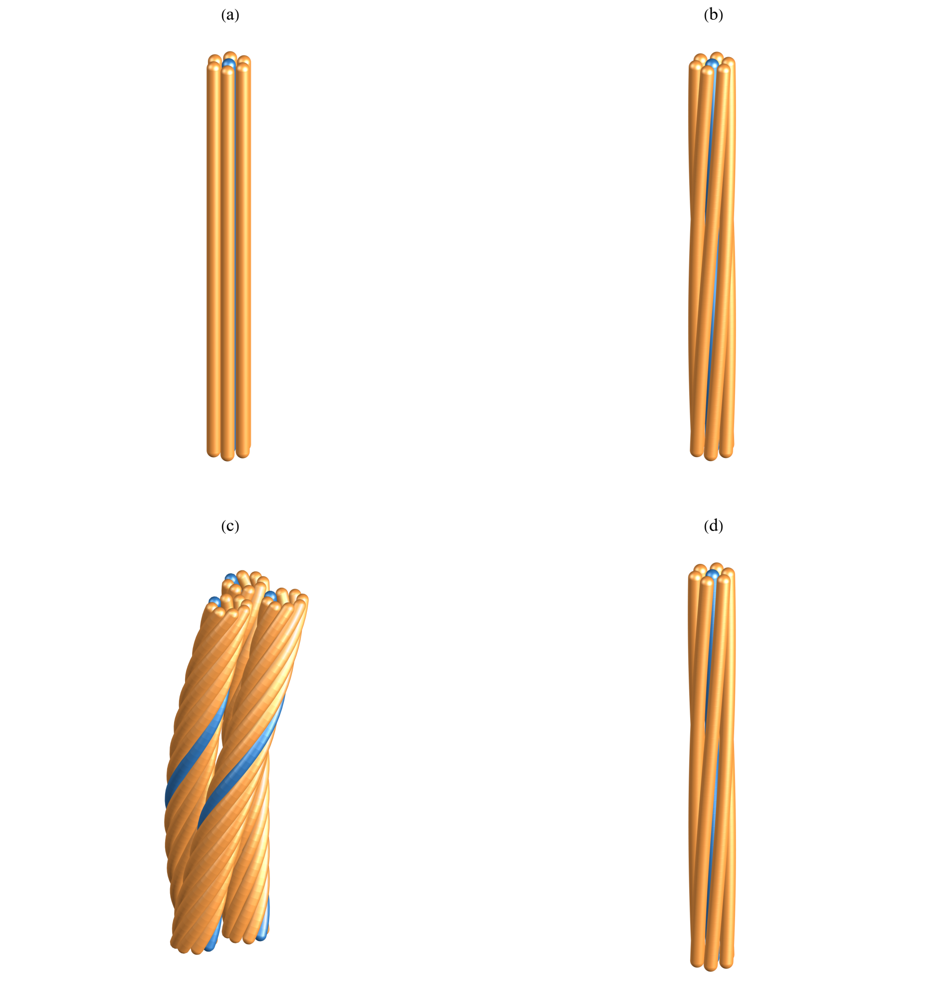

<!-- Generated from manuscript/automation/zh-CN/main.tex; edit the LaTeX source. -->

# 智能体驱动的可复核建模与仿真：Wolfram--Ansys MCP 工作流及 Litz 案例 {#title}

缪雨轩 (淮南师范学院)

## Abstract

本文提出以任务身份、保存源码和独立验收为基础的智能体建模与仿真流程，通过 Codex、Wolfram 和 Ansys MCP 将研究问题连接到可追溯的计算产物。工作流、执行适配与物理模型分别承担任务组织、软件连接及数值实现，并通过共同参数和结果接口协作。六类已有案例覆盖解析校准与 Notebook、Maxwell 原生建模求解、跨求解器比较、频率扩展、接口修复和 A--φ 失败诊断。七股共同端口比较的复电流相对 L2 差异为 0.0106814%，电阻相对差异为 0.00132823%；这些结果对应保存网格，空间与边界收敛尚待进一步检查。案例说明了协议状态、执行状态和物理验收如何共同支持研究接续。工作流、配置、适配代码、模型与运行记录共同构成可复用的研究材料。

## Keywords

Litz 线；分层验证；趋肤与邻近效应；共端场路；有限长度 PEEC；可复现数值研究

## 研究问题与方法定位 {#chapter:01}

科学计算中的一次结果通常经历模型选择、参数解释、软件调用、求解、后处理和论述等环节。这些环节使用不同的数据表示与成功判据：工具能够连接并不说明模型设置正确，求解器正常退出也不说明电流、功率或离散误差满足研究要求。智能体参与建模时，需要把自然语言任务转化为可执行对象，并把每项判断连接到可保存、可检查的证据。

本研究以 Litz 线为实例，将 Codex 客户端、模型上下文协议 MCP、Wolfram Language 与 Ansys Electronics Desktop 组合为自动化研究流程。Codex 承担任务分解、源码编辑、工具调用和结果解释；MCP 提供工具发现与调用；项目运行器负责输入校验、源码身份、进程资源和产物保存；物理验收由独立计算与明确容差完成。该分工使交互中的探索能够转化为接手者可继续执行的研究对象。[@CODEX; @MCP; @WOLFRAM; @AEDT]

Litz 建模对这一流程提出了具体要求。解析圆线、二维共端模型、有限长度 PEEC、外场 RT0 和三维 A--φ 保留的自由度与激励不同，结果需要按对应观测量解释。换位方法与多尺度建模文献提供了选择模型的基础；逐股复电流、实际铜面积和回流条件则决定不同实现能否直接比较。[@P01; @N01; @RUEHLI1974; @RT1977]

本文研究三个工程问题：如何使客户端、工具和求解器共享可追溯的任务身份；如何把协议检查与物理验收组织成相互衔接的步骤；以及如何在代码扩展、接口错误和数值未通过时保留足够的恢复信息。评价材料来自 rc.2 的六类运行案例，结论对应这些案例实际覆盖的功能。客户端比较、人工操作耗时对照和大样本成功率需要另外设计实验。

<figure id="fig:model_hierarchy" data-latex-placement="!htbp">

<figcaption>分层模型与可比较观测量。 输运模型按物理对象与观测量分组：圆线内场用于解析与二维校准，多股二维场路求解共同端口下的复电流，纵向 PEEC 检验有限长度效应。连线标明内部场校准或等面积电阻参照。RT0 外场损耗与三维 A–φ 场诊断各自构成独立研究范围。</figcaption>
</figure>

## 软件连接与分层架构 {#chapter:02}

系统分为研究工作流、执行适配和物理模型三个层次。工作流定义任务输入、操作顺序、检查依据和完成条件；适配层管理 Wolfram、AEDT 及数值后端的连接和执行；模型层保存公式、离散实现与路线测试。参数与产物通过共同任务接口流转，使文本教程、命令行和 MCP 入口能够引用同一份已保存输入。

Wolfram 接入固定 AgentTools 2.2.0，来源提交为 9c99e2da5286c2ff7ac2298956107cd9334c6e90；既有验证记录使用 Wolfram 内核 15.0.0。工具提供代码执行、测试以及 Notebook 读写。数值表达式返回和 TestReport 支持当前计算检查。归档的 rc.2 前端案例分别检查了 Notebook 的打开、保存、重开与图形回读。[@AGENTTOOLS]

Ansys 接入固定 PyAEDT-MCP 0.2.dev0，来源提交为 80ae7c3cb47e5de7b744a2898061510299d3bcef；建模适配采用 PyAEDT 1.8.0。服务器在独立 CPython 环境中运行，项目运行器启动并记录所属 AEDT Student gRPC 会话，再由 MCP 连接到该会话。AEDT 内置脚本环境与外部 CPython 具有不同的模块和对象接口，调用记录因此保留实际执行位置、工具名与返回值。[@PYAEDTMCP; @PYAEDT; @ANSYSCOMMONMCP]

默认配置采用本地标准输入输出传输，配置生成器也提供本机 HTTP 方式。安装材料固定上游来源、依赖和许可，连接诊断核对实际路径与工具清单。Wolfram、AEDT 及字体是运行环境的组成部分，版本和许可证条件随运行记录保存。其他 MCP 客户端可使用相同任务说明和协议接口，本文端到端记录对应 Codex 与标准 MCP 客户端桥接。

研究源码与软件连接之间保留清晰边界，使模型能够通过命令行独立运行，也便于定位失败发生在哪一层。客户端会话中产生的临时代码在正式验收前写入文件；运行清单记录文件哈希和参数。由此，后续修订能够通过代码差异和新的运行身份追溯到原始尝试。

## 任务身份与物理验收 {#chapter:03}

任务提交包含案例、参数文件、运行号和资源策略。长任务先返回运行号，再将状态、日志和结果持续写入所属目录。客户端连接超时后查询该运行的状态，避免将通信中断解释为求解器停止并重复启动。结果同时记录执行状态与物理验收状态；取消、预算耗尽、程序异常和未收敛分别保留其原因。

运行器管理自己创建的进程树，依据进程创建身份实施取消和清理。项目预算为八个逻辑处理器、24 GiB 任务内存及 8 GiB 系统空闲内存；Student 案例另受其实际许可证限制，并请求四个求解器核。资源记录用于解释执行能力和中止原因，避免将受限运行与完整计算混在同一比较中。[@PSUTIL; @PYTHON]

接续前核对请求、源码快照和检查点身份。已有教程的恢复通过关联的新运行号重新执行保存输入；完整数值路线则按各自的检查点协议恢复。连接恢复、任务重启和数值检查点恢复具有不同含义，产物中的父任务关系与恢复说明保留这些差别。

物理约定从统一参数文件进入各执行入口：SI 单位、exp(jωt)、RMS 相量、20 ℃ 铜、σ=5.8×10⁷ S/m 和 μr=1。主要输运工况为 200 kHz、20 A RMS。沿途绝缘的股线在端部并联，共同端电压与总电流共同确定逐股复电流，所对应的增广系统见下式。

$$\begin{bmatrix} Z&-\mathbf1\\ \mathbf1^T&0\end{bmatrix}\begin{bmatrix}\mathbf i\\V\end{bmatrix}=\begin{bmatrix}-\mathbf e\\I_t\end{bmatrix}\tag{1}$$

式中的 Z 为所选模型的耦合阻抗矩阵，e 为独立感应电压项，i 与 V 为待求复电流和端电压。验收检查电流约束、功率平衡与离散敏感性，并核对回流和边界。Q1 的 2 mm 圆线承担解析校准，其直流电流密度约为 6.366 A/mm²；Q2 候选要求至少 5 mm² 名义铜截面。小股数端口案例用于验证接口和约束，其面积条件随案例保留。

<figure id="fig:common_terminal" data-latex-placement="!htbp">

<figcaption>多股共同端口与回流。 各股沿途绝缘，在两端并联，逐股复电流由共同端电压及总电流约束求解。耦合矩阵 Z 与激励项 e 包含指定模型中的阻抗和场作用。受控回流承担反向总电流，并具有独立的端场。图中给出已知输入及待求复电流和电压。</figcaption>
</figure>

## 建模、扩展与跨求解器比较 {#chapter:04}

### Wolfram 校准与模型扩展

归档的 rc.2 Wolfram 案例记录 MCP 初始化、工具发现和实际调用，并将解析计算、测试、图形及 Notebook 保存连接起来。单圆线基准在 200 kHz 下给出 Rac=20.0162 mΩ/m、损耗 8.00648 W/m；复电流积分与焦耳功率积分分别检验归一化及 RMS 约定。解析基准及原生 Notebook 的工具能力分别来自数学定义与 AgentTools 接口。[@BESSEL; @AGENTTOOLS]

<figure id="fig:q1_profile" data-latex-placement="!htbp">

<figcaption>单圆线径向电流幅值与相位。 铜导体直径 2 mm，200 kHz、20 A RMS。 (a) RMS 幅值；(b) 连续显示的相位。 相位显示采用径向连续提升，幅值保留 RMS 归一化。径向样本来自保存的 Bessel 解析数据。</figcaption>
</figure>

频率扩展案例将单频解析实现扩展为频率研究，保存源码差异、参数和新运行结果，并检验积分、低频极限及原单频回归。该案例说明智能体修改可以通过确定性检查进入研究流程；其验收范围是解析实现及所测频率条件，后续增加材料频散或热耦合时需建立相应物理检查。

### Maxwell 建模、求解与交叉比较

Ansys 案例从运行器所属会话连接进入 MCP，完成小型七股 Maxwell 模型的材料、激励、求解和结果回读。rc2_maxwell_mcp_verified_01 及关联恢复运行通过端口与功率范围内的检查；协议探针自身的结果保留为协议状态。任务取消和新运行恢复另有独立记录，因而可以检查从任务身份到实际 AEDT 执行的对应关系。

Wolfram 与 Maxwell 比较采用直线绝缘七股、共同端电压、总电流约束及受控铜回流。对齐项目包括股数、多边形截面、股径、回流内外半径、外域半径、轴向深度、频率和总电流。保存比较中的逐股复电流相对 L2 差异为 0.0106814%，束内 Rac 相对差异为 0.00132823%；相应电阻为 318.290316 和 318.294544 mΩ/轴向m。

这些数值描述该案例的跨实现一致程度。两套实现使用独立网格和插值阶次，导体截面为 42 边形，回流分段也可能不同；Maxwell 使用一次自适应求解，尚未建立空间和边界收敛。案例铜面积小于 Q2 要求。因此，比较结果作为共同端口实现的交叉核查，进一步的精度估计需改变网格与边界并分析结果变化。

## 失败诊断与恢复 {#chapter:05}

失败诊断案例保留了一次实际单位换算 API 错误及其修复。原 MCP 调用的传输返回并不能单独代表业务执行成功：工具可能以普通字符串返回错误，而协议层 isError 仍为 false。诊断需要检查实际返回内容、异常上下文和预期结果结构，随后修正 API 调用，并在新运行中核对成功响应及后续求解产物。

该修复保持原物理参数和约束。失败调用、修订后的调用与关联 Maxwell 结果构成对照，使读者能够识别修复发生在接口层。协议报告据此说明工具是否完成预期操作，物理报告则继续负责端口和功率验收；二者通过运行身份关联。

A--φ 案例展示另一类诊断。执行器读取已有场、势和导数诊断，记录 completed 执行状态，同时保留 failed_retained_phi_gauge 物理状态。采样参数和显示参数的修改只改变保存场的观察方式。原场输入、采样位置、诊断公式与验收门槛共同决定解释依据，后续修订需要回到势与规范条件的数值实现。[@FEMDOC]

<figure id="fig:aphi_gates" data-latex-placement="!htbp">

<figcaption>A–φ 圆柱校准指标。 三档网格与各指标门槛分别展示。 圆柱三档含 1683、3672、9108 节点。误差以各自验收门槛归一化，水平线标出单位比值。</figcaption>
</figure>

Wolfram 工具记录还包含前端工作完成后的进程清理：保存回执已确认，所属辅助进程最终退出码为 137，清理原因单独记录。分析这类运行时，需要同时读取完成回执、已保存产物和进程终止原因。单个退出码无法完整表达跨前端与内核的工作状态。

归档的 rc.2 六类案例共同覆盖校准与 Notebook、原生建模求解、跨求解器比较、源码扩展、接口修复及数值失败解释。其共同产物是可定位的输入、源码、调用、结果和验收说明。接手者可以选择具体失败层重现问题，并以新的运行身份继续研究。

## 当前设备集成与科研检索 {#chapter:07}

2026 年 10 月 28 日的集成将项目、ANSYS 和检索依赖分置于三个 Conda 前缀。三者使用 Python 3.12.16；检索环境包含 Node.js 24.22.1，出版转换固定 Pandoc 3.13。Conda 包身份、pip 清单、项目 editable 安装和官方 MCP 提交分别记录。三个环境均已在新前缀中重建，并通过依赖及版本检查。固定提交的非 editable VCS 安装依据安装元数据确认身份；editable 安装还需检查工作树及已跟踪修改。

观测到的桌面与执行宿主为 Windows Server 2022 Datacenter，版本 21H2，构建 20348.4405。Codex、Chrome 和 Explorer 位于会话 1。Windows 10 是用户要求的部署目标；宿主观测没有确定可能存在的远程客户端操作系统。本次验证范围因此是所观测的 Server 2022 安装。Windows 10 和 Windows 11 的平台支持声明仍需各自设备证据。

候选 MCP 配置在替换现行配置前接受探测。完成备份后，项目与 Codex 配置已切换，MCP 服务已重启。原生工具返回确认了新 Conda 可执行路径、Wolfram 内核 15.0.0 和十二项解析测试通过。ANSYS 原生客户端通过 PyAEDT 1.8.0 连接到任务所属的 Student 2025.2.4 会话；断开连接与进程清理依据所记录的进程创建身份分别检查。这些检查支持当前设备上的连接与执行行为。

独立 Python 3.13.18 环境复现了当前 PyAEDT-MCP 上游的 Student 版本参数传递缺口。补丁将该选项传递到启动、连接与服务自动启动，同时保持默认行为。新增九项回归在基线上失败，修订后的测试集通过 141 项测试。本机 Student 的实际启动、连接和自动启动调用也已通过，并记录任务所属进程的清理。修复已作为 PR 155 提交至官方仓库，目标分支与差异已回读。当前贡献结果是实际提交；上游审查与合并分别记录。[@PYAEDTMCP]

四个技能分别负责科研检索、论文获取、开放能力复用与研究交接。广域发现优先使用腾讯元宝，来源核实使用出版社页面、学术元数据、仓库 API 与授权浏览器。固定提交、采用 MIT 许可的 academic-search 模块负责记录归一化、保留元数据冲突与获取开放全文。上游身份、版权及测试继续保留。访问能力、身份核验、软件许可与全文再分发权分别记录。[@ACADEMICSEARCH]

已观测的获取案例包括中文半解析利兹线电阻论文与英文绕组损耗论文。PDF 解析、题名和 DOI 匹配及 SHA256 共同确认下载文件身份。中文出版社与机构索引给出的出版日期不同，去重后仍保留各自来源。英文录用稿由 White Rose 以 CC BY 4.0 提供；中文全文保存在本地，再分发权尚未确认。授权机构 Chrome/WebVPN 会话随后通过 HTML 阅读页下载了六页 PDF，题名和 DOI 通过身份核验；机构与出版社副本分别保留哈希。获取历史同时保留受阻的下载、另一会话需要重新登录及人工验证事件。[@C01; @ZHU2026]

研究交接示例先保存任务说明与参数，再运行现有单圆线 CLI 校准。十二项检查通过，包含独立复电流与焦耳功率积分。这验证了文献到现有模型任务的交接；复现所引论文的绕组模型还需要几何、局部场与收敛工作。小型 Maxwell 重跑通过端口电流和功率检查，仍保留单网格限制。工具调用成功及这些局部物理检查尚不能支持收敛后的 Litz 性能排名。

三组配对试验针对同一 DOI，使用相同的确定性校验器与权限，对照实时 Crossref 查询和经哈希核验的当日记录复用。耗时中位数分别为 1.102 s 和 0.344 ms，每次网络调用量分别为一次和零次；六次试验均通过 DOI、题名、作者及出版日期检查。测量不含缓存建立与人工核验，被测阶段没有模型调用，宿主 tokens 不可观测。更广泛的效率结论仍需匹配完整任务、模型设置与工具权限，并在独立设备验证。LaTeX 维护正文，严格的 Pandoc 转换检查段落身份、正文与公式。

## 讨论与结论 {#chapter:06}

自动化研究的可复核性取决于任务与证据之间的连续关联。可见任务、工具事件、源码差异和确定性测试足以组织本文案例的执行记录；科学判断仍需要明确模型适用条件、比较量和验收容差。代码能够运行、图形能够生成和论文能够排版，分别对应软件执行、结果表达和文档构建，它们与物理可靠性通过验收步骤连接。

研究过程同时涉及可编辑对象与稳定对象。参数、源码和后续研究任务需要便于修改；用于支撑结论的输入与结果则通过哈希固定。版本化数据目录保存原始文件身份，新运行写入独立目录。图件从保存数据重绘时记录来源与变换，双语稿件共享公式、图表和引用编号，使阅读层的变化可以追溯到同一科学内容。

这种流程特别适合逐层推进的模型研究。解析和二维案例提供低成本回归，少股模型检查共同端约束，有限长度及三维路线逐步引入新的自由度。保存的几何与场数据为后续三维解释保留输入；真实中心线保留股线身份、弧长和局部位置，为后续模型扩展提供输入。结构性能比较还需匹配实际铜体积、回流、端区和数值不确定性。

<figure id="fig:geometry_comparison" data-latex-placement="!htbp">

<figcaption>股线中心线的三维结构比较。 面板依次展示直束、单级、传统多级局部和跨层结构。 24 股结构使用 0.100 mm 铜径，传统多级面板展示 3 mm 局部。蓝色标记保持选定股线的物理身份。</figcaption>
</figure>

本文交付了工作流、接入配置、运行适配、模型源码和可追溯案例。已有记录支持 Codex 通过 Wolfram 与 Ansys MCP 完成指定建模任务、扩展解析实现并依据错误证据修复接口；跨求解器和 A--φ 案例进一步说明验收状态如何限制结果解释。下一步方法评价可增加独立客户端、重复任务和人工基线，研究不同任务复杂度下的完成率、资源代价与修复稳定性。

Wolfram、AgentTools、PyAEDT-MCP、PyAEDT 及相关开源数值与文档工具共同支持了本研究的实现。AI 参与源码检查、模型与适配代码、调用编排、诊断和文稿整理；作者负责物理假设、验收依据与研究结论。软件环境和上游来源随仓库提供，读者可沿方法、实现、测试和结果的索引继续研究。

## 本轮收敛诊断与可复核终态

2026 年 10 月的补充运行采用统一任务接口，分别保存执行状态、物理验收、源码与输入身份。制造解在 208、756 和 1856 个节点上通过；最大场值误差为 $1.70\times10^{-14}$，最大导数误差为 $2.26\times10^{-13}$。 圆柱的解析边界迹与二维离散解边界迹在相同的 1683、3672 和 9108 节点挤出网格上配对重算。最细档解析迹的 $J$ 相对误差为 0.877248%，$\phi$ 误差为 $1.70939\times10^{-4}$，gauge 残差为 $2.77686\times10^{-2}$；离散迹对应值为 0.877132%、$1.47596\times10^{-4}$ 和 $2.77850\times10^{-2}$。两组均保留实际 $\phi$ 及其导数。仅替换边界迹未使 $\phi$ 和 gauge 达到 $10^{-8}$ 与 $10^{-3}$ 门槛；下一实验应检查挤出离散算子的分块残差与 gauge 耦合。

Maxwell 七股采用官方网格链接并完成一次有依据的设置修订。源设计和基解均为 1694 个实际网格单元，但严格坐标身份仍失败。仅允许节点和单元编号重排的规范化，未放宽坐标门槛。因此，本轮交付固定网格诊断；后续网格收敛、边界敏感性与同条件跨求解器比较保持依赖阻塞状态。历史单网格一致性继续按其限定范围引用。

机器可读证据索引位于仓库的 provenance/convergence 目录。上述有限终态支持后续最小实验设计；最终 Q2 设计仍要求名义铜面积至少 $5\,\mathrm{mm^2}$、传统多级 Litz 强基线以及实际弧长和铜量公平比较。

## References {#references .unnumbered}

\[CODEX\] OpenAI. Codex. 2026. <https://developers.openai.com/codex/>

\[MCP\] Model Context Protocol contributors. Model Context Protocol. 2026. <https://modelcontextprotocol.io/>

\[WOLFRAM\] Wolfram Research. Wolfram Language and Notebook. 2026. <https://www.wolfram.com/language/>

\[AEDT\] ANSYS, Inc.. Ansys Electronics Desktop / Maxwell. 2026. <https://www.ansys.com/products/electronics/ansys-maxwell>

\[P01\] Silvano Cruciani, Tommaso Campi, Francesca Maradei, Mauro Feliziani. Numerical Modeling of Litz Wires Based on Discrete Transpositions of Strands and 2-D Finite Element Analysis. IEEE TPEL, 38, 5, 6710--6719, 2023. <https://doi.org/10.1109/TPEL.2023.3240338>

\[N01\] Xinsheng Zhang, Fei Xiao, Ruitian Wang, Shunjun Chen, Xuexin Fan, Xin Li. AC Impedance Modeling of Composite Litz Wire With Nonideal Transposition Based on Improved Discrete Transposition Model. IEEE TPEL, 41, 7, 11003--11019, 2026. <https://doi.org/10.1109/TPEL.2026.3661080>

\[RUEHLI1974\] Ruehli, A.E.. Equivalent Circuit Models for Three-Dimensional Multiconductor Systems. IEEE Transactions on Microwave Theory and Techniques, 22, 3, 216--221, 1974. <https://doi.org/10.1109/tmtt.1974.1128204>

\[RT1977\] Raviart, P. A., Thomas, J. M.. A mixed finite element method for 2-nd order elliptic problems. Mathematical Aspects of Finite Element Methods, Springer, 606, 292--315, 1977. <https://doi.org/10.1007/bfb0064470>

\[AGENTTOOLS\] Wolfram Research. Wolfram AgentTools. 2026. <https://github.com/WolframResearch/AgentTools>

\[PYAEDTMCP\] ANSYS, Inc.. PyAEDT-MCP. 2026. <https://github.com/ansys/pyaedt-mcp>

\[PYAEDT\] ANSYS, Inc.. PyAEDT. 2026. <https://github.com/ansys/pyaedt>

\[ANSYSCOMMONMCP\] ANSYS, Inc., contributors. ansys-common-mcp. 0.3.5, 2026. <https://github.com/ansys/pyansys-common-mcp>

\[PSUTIL\] Giampaolo Rodola, contributors. psutil. 2026. <https://github.com/giampaolo/psutil>

\[PYTHON\] Python Software Foundation. Python. 2026. <https://www.python.org/>

\[BESSEL\] NIST. NIST Digital Library of Mathematical Functions, Modified Bessel Functions. 2026. <https://dlmf.nist.gov/10.25>

\[FEMDOC\] Wolfram Research. Wolfram quasistatic magnetic field models. 2026. <https://reference.wolfram.com/language/PDEModels/tutorial/Electromagnetics/QuasistaticMagneticFields.html>

\[ACADEMICSEARCH\] Chengmingyue. Academic Search. 1.4.0, 2026. <https://github.com/ustc-ai4science/academic-search>

\[C01\] 金峰逸, 马玉芳. 基于半解析有限元的利兹线交流电阻分析. 电子学报, 51, 12, 3457--3462, 2023. <https://doi.org/10.12263/dzxb.20230001>

\[ZHU2026\] Wenjun Zhu, Yangyu Sun, Xiao Chen, Jiabin Wang, G. W. Jewell, Ellis Chong, Andreas Reeh. AC Loss Calculation for Litz Wire Windings in Electrical Machines. IEEE Transactions on Transportation Electrification, 12, 1, 21--31, 2026. <https://doi.org/10.1109/TTE.2025.3610369>
