<!-- Generated from manuscript/paper/zh-CN/main.tex; edit the LaTeX source. -->

# Litz 线的分层验证、共端复电流分配与有限长度纵向 PEEC {#title}

缪雨轩 (淮南师范学院)

## Abstract

Litz 线的高频损耗取决于单股趋肤、局部邻近场、股间复电流分配、换位路径及端部约束。本文建立可复现的分层数值验证框架，区分各层实际保留的物理内容。沿途绝缘、端部并联的股线采用共同端电压和总复电流约束，并在指定线性场路模型内给出均流判据。有限长度纵向 PEEC 则独立检查轴向长度、互项与自项积分及横向离散的影响。

在 200 kHz、20 A RMS、20 ℃ 铜导体工况下，单圆线解析与独立二维校准建立了内场参考，640 股二维共端模型具有受控网格、回流和外域检查。5024 自由度纵向模型末档 Rac 为 20.012738 mΩ/轴向m，与本档等面积 Bessel 参照相差 0.044582%。固定长方体外场 RT0 算例的末两次损耗变化为 0.655090% 和 0.362916%；它检验外场算子，不能作为 Litz 输运电阻。三维 A--φ、Ansys 原生三维接口及真实性能排名的未通过边界继续保留。结果支持限定模型内的数值结论，不证明实际多级或跨层 Litz 的性能优劣。

## Keywords

Litz 线；分层验证；趋肤与邻近效应；共端场路；有限长度 PEEC；可复现数值研究

## 引言 {#chapter:01}

### 高频损耗与电流分配

Litz 线通过细股绝缘与沿程换位调节高频电流分布，其损耗同时受单股趋肤、股间磁耦合和端部连接影响。单股直径描述局部电流渗透的尺度，沿程位置决定各股所经历的磁场，共同端接则约束复电流的整体分配。因此，评价一种结构需要把几何参数、场路条件与可比较的损耗量联系起来，并估计相关数值不确定性。

现有研究从不同尺度处理这一问题。离散换位模型 DTM [@P01] 将截面二维有限元与股线位置置换结合，改进模型 iDTM [@N01] 进一步描述复合 Litz 的非理想换位；分段等效电路 iSEC [@P02] 则在指定绕组和分层假设下求解损耗。FEM--PEEC 耦合 [@P03] 与准二维多导体模型 [@P04] 提供了场量和电路量共同求解的途径。连续体模型 [@P05] 及复磁导率均匀化 [@P09] 以平均量降低绕组计算成本。这些方法在空间分辨率、换位表示和端接处理上各有侧重，结果的比较因而首先取决于模型是否描述同一物理对象与激励。

本文以可复核的数值验证为目标，连接单圆线解析、多股二维共端场路和有限长度纵向 PEEC 三个层次。解析解提供内部阻抗基准；二维模型同时求解股内场与股间复电流；纵向模型用于考察有限长度核及积分设置对电阻的影响。传统多级 Litz 是后续结构比较的基线，跨层路径属于待评价的候选几何。本文给出的数值结论限于各层实际包含的自由度和边界条件。

### 研究问题与本文工作

本文回答三个相互关联的问题：独立离散方法能否复现单圆线的趋肤电流和损耗；共同端电压下，怎样判断各股复电流是否均匀；有限长度纵向 PEEC 的电阻对长度、积分和横向离散有多大敏感性。相应地，本文建立按观测量组织的验证关系，推导指定线性场路模型的均流条件，并给出 640 股二维算例及 1264、5024 自由度纵向算例的定量结果。三维外场算例、场势诊断和接口验证作为补充材料，用于说明现有实现的适用范围与进一步研究所需的条件。

## 方法 {#chapter:02}

### 工况与比较量

计算采用 SI 单位、exp(jωt) 时间约定和 RMS 相量。材料为 20 ℃ 铜，电导率 σ=5.8×10⁷ S/m，相对磁导率 μr=1；主输运工况为 200 kHz、20 A RMS，独立外加场为零。股线沿途绝缘、端部并联。电阻和损耗按轴向长度归一化，股线的实际弧长另行计入铜体积与直流电阻。有限段端电压的单位为 V，二维轴向端场的单位为 V/m，二者通过所采用的轴向长度建立联系。

原题 Q1 的直径 2 mm 圆线用于解析校准。其铜面积为 3.141593 mm²，在 20 A 下的平均直流电流密度为 6.366198 A/mm²，超过题设 4 A/mm² 限值。满足该限值的 Q2 需至少 5 mm² 铜截面。640 股、单股铜径 0.100 mm 的理想圆面积为 5.026548 mm²，二维模型以 64 边形表示每股，实际铜面积为 5.01848 mm²。等铜比较使用实际离散面积，使几何近似的影响与电磁结果具有一致的参照。

各股具有不同弧长时，直流电阻由并联电导求得，铜体积由各股面积与弧长乘积相加，见 [(1)](#eq:E01)。本文同时考察绝对交流电阻、Rac/Rdc、铜损耗与复电流分配。RMS 相量下的焦耳损耗见 [(2)](#eq:E02)；该式中电阻由纯输运工况的铜损耗定义。补充材料的 RT0 算例采用独立外场和零净输运，其吸收功率以外场损耗单独报告。

$$\begin{gathered}
R_{\mathrm{dc}}=\left(\sum_{k=1}^{N}\frac{\sigma A_k}{\ell_k}\right)^{-1} \\
V_{\mathrm{Cu}}=\sum_{k=1}^{N}A_k\ell_k
\end{gathered}
\tag{1}$$

$$\begin{gathered}
P_{\mathrm{Cu}}=\int_{\Omega_{\mathrm{Cu}}}|\mathbf J|^2/\sigma\,\mathrm d\Omega \\
R_{\mathrm{ac}}=P_{\mathrm{Cu}}/|I_t|^2 \\
r_{\mathrm{ac}}=R_{\mathrm{ac}}/L_z
\end{gathered}
\tag{2}$$

### 模型层级与验证关系

各模型的关系如 图 [1](#fig:model_hierarchy) 所示。解析圆线与二维扩散模型具有共同的长直内场问题，可比较径向电流和内部电阻。二维共端模型进一步保留股内分布、股间电流与受控回流，适合研究指定截面的场路耦合。纵向 PEEC 采用有限长度部分电感核，可检查长度对轴向电流解的影响。三分量 RT0 模型则以长方体外场吸收为算例，检验三维电流连续性与离散算子。换位路径和实际端区需要相应的沿程或横向自由度，属于后续三维结构研究的范围。

<figure id="fig:model_hierarchy" data-latex-placement="!htbp">

<figcaption>分层模型与可比较观测量。 输运模型按物理对象与观测量分组：圆线内场用于解析与二维校准，多股二维场路求解共同端口下的复电流，纵向 PEEC 检验有限长度效应。连线标明内部场校准或等面积电阻参照。RT0 外场损耗与三维 A–φ 场诊断各自构成独立研究范围。</figcaption>
</figure>

验证分为方程求解、物理约束、功率一致性和参数敏感性四部分。真实线性残差、共同端条件与总复电流误差的目标为 10⁻⁸，独立功率平衡为 0.1%，网格、分段、边界及长度变化的比较目标为 1%。解析参考与电流、功率积分分别使用 10⁻⁶ 和 10⁻⁸ 门槛。RT0 的 GMRES 真残差目标为 10⁻¹¹，积分敏感性为 0.1%；同模型 CPU/GPU 矩阵与复电流的对照门槛为 10⁻¹⁰。

这些检查回答不同的问题。残差衡量离散系统的求解精度，功率平衡检查场路与后处理的一致性，参数敏感性表征指定扰动范围内的变化。模型遗漏、边界近似及实验偏差需要相应的独立证据。因此，下文分别说明数值检查结果及其物理适用范围，并把有限敏感性结果作为局部验证，而非全模型误差的统一上界。

### 共端场路与复电流均流条件

共同端点、股线支路与回流的关系见 图 [2](#fig:common_terminal)。令 Z 为指定线性模型的耦合阻抗矩阵，e 为独立外场引起的感应项，i 为各股复电流，V 为公共端电压。端口方程 Z i+e=V1 与总电流条件 1$^{\mathrm T}$i=It 共同构成 [(3)](#eq:E04)。求解该增广系统可同时得到幅值和相位，等流值 It/N 用于比较求得的电流分布。

$$\begin{bmatrix} Z&-\mathbf1\\ \mathbf1^T&0\end{bmatrix}\begin{bmatrix}\mathbf i\\V\end{bmatrix}=\begin{bmatrix}-\mathbf e\\I_t\end{bmatrix}\tag{3}$$

<figure id="fig:common_terminal" data-latex-placement="!htbp">

<figcaption>多股共同端口与回流。 各股沿途绝缘，在两端并联，逐股复电流由共同端电压及总电流约束求解。耦合矩阵 Z 与激励项 e 包含指定模型中的阻抗和场作用。受控回流承担反向总电流，并具有独立的端场。图中给出已知输入及待求复电流和电压。</figcaption>
</figure>

在增广系统具有唯一解时，令 i=(It/N)1 可知：等流解存在，当且仅当向量 (It/N)Z1+e 的所有分量相同。将该向量投影到与 1 正交的子空间，便得到 [(4)](#eq:E05)。无独立外场时，条件简化为 Z 的各行和相同；存在外场时，感应项也参与决定均流。该判据给出了所选阻抗模型与端接条件下的充要条件，便于将几何换位的作用具体落实到耦合矩阵及感应项的变化上。

$$\begin{gathered}
Q=I_N-\mathbf1\mathbf1^T/N \\
Q\left[(I_t/N)Z\mathbf1+\mathbf e\right]=\mathbf0
\end{gathered}
\tag{4}$$

二维共端 FEM 将公共轴向端场与 Az 自由度联合求解。导体内按 Jz=σ(v−u) 恢复电流密度，其中 v 与保存变量 u 均以 V/m 表示，回流导体使用相应的端场。电流和损耗由带材料标记的线性三角形积分，坐标由 mm 转换为 m 后计算面积。由此得到的逐股复电流、束内损耗、回流损耗及铜面积，与原始场路结果独立核对；空气区域与各导体区域分别处理。

### 有限长度纵向 PEEC

纵向 PEEC 将导体截面离散为体积细丝，每条细丝内采用沿轴向、沿长度均匀的复电流密度。欧姆电阻与有限体积对的部分电感由 [(5)](#eq:E08) 给出，并形成 Z=R+jωL，随后按 [(3)](#eq:E04) 施加公共端口和总电流约束。1264 与 5024 表示体积细丝自由度；这些细丝是连续导体的离散单元。同一截面内各体积细丝的电流差异表示内部电流集中，所用基函数的范围为纵向电流。

$$\begin{gathered}
R_{\alpha\beta}=\delta_{\alpha\beta}\frac{L_z}{\sigma A_\alpha} \\
L_{\alpha\beta}=\frac{\mu}{4\pi A_\alpha A_\beta}\int_{V_\alpha}\int_{V_\beta}\frac{\hat{\mathbf t}_\alpha\cdot\hat{\mathbf t}_\beta}{|\mathbf r-\mathbf r'|}\,\mathrm dV\,\mathrm dV'
\end{gathered}
\tag{5}$$

纵向算例的名义圆线直径为 2 mm。m40 与 m80 的方形细丝宽度分别为 0.050 mm 和 0.025 mm，对应实际截面面积 3.16 mm² 和 3.14 mm²。敏感性试验分别改变长度、互项积分或自项积分设置。1264 自由度模型采用同一截面与 0.16、0.32、0.64 m 三档长度；固定长度后，将互项积分阶数 q 依次取为 4、6、8，自项精度从 10/8 提高至 12/10；两个数字依次表示自项数值积分的 AccuracyGoal 与 PrecisionGoal，即绝对精度和相对精度的目标位数。5024 自由度模型复核 0.32、0.64 m 长度及相同积分变化。两种截面离散的铜面积略有差异，因此各档电阻分别与自身等面积圆线的 Bessel 解比较；跨档变化同时包含离散和面积近似的影响。

部分电感核包含有限导体周围的磁耦合，圆线 Bessel 解给出长直导体的内部阻抗。两者在本文中以耗散分量 Rac 进行比较，同时保留长度和面积条件。长度试验衡量当前核与纵向基函数的敏感性；横向环流、曲线股线和真实端部电流重分布需通过扩展自由度研究。与 FEM--PEEC 耦合方法 [@P03] 的联系在于场路联合描述，具体的激励、回流和场反馈方式仍应按各实现分别比较。

## 结果 {#chapter:03}

### 单圆线内部场校准

长直圆线的径向电流与内部阻抗采用 [(6)](#eq:E03)。200 kHz 下趋肤深度 δ=0.147772 mm，约为圆线半径的 0.148，电流集中于表层。直流电阻为 5.4881 mΩ/m，交流电阻为 20.0162 mΩ/m，Rac/Rdc=3.64720，对应损耗 8.00648 W/m。径向曲线与截面幅值分别见 图 [3](#fig:q1_profile) 和 图 [4](#fig:q1_cross_section)。相位沿半径连续展开，显示了趋肤扩散同时引起的幅值衰减和相位变化；解析阻抗的范围为导体内部场。

$$\begin{gathered}
\delta=(\pi f\mu\sigma)^{-1/2} \\
\kappa=(1+j)/\delta \\
J_z(r)=\frac{I_t\kappa I_0(\kappa r)}{2\pi a I_1(\kappa a)} \\
z_{\mathrm{int}}=\frac{\kappa I_0(\kappa a)}{2\pi a\sigma I_1(\kappa a)}
\end{gathered}
\tag{6}$$

<figure id="fig:q1_profile" data-latex-placement="!htbp">

<figcaption>单圆线径向电流幅值与相位。 铜导体直径 2 mm，200 kHz、20 A RMS。 (a) RMS 幅值；(b) 连续显示的相位。</figcaption>
</figure>

独立二维圆盘扩散使用 353、1389、5573 节点的三档网格，并按总复电流归一化。随着网格细化，Rac 解析相对误差由 7.05×10⁻³ 降至 2.30×10⁻⁴，最终为 1.79×10⁻⁶；最细档功率积分相对差为 3.07×10⁻⁶，见 图 [5](#fig:q1_fem_error)。这组结果验证了孤立圆线内场问题的离散、归一化与功率后处理。截面图通过径向解析样本的线性插值和轴对称映射得到，后续多股模型则使用其实际导体场解。

<figure id="fig:q1_cross_section" data-latex-placement="!htbp">
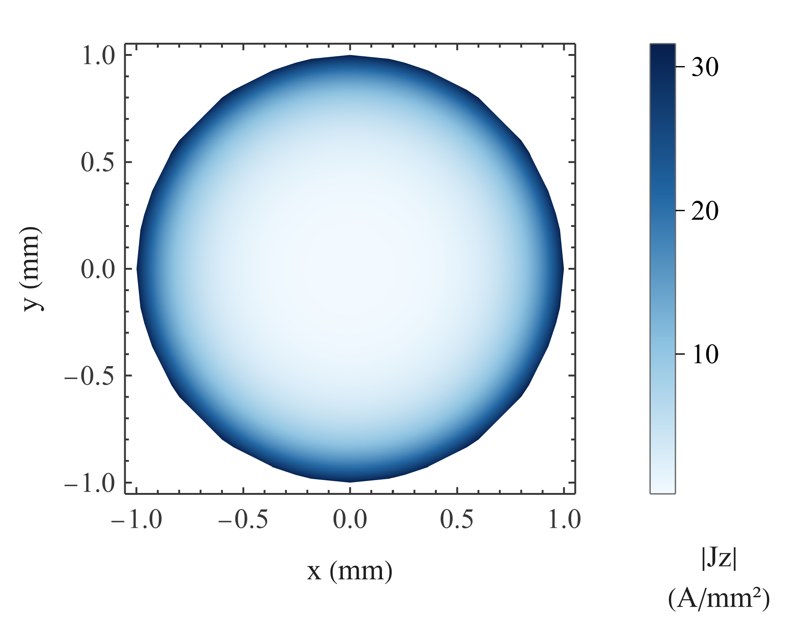
<figcaption>单圆线解析截面幅值。 铜导体直径 2 mm，200 kHz、20 A RMS。 色标显示轴向 RMS 电流密度。</figcaption>
</figure>

<figure id="fig:q1_fem_error" data-latex-placement="!htbp">
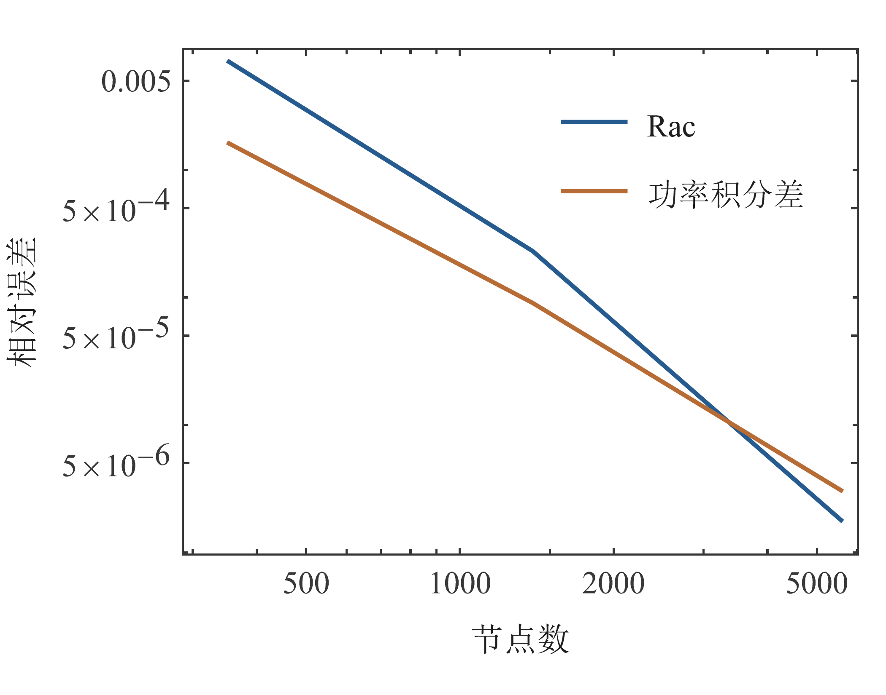
<figcaption>单圆线二维校准误差。 铜导体直径 2 mm，200 kHz、20 A RMS。 三档网格与独立功率积分对应同一内场问题。</figcaption>
</figure>

### 640 股直束的共端电流与损耗

640 股二维模型的实际铜截面为 5.01848 mm²。束内交流电阻为 15.793 mΩ/轴向m，束内损耗为 6.3172 W/轴向m，回流损耗为 2.19621 W/轴向m；分开积分明确了导体束与回流各自的热耗散。共同端轴向电场为 0.411856+j(4.06497) V/m。各股复电流之和恢复 20 A RMS，而归一化复电流 RMS 偏差为 1.85421，表明该共端直束存在显著的股间电流差异。

图 [6](#fig:coax640_currents) 按物理股线身份展示电流幅值和相位，It/N 为等流参照。幅值差异与相位差共同决定各股对总输运电流的贡献，因此均流程度应根据复电流评价。图 [7](#fig:coax640_fields) 给出相应的截面场分布，可将逐股统计与空间位置联系起来。对于这一沿轴向保持截面的直束，细股自身的趋肤尺度与束内磁耦合造成的集体电流分配同时存在；沿程换位的影响需另行引入位置变化。

<figure id="fig:coax640_currents" data-latex-placement="!htbp">
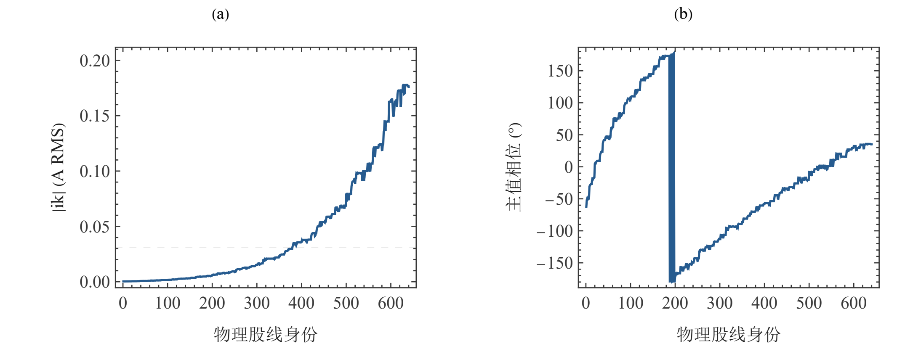
<figcaption>640 股共端复电流分配。 (a) 幅值；(b) 相位，按物理股线身份排列。</figcaption>
</figure>

<figure id="fig:coax640_fields" data-latex-placement="!htbp">
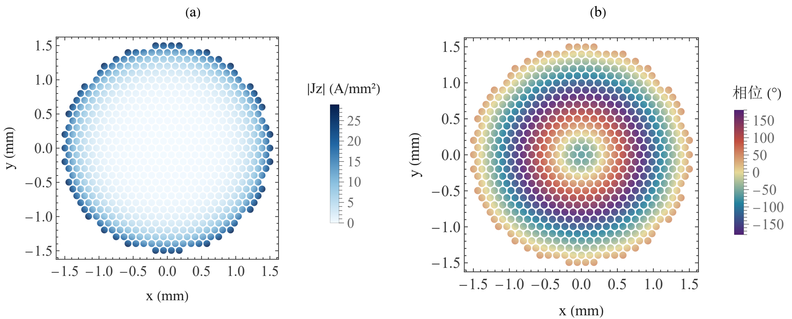
<figcaption>640 股二维截面电流密度。 (a) RMS 幅值；(b) 相位，材料标记识别各股。</figcaption>
</figure>

三档网格以及回流距离、外域变化共完成 23 项检查。末次网格细化的 Rac 变化为 0.011902%，回流距离与外域变化分别为 0.000495% 和 0.000270%，见 图 [8](#fig:coax640_mesh)。在已检查的扰动范围内，这些变化均小于 1% 比较目标，支持指定二维共端模型结果的数值稳定性。其适用对象为受控回流下的二维直束，实际绕制结构的有限端区与沿程耦合仍需进一步验证。

<figure id="fig:coax640_mesh" data-latex-placement="!htbp">
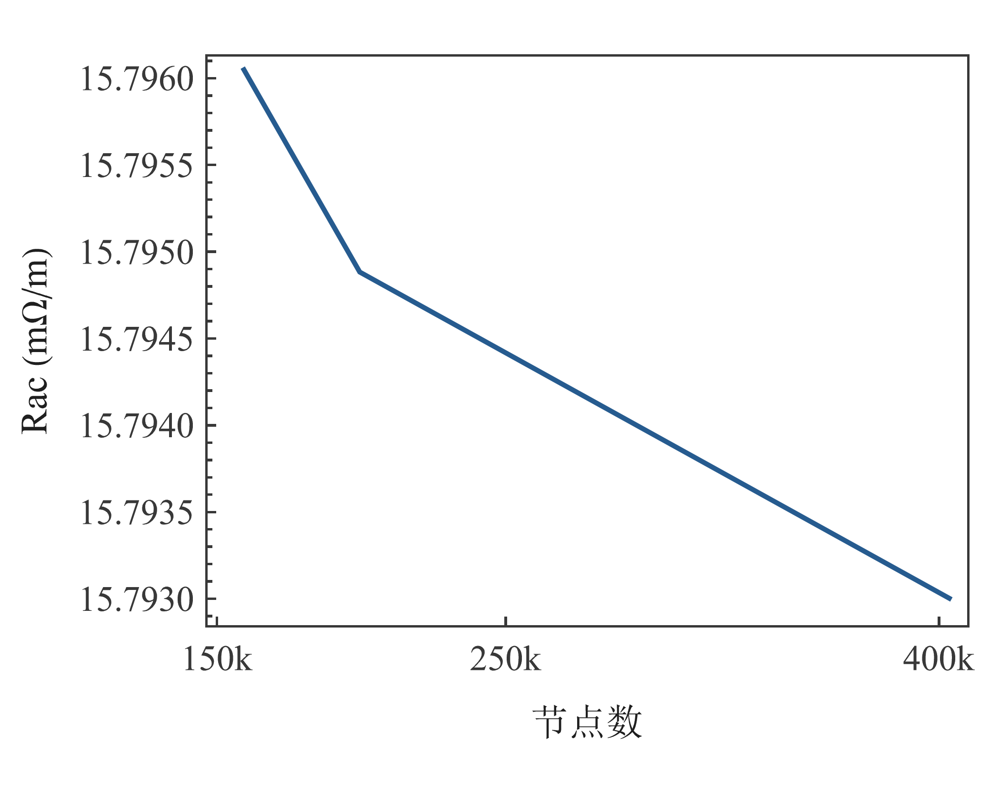
<figcaption>640 股网格与边界敏感性。 各试验按网格、回流和外域分别改变一个因素。</figcaption>
</figure>

### 纵向 PEEC 的长度和积分敏感性

1264 自由度模型在 0.16、0.32、0.64 m 的电阻分别为 19.8992、19.9586、19.9885 mΩ/轴向m，相邻长度变化为 0.298640% 和 0.149482%；5024 自由度模型的 0.32$\to$`<!-- -->`{=html}0.64 m 变化为 0.148730%，见 图 [9](#fig:peec_length)。长度增加时电阻变化减小，且已检查增量均低于 1%。该序列给出了 0.16--0.64 m 范围内的敏感性。

在 5024 自由度、Lz=0.64 m、互项 q=4、自项 12/10 时，Rac=20.0127 mΩ/轴向m，Rac/Rdc=3.64472，损耗为 8.00510 W/轴向m，与该档等面积 Bessel 参照相差 0.044582%。图 [10](#fig:peec_cross_section) 以保存的细丝电流和方形单元恢复截面电流分布，呈现导体内部的表层集中。这里的自由度属于连续导体离散，电流离散程度与前述绝缘股线间的均流指标具有不同含义。

<figure id="fig:peec_length" data-latex-placement="!htbp">
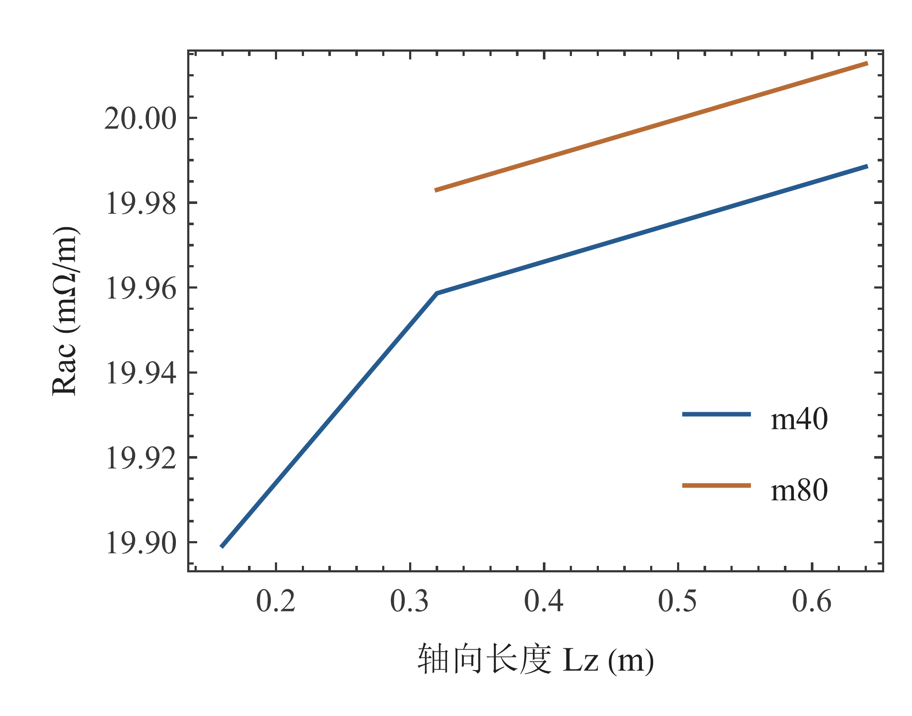
<figcaption>纵向 PEEC 长度敏感性。 同一截面按保存的轴向长度比较单位长度电阻。</figcaption>
</figure>

<figure id="fig:peec_cross_section" data-latex-placement="!htbp">
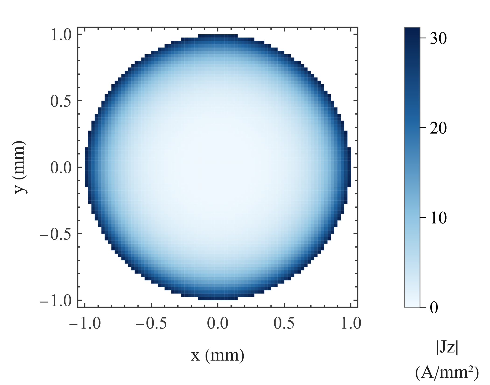
<figcaption>纵向 PEEC 截面电流。 方形细丝单元的复电流恢复 RMS 幅值。</figcaption>
</figure>

互项 q=4$\to$`<!-- -->`{=html}6$\to$`<!-- -->`{=html}8、自项 10/8$\to$`<!-- -->`{=html}12/10 的结果见 图 [11](#fig:peec_sensitivity)。两种规模中，互项变化所对应的最大电阻相对变化为 1.21×10⁻⁵，最大复电流相对变化为 1.60×10⁻⁵；自项变化的相应最大值为 6.75×10⁻¹¹ 和 7.10×10⁻¹¹。横向粗细离散在 0.32、0.64 m 下的电阻变化分别为 0.122127% 和 0.121376%，该比较同时涉及实际面积变化。由此，积分设置的影响在当前试验中小于长度和截面离散的影响。解析参照与敏感性结果共同支持纵向模型的电阻计算，真实端区及横向电流的误差仍属于模型层面的研究问题。

<figure id="fig:peec_sensitivity" data-latex-placement="!htbp">
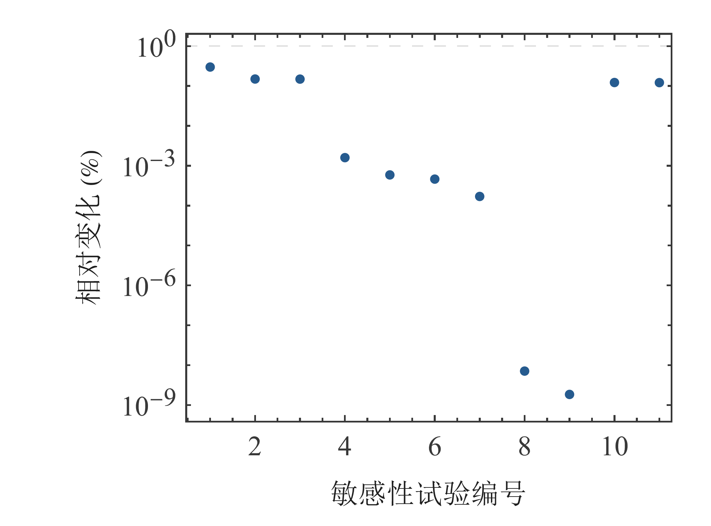
<figcaption>纵向 PEEC 积分敏感性。 互项阶数与自项精度各自进行单因素对照。</figcaption>
</figure>

### CPU/GPU 数值对照与计算规模

在相同模型、离散与积分设置下，5024 自由度的 CPU/GPU 部分电感矩阵相对差为 7.48×10⁻¹⁶，复电流相对差为 7.78×10⁻¹⁴；1264 自由度也达到 10⁻¹⁰ 对照门槛，见 图 [12](#fig:gpu_equivalence)。这些结果说明两种已实现算法在所比较矩阵与端口解上的数值一致性。性能比较还需要相同计时范围，本文保留各阶段时间及资源样本，物理结论采用前述模型验证结果。

图 [13](#fig:resource_memory) 给出可归属进程树的采样内存曲线，采样间隔内的短时峰值可能高于曲线所示值。更大规模中，9856 自由度保存了可恢复的部分电流等结果，其完整矩阵、公共电压或全场覆盖情况按数据清单逐项列出；20108 及以上规模提供资源需求和退出边界记录。它们用于评估进一步计算的成本，完整数值验证仍以具备相应检查数据的算例为依据。

<figure id="fig:gpu_equivalence" data-latex-placement="!htbp">
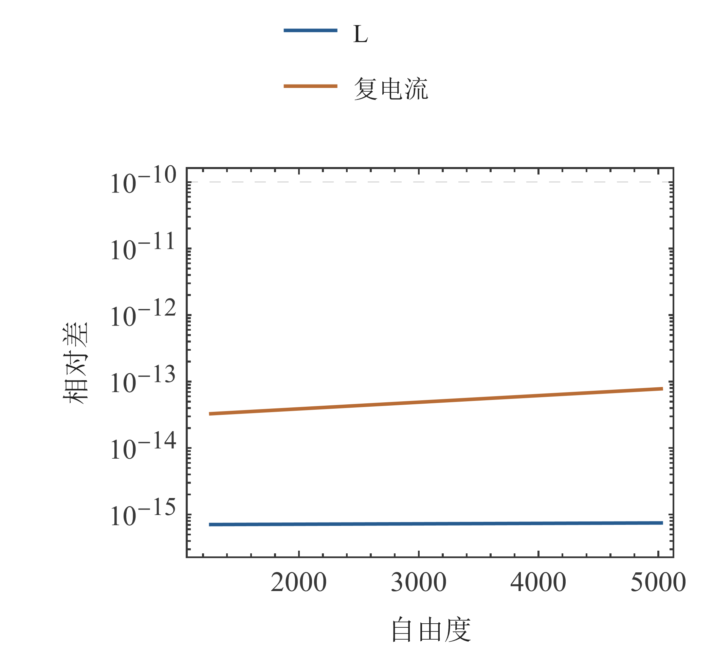
<figcaption>CPU/GPU 同模型数值对照。 矩阵与复电流相对差使用同一离散和积分设置。</figcaption>
</figure>

<figure id="fig:resource_memory" data-latex-placement="!htbp">
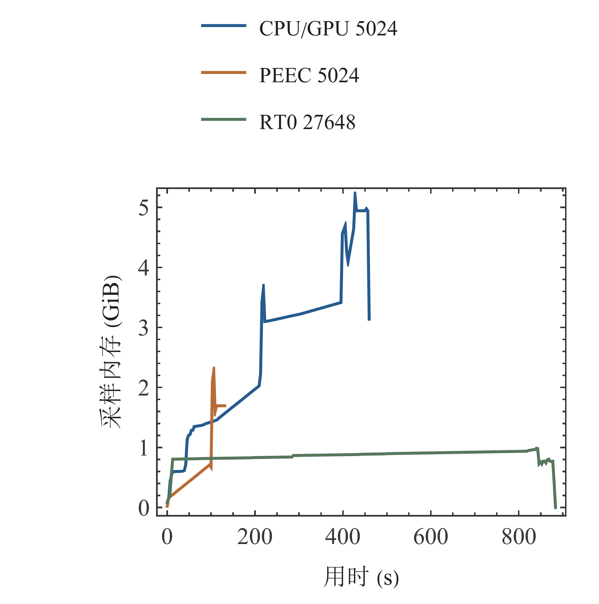
<figcaption>可归属进程树资源曲线。 曲线使用归档的时间及内存样本。</figcaption>
</figure>

## 讨论 {#chapter:04}

### 对电流分配与损耗的解释

三个层次的结果分别回答了引言提出的问题。单圆线解析与二维校准建立局部趋肤基准；640 股结果显示，共同端电压允许各股具有显著不同的复电流，单股尺寸与股间均流应分别评价；纵向 PEEC 则量化了给定基函数下长度和积分的影响。由此，结构比较需要同时控制实际铜面积、回流、端接与轴向长度，并将换位所改变的耦合关系纳入场路求解。较小的离散变化有助于识别数值稳定区间，结构优势仍须与相关模型误差及实验不确定性共同比较。

DTM 与 iDTM [@P01; @N01] 为连接沿程位置和截面场提供了方法基础；本文的共端判据进一步把均流要求表述为耦合矩阵与感应项的代数条件，可用于检查给定换位近似是否保留关键差异。iSEC [@P02] 的分段电路和准二维方法 [@P04] 的电流约束，也体现了场路协同求解的必要性。连续体与复磁导率方法 [@P05; @P09] 适合降低宏观计算成本，逐股电流及局部损耗则需要与其平均化假设一致的恢复方法。上述文献提供方法参照；本文的定量验证采用自身工况、离散和误差记录，各方法的实验精度需在共同算例下比较。

现阶段的主要不确定性来自实际结构与简化模型之间的差异。二维直束省略沿程换位，纵向 PEEC 的基函数省略横向环流和真实端部重分布；RT0 外场算例检验的是固定长方体中的外场吸收。补充材料记录的三维 A--φ 圆柱校准仍有 φ 与规范残差未通过，Ansys 原生三维接口也尚未形成可接受场解。此外，温升、绝缘厚度、绕制公差与端接接触尚待热模型和实验评价。这些因素限定了当前结果向实际 Litz 性能的推广范围。

### 后续验证的重点

后续工作宜先在规模可控的三维圆柱和小股数结构上，使边界、规范、端场与独立功率积分形成一致验证；随后引入真实端接和横向自由度，再比较满足铜面积要求的传统多级与跨层结构。实验可在相同频率、温度、回流与轴向长度下测量复阻抗，同时记录端接电阻和几何公差。这样的顺序能将数值实现误差、几何近似及实际制造偏差逐步区分，并为结构性能排名提供可比较的依据。

## 结论 {#chapter:05}

本文在统一相量、长度和面积定义下，建立了单圆线解析、二维共端场路与有限长度纵向 PEEC 的验证关系。二维内场解的最细网格电阻解析误差为 1.79×10⁻⁶。对端部并联的股线，等流条件可表述为耦合阻抗与外场感应项在差模子空间中的投影为零；640 股直束的复电流结果表明，共同端接与细股划分仍需结合磁耦合评价均流。纵向 PEEC 在已检查长度和积分设置下达到相应敏感性目标，5024 自由度末档电阻与本档等面积 Bessel 参照相差 0.044582%。

这些结果为后续真实换位结构研究提供了局部场基准、共端约束和有限长度计算的参照。RT0 外场、CPU/GPU 对照及三维诊断资料补充说明了各实现的范围。实际 Litz 结构的性能排序仍需具有端区和横向自由度的三维验证，并结合温升与受控实验完成评价。

当前设备的环境迁移重跑了单圆线解析校准与小型 Maxwell 端口及功率案例。这些运行验证迁移后的执行路径，保留原 Maxwell 网格的收敛范围和 A--φ 规范条件失败状态。新核实的半解析与绕组损耗文献为后续工作提供候选方法；其中绕组局部场与均匀化假设，需要与本文孤立导线和共端模型明确比较后，才能转用定量结果。[@C01; @ZHU2026]

## 理论与离散 {#chapter:S1}

### 圆线径向方程与归一化

长直圆线内部的轴向电流满足 (1/r)d(r dJz/dr)/dr=κ²Jz。轴心有限性确定径向函数为 I$_0$(κr)，总复电流约束与积分关系 $\int$$_0$$^a$rI$_0$(κr)dr=aI$_1$(κa)/κ 确定其系数。表面轴向电场与总电流之比给出单位长度内部阻抗；对电流密度独立执行焦耳积分，可核对阻抗实部与损耗之间的关系。推导采用与正文一致的 RMS 相量。

### 复电流均流条件的推导

若等流解存在，将 i=(It/N)1 代入端口方程，即得向量 (It/N)Z1+e 的全部分量相同，投影条件因而必要。反之，若投影条件成立，该向量可写为某一标量 V 与 1 的乘积，等流向量同时满足端口方程和总电流约束；在增广系统解唯一时，它即为实际解，条件因而充分。数值结果以 sqrt(mean(\|ik−It/N\|²))/\|It/N\| 表示归一化复电流 RMS 偏差，并同时展示逐股幅值与相位。

### 股线身份与截面位置的变换

令 Ps 将固定物理股线身份映射到第 s 个截面的空间位置，则局部电流为 Ps i，转换回身份坐标的局部电压为 Ps$^{\mathrm T}$ZsPs i。按段长 Δzs 串联相加得到 [(7)](#eq:E06)。在这一表示中，位置与身份分别保存，K、2K、4K 的分段比较使用同一轨迹和同一组股线。周期、间隙与曲率用于检查轨迹，实际弧长和铜体积用于比较材料用量。

$$Z_{\mathrm{tot}}=\sum_{s=1}^{K}\Delta z_s P_s^T Z_s P_s\tag{7}$$

### 纵向细丝基函数与核积分

第 α 条体积细丝中的电流密度取为常量 iα/Aα，方向沿轴向。由矢势体积积分得到测试细丝内的感应电场，再沿长度积分，可得对称部分电感矩阵。自项在重合点具有可积奇性，使用专门的自项精度控制；互项采用独立积分阶数。欧姆电阻与 jωL 组成耦合矩阵，并与公共端电压和总电流约束联合求解。所用基函数决定了这一模型能够表示的电流方向。

### 线性三角形的电流与功率积分

线性三角形内以 J=$\sum$$_a$NaJa 插值复电流密度。每个形函数的面积积分为 AT/3，因而可直接得到单元复电流；焦耳损耗使用 [(8)](#eq:E09) 的一致质量矩阵计算。材料标记确定单元所属股线、回流或空气，坐标转换为米后求面积。按材料求和所得电流和损耗与原始场路标量独立核对。

$$\begin{gathered}
M_T=\frac{A_T}{12}\begin{bmatrix}2&1&1\\1&2&1\\1&1&2\end{bmatrix} \\
P_T=\mathbf J_T^H M_T\mathbf J_T/\sigma
\end{gathered}
\tag{8}$$

圆线推导采用修正 Bessel 函数的定义与积分关系；纵向耦合采用部分元件等效电路的电阻和部分电感表述。[@BESSEL; @RUEHLI1974]

## 完整敏感性数据 {#chapter:S2}

### 几何采样与离散换位

图 [14](#fig:geometry_comparison) 展示直束、单级、传统多级与跨层中心线。几何记录包括股线身份、周期、间隙、曲率、实际弧长和铜体积，400、800、1600 轴向采样及 60 项检查支持这些量的采样一致性。所示 24 股、0.100 mm 铜径结构的名义铜面积约为 0.1885 mm²，用于说明几何构造；满足至少 5 mm² 铜面积的结构需另行建立并验证。三维视角用于观察空间路径，电磁性能由相应场路模型评价。

<figure id="fig:geometry_comparison" data-latex-placement="!htbp">

<figcaption>股线中心线的三维结构比较。 面板依次展示直束、单级、传统多级局部和跨层结构。</figcaption>
</figure>

当前 DTM/iDTM 演示采用 [(7)](#eq:E06) 的加性离散块。对于同一组带权阻抗块，求和结果对排列顺序保持不变，因此该实现可验证身份映射和给定块的电路叠加。真实换位路径的比较还需考虑位置随长度的变化、层级间的非交换关系、局部场及端接条件。与文献 [@P01; @N01] 对照时，这些具体假设决定两种实现具有多大可比性。

### RT0 长方体外场算例

算例为 1×1×2 mm 均质铜长方体，频率 200 kHz，外加 Bz=1 mT RMS，净输运电流为零。三分量电流以面通量自由度表示，分别检查连续性、端口约束和外场功率。采用 q=14 积分时，8192、16000、27648 单元的损耗为 0.927463、0.933539、0.936927 mW；连续两次细化变化为 0.655090% 和 0.362916%，低于 1% 目标。末档提高至 q=18 后，损耗与复面通量的相对变化分别为 1.55×10⁻⁸ 和 1.39×10⁻⁸，低于 0.1% 积分目标，见 图 [15](#fig:rt0_spatial)。

<figure id="fig:rt0_spatial" data-latex-placement="!htbp">
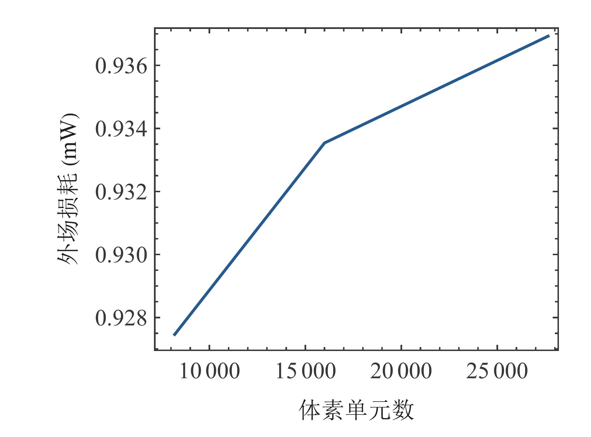
<figcaption>RT0 空间与积分对照。 铜长方体为 1×1×2 mm，200 kHz、1 mT RMS 外场、零净输运。 q14 空间序列与末档 q18 对照使用相同外场工况。</figcaption>
</figure>

切面和矢量图分别见 图 [16](#fig:rt0_sections)、图 [17](#fig:rt0_vectors)，均由保存的面通量恢复。单元中心电流由相对两面的通量平均后除以面面积得到；单元平均损耗密度采用完整 RT0 局部重叠积分，因此包含单元内电流变化。箭头表示零相位时刻电流的实部，并采用统一长度比例，色标表示复 RMS 范数。切面位置和矢量抽样对应图中标注，体积分则使用全部单元。

<figure id="fig:rt0_sections" data-latex-placement="!htbp">
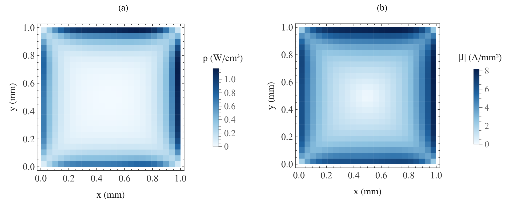
<figcaption>RT0 外场电流与损耗切面。 铜长方体为 1×1×2 mm，200 kHz、1 mT RMS 外场、零净输运。 (a) 单元平均损耗密度；(b) 复 RMS 电流范数。</figcaption>
</figure>

<figure id="fig:rt0_vectors" data-latex-placement="!htbp">
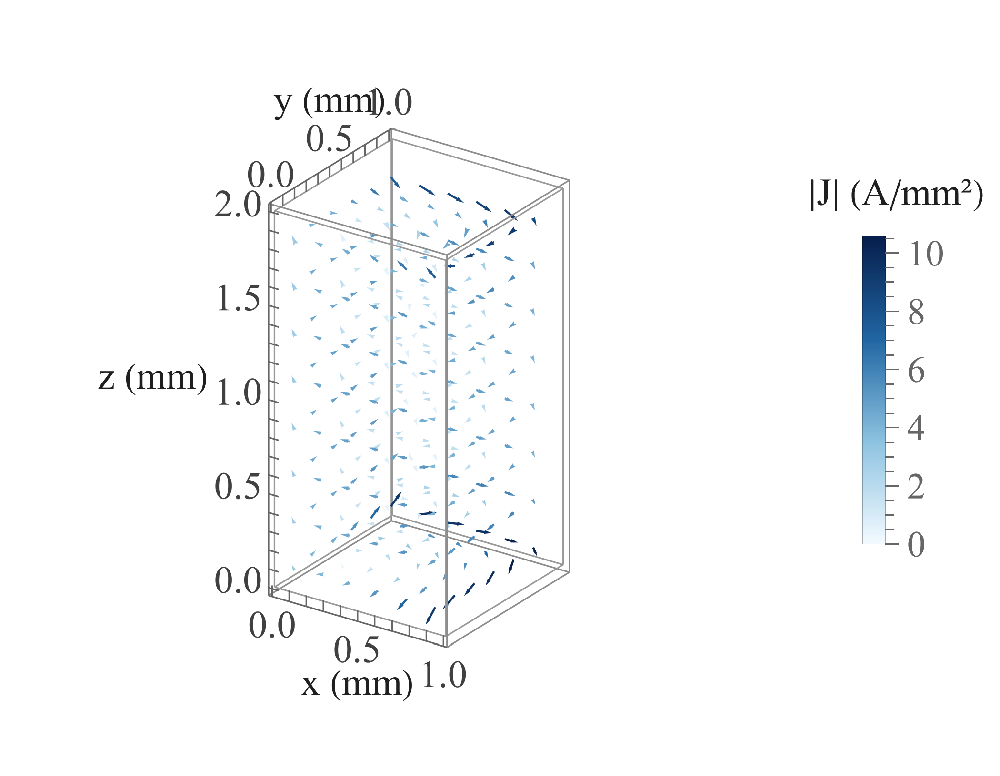
<figcaption>RT0 重构电流三维矢量。 铜长方体为 1×1×2 mm，200 kHz、1 mT RMS 外场、零净输运。 箭头为固定相位的实部，色标为复 RMS 范数。</figcaption>
</figure>

各档记录的 GMRES 迭代次数为 35，真残差满足 10⁻¹¹ 目标。空间与积分比较共同支持固定外场长方体的数值结论，适用范围尚未扩展至曲线 Litz 掩膜、独立边界通量验证和实际输运端接。q=18 原摘要中的缺失指标与失败状态、基于 CSV 的后处理验收，以及致密和矩阵自由实现的资源记录分别列入来源资料，以保持求解和数据解释的对应关系。

### A--φ 圆柱校准与场势诊断

A--φ 模型按 [(9)](#eq:E07)，由保存的 A 和 φ 的实际梯度恢复电流。圆柱三档网格分别含 1683、3672、9108 节点，结果见 图 [18](#fig:aphi_gates)。最细档径向 J 校准达到目标，φ 与规范残差在三档中仍未通过，较粗两档 J 也未达到目标。制造解检查支持所检验方程与实现的对应关系，物理圆柱校准则揭示了仍需研究的场势一致性问题。

$$\mathbf J=-\sigma\left(j\omega\mathbf A+\nabla\phi\right)\tag{9}$$

<figure id="fig:aphi_gates" data-latex-placement="!htbp">

<figcaption>A–φ 圆柱校准指标。 三档网格与各指标门槛分别展示。</figcaption>
</figure>

图 [19](#fig:aphi_preserved) 使用 128 个具有明确身份的节点样本，分别显示 A、φ、J 和实际 φ 梯度，表示这些采样位置的数值。边界、缩放、导数与后处理的诊断记录，以及直接分解、OOC 和迭代路线的失败原因，共同保留在复现资料中。它们用于进一步区分实现问题与离散误差；当前圆柱结果的物理验收状态为未通过。

<figure id="fig:aphi_preserved" data-latex-placement="!htbp">
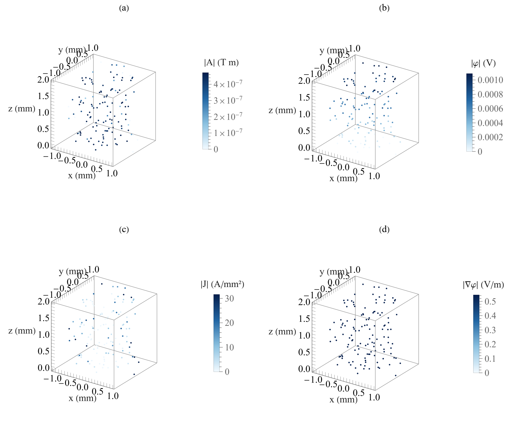
<figcaption>A–φ 保存场样本。 面板分别给出 A、φ、J 和实际 φ 梯度。</figcaption>
</figure>

### Ansys 端口验证与能力范围

七股二维端口短测采用 704 单元，包含两个电压基解和第三次实际 ±20 A 场解。公共端电压、逐股复电流与独立功率为这一网格提供场路一致性检查，电流结果见 图 [20](#fig:ansys_seven_current)。其验证范围为单档网格；后续固定网格与精度尝试尚未形成完整三档验收，原生三维 J 表达式探针也未取得可接受的物理解。

<figure id="fig:ansys_seven_current" data-latex-placement="!htbp">
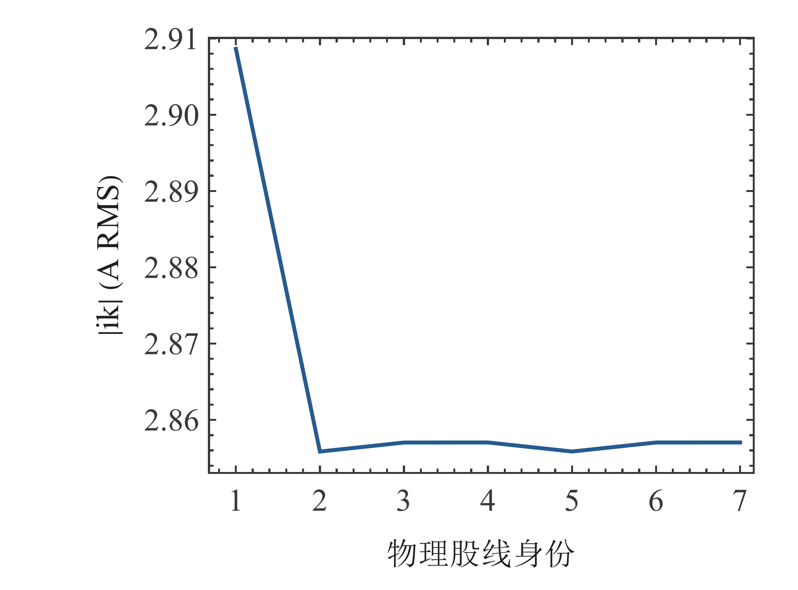
<figcaption>Ansys 七股二维复电流。 704 单元有效端口短测给出逐股幅值与相位。</figcaption>
</figure>

图 [21](#fig:ansys_limits) 汇总已核查的 Ansys Student v252 能力：二维最多 2000 个三角形，三维最多 64000 个体单元和 8000 个面单元，计算最多使用 4 核。接口、许可规模和数值精度分别限制可执行的验证。实际端接、曲线 STL 与足铜大束研究需要与目标几何相匹配的许可和网格能力，并完成相应敏感性与功率检查。

<figure id="fig:ansys_limits" data-latex-placement="!htbp">
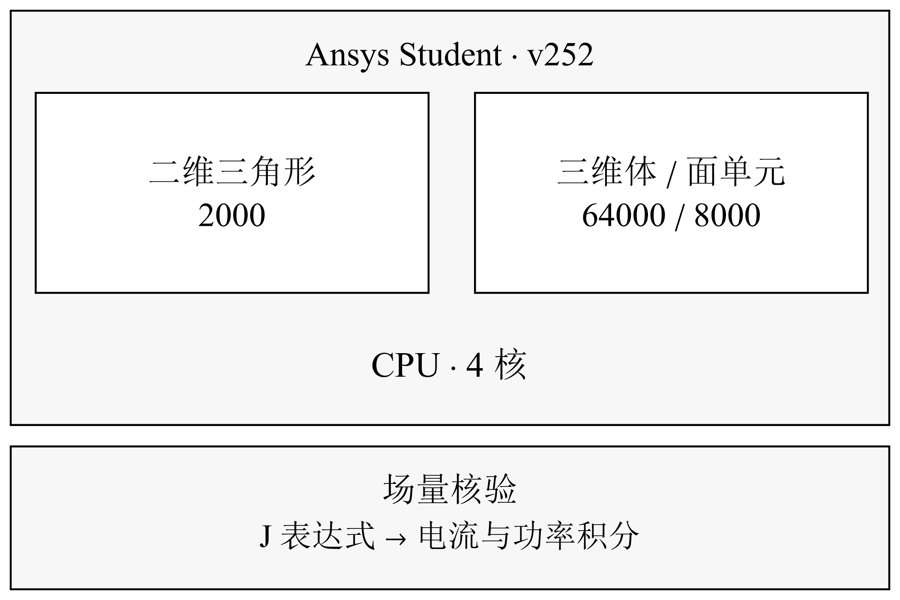
<figcaption>Ansys Student 能力与接口诊断。 Ansys Student v252 的许可规模及场量检查入口。二维上限为 2000 个三角形，三维上限为 64000 个体单元与 8000 个面单元，计算使用至多四核。许可边界来自 rc.1 保存记录，图件来源核对日期为 2026-10-15。</figcaption>
</figure>

  节点数   h/a    Rac (mΩ/m)   电阻相对误差
  -------- ------ ------------ --------------
  353      0.24   20.1572      0.00704525
  1389     0.12   20.0208      0.000230269
  5573     0.06   20.0162      1.79233e-06

  : 单圆线二维校准 {#tab:S2.tables-0}

  自由度   长度 (m)   Rac (mΩ/轴向m)   Rac/Rdc
  -------- ---------- ---------------- ---------
  1264     0.16       19.8992          3.64713
  1264     0.32       19.9586          3.65802
  1264     0.64       19.9885          3.66349
  5024     0.32       19.983           3.63931
  5024     0.64       20.0127          3.64472

  : 纵向 PEEC 长度敏感性 {#tab:S2.tables-1}

  单元数   积分阶数   损耗 (mW)
  -------- ---------- -----------
  8192     14         0.927463
  16000    14         0.933539
  27648    14         0.936927
  27648    18         0.936927

  : RT0 外场损耗与积分阶数 {#tab:S2.tables-2}

  自由度   电感矩阵相对差   复电流相对差
  -------- ---------------- --------------
  1264     7.07572e-16      3.28174e-14
  5024     7.48149e-16      7.78082e-14

  : CPU/GPU 同模型对照 {#tab:S2.tables-3}

  图中编号   单因素比较                                                 图示相对变化 (%)
  ---------- ---------------------------------------------------------- ------------------
  1          1264 自由度 长度 0.16$\to$`<!-- -->`{=html}0.32 m          0.29864
  2          1264 自由度 长度 0.32$\to$`<!-- -->`{=html}0.64 m          0.149482
  3          5024 自由度 长度 0.32$\to$`<!-- -->`{=html}0.64 m          0.14873
  4          1264 自由度 互项积分 q4$\to$q6                             0.001597
  5          1264 自由度 互项积分 q6$\to$q8                             0.000588978
  6          5024 自由度 互项积分 q4$\to$q6                             0.000462112
  7          5024 自由度 互项积分 q6$\to$q8                             0.000169935
  8          1264 自由度 自项积分 10/8$\to$`<!-- -->`{=html}12/10       7.09596e-09
  9          5024 自由度 自项积分 10/8$\to$`<!-- -->`{=html}12/10       1.84501e-09
  10         长度0.32 m：1264 自由度$\to$`<!-- -->`{=html}5024 自由度   0.122127
  11         长度0.64 m：1264 自由度$\to$`<!-- -->`{=html}5024 自由度   0.121376

  : PEEC 敏感性图的编号与量值 {#tab:S2.tables-4}

rc.2 进一步完成了通过 PyAEDT-MCP 的二维 Maxwell 建模、求解和工程回读，并保留任务取消及关联重启记录。与 Wolfram 的七股直束比较对齐截面、材料、频率、回流和总电流约束，逐股复电流相对 L2 差异为 0.0106814%，束内 Rac 相对差异为 0.00132823%。该比较使用独立网格，Maxwell 仅运行一次自适应求解，空间和边界收敛尚待检查。其成功说明对应二维端口链路已贯通；三维接口及足铜换位结构需要各自的场解与验收。[@PYAEDTMCP; @PYAEDT]

RT0 面通量表示依据最低阶混合有限元空间，非对称离散系统采用 GMRES 迭代并检查真实残差。场势实现与准静态磁场模型文档共同用于诊断 A--φ 的边界和规范。[@RT1977; @GMRES1986; @FEMDOC]

## 来源与复现 {#chapter:S3}

### 数据身份与科学状态

各路线的数据清单以模型、参数、源码与运行身份连接原始 WXF、检查点、Ansys 工程、日志和后处理结果。JSON/CSV 保存复数实部与虚部、单位及股线身份；源字段存在单位歧义时，规范量值依据源模型定义解释，并记录转换依据。逐图映射进一步关联数据、绘图表达式、独立 PDF/SVG/PNG 及组图布局。清单分别说明标量积分、空间场和部分恢复结果的覆盖范围。

失败案例保存触发输入、实际错误、针对性修订、停止条件和继续研究所需条件。几何验证的包装器退出码及内核退出信息缺失，RT0 q=18 原摘要的缺失指标和失败状态，以及较大 PEEC 规模的异常退出，均按原运行记录保留；纵向 PEEC 的 1.28 m 档状态为未运行。后处理验收使用独立身份，读者可据此区分数据恢复、数值求解和物理验证的状态。

LaTeX 主稿维护正文、公式和图注，生成的 Markdown 提供阅读稿。数据集清单定位保留的数值及几何证据，科研计算通过文本教程与 CLI 执行。迁移核验包括相对链接、附件读取、文件 SHA256 和含空格目录中的轻量运行；文档构建记录给出线程、内存与环境信息，便于在具备相应依赖的设备上复现。

### 计算与文档构建

研究计算入口读取模型输入和求解配置，输出运行记录及相应检查结果；文档构建入口读取已保存量值、图件与 LaTeX 主稿，生成 Markdown 阅读稿并编译预览 PDF。输入、源码及输出哈希共同定义一次构建，所用单图保留矢量曲线和字体信息，组图记录面板身份与布局参数。下列来源表用于从正文观测量追溯到具体文件及其验收记录。

来源清单：metrics.json; migration-receipt.json; reading-receipt.json.

  来源                                      SHA256
  ----------------------------------------- ------------------------------------------------------------------
  docs/总控/当前运行索引.json               3324976d4af8f58e60820a88ae978246443f78fbdd0cfa1050e86809110ae60d
  outputs/prewrite\_ closure\_ state.json   80a66afa79c321a89f730b102af0e70125f6e1655372717d6b59f470c6520e71

  : 冻结来源与完整性 {#tab:S3.sources-1}

## 本轮收敛诊断与可复核终态

2026 年 10 月的补充运行采用统一任务接口，分别保存执行状态、物理验收、源码与输入身份。制造解在 208、756 和 1856 个节点上通过；最大场值误差为 $1.70\times10^{-14}$，最大导数误差为 $2.26\times10^{-13}$。 圆柱的解析边界迹与二维离散解边界迹在相同的 1683、3672 和 9108 节点挤出网格上配对重算。最细档解析迹的 $J$ 相对误差为 0.877248%，$\phi$ 误差为 $1.70939\times10^{-4}$，gauge 残差为 $2.77686\times10^{-2}$；离散迹对应值为 0.877132%、$1.47596\times10^{-4}$ 和 $2.77850\times10^{-2}$。两组均保留实际 $\phi$ 及其导数。仅替换边界迹未使 $\phi$ 和 gauge 达到 $10^{-8}$ 与 $10^{-3}$ 门槛；下一实验应检查挤出离散算子的分块残差与 gauge 耦合。

Maxwell 七股采用官方网格链接并完成一次有依据的设置修订。源设计和基解均为 1694 个实际网格单元，但严格坐标身份仍失败。仅允许节点和单元编号重排的规范化，未放宽坐标门槛。因此，本轮交付固定网格诊断；后续网格收敛、边界敏感性与同条件跨求解器比较保持依赖阻塞状态。历史单网格一致性继续按其限定范围引用。

机器可读证据索引位于仓库的 provenance/convergence 目录。上述有限终态支持后续最小实验设计；最终 Q2 设计仍要求名义铜面积至少 $5\,\mathrm{mm^2}$、传统多级 Litz 强基线以及实际弧长和铜量公平比较。

## References {#references .unnumbered}

\[P01\] Silvano Cruciani, Tommaso Campi, Francesca Maradei, Mauro Feliziani. Numerical Modeling of Litz Wires Based on Discrete Transpositions of Strands and 2-D Finite Element Analysis. IEEE TPEL, 38, 5, 6710--6719, 2023. <https://doi.org/10.1109/TPEL.2023.3240338>

\[N01\] Xinsheng Zhang, Fei Xiao, Ruitian Wang, Shunjun Chen, Xuexin Fan, Xin Li. AC Impedance Modeling of Composite Litz Wire With Nonideal Transposition Based on Improved Discrete Transposition Model. IEEE TPEL, 41, 7, 11003--11019, 2026. <https://doi.org/10.1109/TPEL.2026.3661080>

\[P02\] Yueyin Wang, Wu Chen, Zhan Shen. Modeling of Litz Wire Winding AC Resistance Based on Improved Segmented Equivalent Circuit. IEEE TPEL, 39, 1, 1135--1149, 2024. <https://doi.org/10.1109/TPEL.2023.3321327>

\[P03\] Andreas Roßkopf, Eberhard Bär, Christopher Joffe, Clemens Bonse. Calculation of Power Losses in Litz Wire Systems by Coupling FEM and PEEC Method. IEEE TPEL, 31, 9, 6442--6449, 2016. <https://doi.org/10.1109/TPEL.2015.2499793>

\[P04\] Tamás Bakondi, Sándor Bilicz, Szabolcs Gyimóthy. Finite element modeling of eddy currents in a multiconductor system with quasi-2D symmetry. COMPEL, 44, 5, 730--742, 2025. <https://doi.org/10.1108/COMPEL-01-2025-0031>

\[P05\] David C. Meeker. An Improved Continuum Skin and Proximity Effect Model for Hexagonally Packed Wires. JCAM, 236, 18, 4635--4644, 2012. <https://doi.org/10.1016/j.cam.2012.04.009>

\[P09\] Korawich Niyomsatian, Johan Gyselinck, Ruth V. Sabariego. Closed-form complex permeability expression for proximity-effect homogenisation of litz-wire windings. IET SMT, 14, 3, 287--291, 2020. <https://doi.org/10.1049/iet-smt.2019.0377>

\[C01\] 金峰逸, 马玉芳. 基于半解析有限元的利兹线交流电阻分析. 电子学报, 51, 12, 3457--3462, 2023. <https://doi.org/10.12263/dzxb.20230001>

\[ZHU2026\] Wenjun Zhu, Yangyu Sun, Xiao Chen, Jiabin Wang, G. W. Jewell, Ellis Chong, Andreas Reeh. AC Loss Calculation for Litz Wire Windings in Electrical Machines. IEEE Transactions on Transportation Electrification, 12, 1, 21--31, 2026. <https://doi.org/10.1109/TTE.2025.3610369>

\[BESSEL\] NIST. NIST Digital Library of Mathematical Functions, Modified Bessel Functions. 2026. <https://dlmf.nist.gov/10.25>

\[RUEHLI1974\] Ruehli, A.E.. Equivalent Circuit Models for Three-Dimensional Multiconductor Systems. IEEE Transactions on Microwave Theory and Techniques, 22, 3, 216--221, 1974. <https://doi.org/10.1109/tmtt.1974.1128204>

\[PYAEDTMCP\] ANSYS, Inc.. PyAEDT-MCP. 2026. <https://github.com/ansys/pyaedt-mcp>

\[PYAEDT\] ANSYS, Inc.. PyAEDT. 2026. <https://github.com/ansys/pyaedt>

\[RT1977\] Raviart, P. A., Thomas, J. M.. A mixed finite element method for 2-nd order elliptic problems. Mathematical Aspects of Finite Element Methods, Springer, 606, 292--315, 1977. <https://doi.org/10.1007/bfb0064470>

\[GMRES1986\] Saad, Youcef, Schultz, Martin H.. GMRES: A Generalized Minimal Residual Algorithm for Solving Nonsymmetric Linear Systems. SIAM Journal on Scientific and Statistical Computing, 7, 3, 856--869, 1986. <https://doi.org/10.1137/0907058>

\[FEMDOC\] Wolfram Research. Wolfram quasistatic magnetic field models. 2026. <https://reference.wolfram.com/language/PDEModels/tutorial/Electromagnetics/QuasistaticMagneticFields.html>
