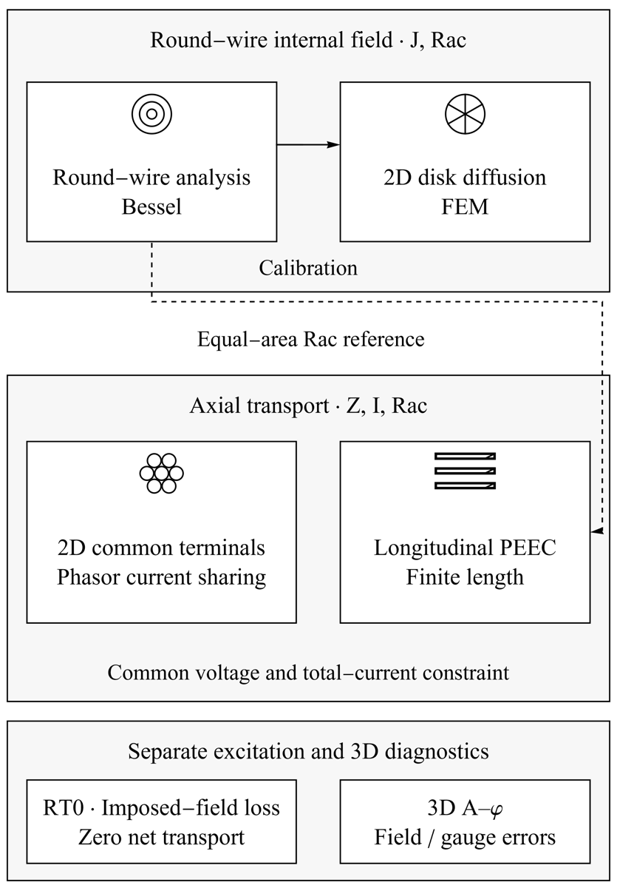

# Litz-Wire Modeling and Numerical Verification: Comprehensive Research Report · 01 Introduction and Research Questions

Miao Yuxuan · Huainan Normal University

[Merged manuscript](../README.md#chapter-01)

## 01 Introduction and Research Questions

### Introduction

Dividing a copper cross-section into many fine strands does not by itself guarantee a reduction in high-frequency loss. Strand diameter sets the local skin-effect scale; neighboring conductors and the return determine the surrounding magnetic field; longitudinal positions and common terminals determine complex strand currents. Comparing geometry alone, nominal copper area, or an assumed average current merges distinct mechanisms into a single indicator. A defensible structural comparison first identifies the fields and constraints retained by a model and then checks the numerical uncertainty relevant to those quantities.

Existing approaches address different scales. DTM combines discrete transpositions with two-dimensional FEM [1], linking strand-position permutations to cross-sectional fields; iDTM additionally considers nonideal hierarchical and subbundle transpositions [2]. The improved segmented equivalent circuit [3] constructs a reduced circuit under its stated winding and layer assumptions. FEM–PEEC coupling [4] and quasi-two-dimensional multiconductor modeling [5] use different macroscopic fields, axial electric fields, and current constraints. Continuum models [6] and complex-permeability homogenization [7] reduce the cost of large winding simulations, but their average fields do not directly replace strand-resolved complex currents or realistic end regions.

The emphasis here is a set of comparable quantities and verification relationships needed for structural research. The first contribution separates the analytical, two-dimensional, longitudinal, and full-component voxel models according to what each can verify. The second derives a current-sharing condition from the common-terminal augmented system and states its model scope. The third performs single-factor sensitivity checks for finite-length longitudinal PEEC while interpreting CPU/GPU agreement separately from physical validation. Traditional multilevel Litz remains a strong baseline. Cross-layer geometry is a candidate for subsequent verification, without a presumed performance advantage.

### Scope

Three questions organize the verification: whether independent discretizations reproduce the local skin-effect reference; which algebraic conditions determine complex current sharing under common terminals; and how strongly the resistance obtained from a finite longitudinal kernel depends on length and integration settings. The contributions are consistent observables, inspectable verification relationships, and quantitative evidence within each model, supporting the selection of the next model for realistic transposition research.

Fig. 1. Model hierarchy and comparable observables.

Transport models are grouped by physical object and observable: round-wire internal fields support analytical and two-dimensional calibration, multistrand field–circuit models resolve common-terminal phasor currents, and longitudinal PEEC examines finite-length effects. Links identify internal-field calibration or equal-area resistance references. RT0 imposed-field loss and three-dimensional A–φ diagnostics occupy separate research scopes.

## References

[1] Silvano Cruciani, Tommaso Campi, Francesca Maradei, Mauro Feliziani. Numerical Modeling of Litz Wires Based on Discrete Transpositions of Strands and 2-D Finite Element Analysis. IEEE TPEL 38(5):6710–6719, 2023. https://doi.org/10.1109/TPEL.2023.3240338

[2] Xinsheng Zhang, Fei Xiao, Ruitian Wang, Shunjun Chen, Xuexin Fan, Xin Li. AC Impedance Modeling of Composite Litz Wire With Nonideal Transposition Based on Improved Discrete Transposition Model. IEEE TPEL 41(7):11003–11019, 2026. https://doi.org/10.1109/TPEL.2026.3661080

[3] Yueyin Wang, Wu Chen, Zhan Shen. Modeling of Litz Wire Winding AC Resistance Based on Improved Segmented Equivalent Circuit. IEEE TPEL 39(1):1135–1149, 2024. https://doi.org/10.1109/TPEL.2023.3321327

[4] Andreas Roßkopf, Eberhard Bär, Christopher Joffe, Clemens Bonse. Calculation of Power Losses in Litz Wire Systems by Coupling FEM and PEEC Method. IEEE TPEL 31(9):6442–6449, 2016. https://doi.org/10.1109/TPEL.2015.2499793

[5] Tamás Bakondi, Sándor Bilicz, Szabolcs Gyimóthy. Finite element modeling of eddy currents in a multiconductor system with quasi-2D symmetry. COMPEL 44(5):730–742, 2025. https://doi.org/10.1108/COMPEL-01-2025-0031

[6] David C. Meeker. An Improved Continuum Skin and Proximity Effect Model for Hexagonally Packed Wires. JCAM 236(18):4635–4644, 2012. https://doi.org/10.1016/j.cam.2012.04.009

[7] Korawich Niyomsatian, Johan Gyselinck, Ruth V. Sabariego. Closed-form complex permeability expression for proximity-effect homogenisation of litz-wire windings. IET SMT 14(3):287–291, 2020. https://doi.org/10.1049/iet-smt.2019.0377
