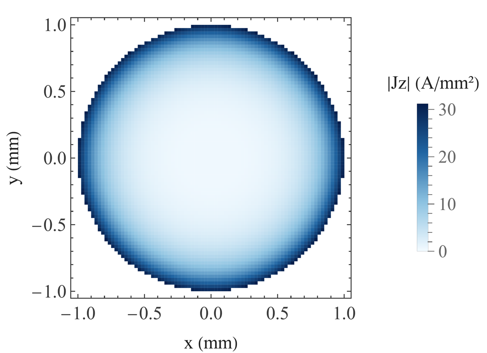
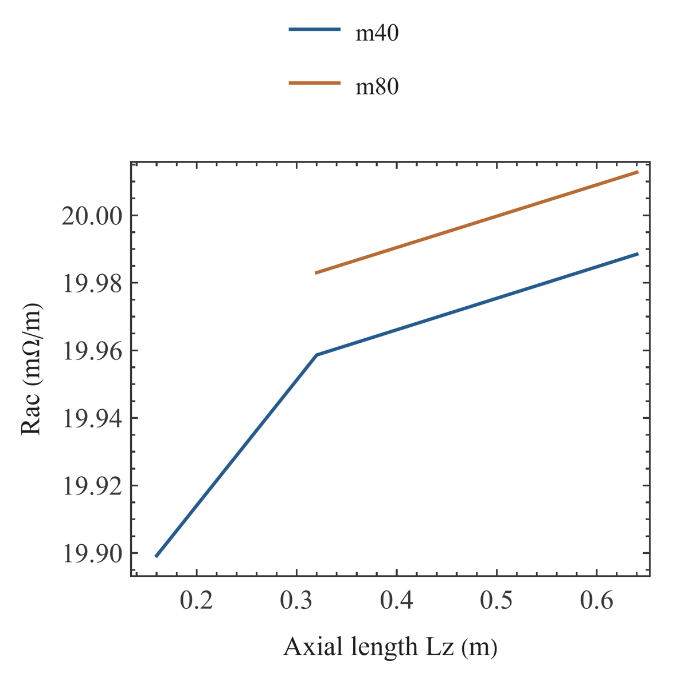
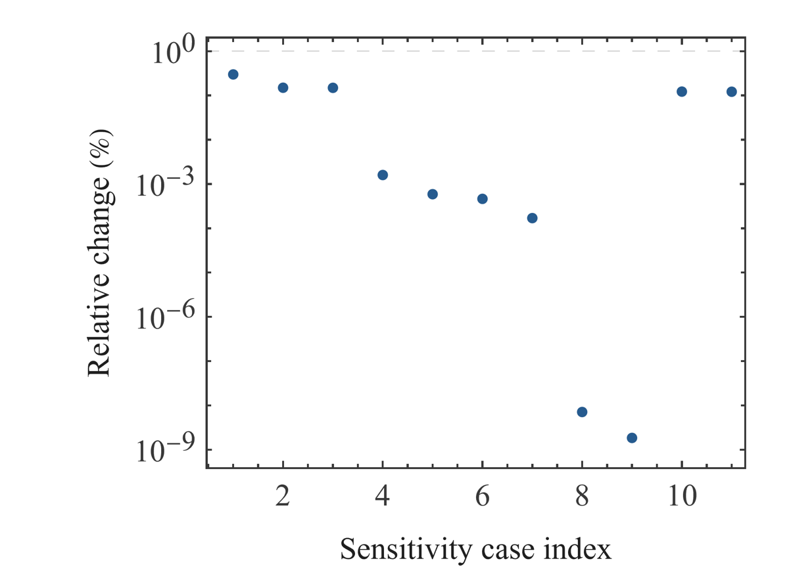

# Litz-Wire Modeling and Numerical Verification: Comprehensive Research Report · 06 Finite-Length Longitudinal PEEC

Miao Yuxuan · Huainan Normal University

[Merged manuscript](../README.md#chapter-06)

## 06 Finite-Length Longitudinal PEEC

### Finite-Length Longitudinal PEEC: Theory and Discretization

The longitudinal model carries axial, uniform-in-length complex current in cross-sectional volume filaments. The ohmic term is each filament’s finite-segment resistance, and partial inductance is obtained by integrating the finite-volume 1/|r−r′| kernel [(7)](../README.md#E08). A common port and total-current constraint are again solved through [(4)](../README.md#E04). Here, 1264 and 5024 count volume-filament degrees of freedom, not insulated Litz strands. Radial concentration can appear through cross-sectional current redistribution, but the basis contains neither complete transverse eddy-current loops nor realistic end redistribution.

Mutual-integration order and self-integration accuracy are archived as separate options. The fixed 1264-degree-of-freedom cross-section is first examined at lengths 0.16, 0.32, and 0.64 m. Integration checks then hold length fixed and change one factor at a time across mutual orders q=4, 6, and 8 and self settings 10/8 to 12/10. The representative 5024 model rechecks the final two lengths and integration settings. Because m40 and m80 have slightly different actual copper areas, each level is interpreted against its own equal-area Bessel reference; an area change is not concealed as pure discretization error.

The external magnetic contribution to partial inductance differs from the internal Bessel impedance of a long straight wire. Analytical comparison therefore focuses on AC resistance while retaining length and actual area. Length variation limits sensitivity of the present finite-kernel calculation to the chosen length but does not introduce transverse basis functions. In comparison with FEM–PEEC literature [4], the longitudinal volume basis, excitation, return, and feedback treatment must each be identified. An assumption of one coupling implementation should not be generalized to every PEEC method.

### Peec Derivation

Within each volume filament, current is represented by the constant axial density iα/Aα. Projection of the volume-integral vector potential onto the testing filament and integration along length produces the symmetric partial-inductance matrix. The self kernel is integrable but singular at coincidence and uses a dedicated accuracy setting; mutual terms use an independent order. Combining finite-segment ohmic resistance with jωL forms Z, after which the common-terminal augmented system determines filament currents and terminal voltage.

### Longitudinal PEEC Sensitivity and Results

For 1264 degrees of freedom, the 0.16, 0.32, and 0.64 m cases give axial AC resistances of 19.899215, 19.958642, and 19.988477 mΩ/m. Both length increments change resistance by less than 1%, and the 0.32-to-0.64 m change at 5024 degrees of freedom also meets the target. Mutual orders q4/6/8, self settings 10/8 to 12/10, and the coarse-to-fine comparison of the actual cross-sections satisfy the bounded campaign criteria. One factor changes at a time. The unexecuted 1.28 m level remains unexecuted and is not assigned an extrapolated result or a zero error.

The final 5024-degree-of-freedom case at axial length 0.64 m, mutual order q4, and self setting 12/10 gives 20.012738128 mΩ/m AC resistance, a ratio to DC resistance of 3.644719868, and loss of 8.005095251 W/m. Its difference from the equal-area Bessel reference is 0.044582%. The cross-sectional color map is reconstructed from preserved filament currents and square cells. A filament-current deviation describes redistribution inside the discretized conductor; it is not a sharing metric for physical insulated Litz strands.

Length sensitivity and the analytical reference answer different questions. The former examines variation of the finite-length kernel over the chosen interval; the latter checks resistance against the comparable scale of long straight-wire internal behavior. Agreement does not eliminate a boundary or basis limitation. In particular, a small integration change supports the present integration implementation but supplies no additional evidence for real end regions, transverse currents in curved strands, or redistribution at terminals. The result is therefore described as bounded acceptance within the longitudinal model.

$$
R_{\alpha\beta}=\delta_{\alpha\beta}\frac{L_z}{\sigma A_\alpha},\qquad L_{\alpha\beta}=\frac{\mu}{4\pi A_\alpha A_\beta}\int_{V_\alpha}\int_{V_\beta}\frac{\hat{\mathbf t}_\alpha\cdot\hat{\mathbf t}_\beta}{|\mathbf r-\mathbf r'|}\,\mathrm dV\,\mathrm dV'.\tag{7}
$$

Fig. 10. Longitudinal PEEC cross-sectional current.

Complex currents in square volume filaments reconstruct the RMS magnitude. The representative model contains 5024 longitudinal volume filaments and has axial length 0.64 m. Coordinates and material areas follow that level’s actual square-cell discretization.

Fig. 11. Longitudinal PEEC length sensitivity.

Resistance per axial length is compared at archived lengths for the same cross-section. The 1264-degree-of-freedom model uses 0.16, 0.32, and 0.64 m, while 5024 degrees of freedom recheck the final two levels. Integration settings remain fixed within each length sequence.

Fig. 12. Longitudinal PEEC integration sensitivity.

Mutual order and self accuracy are compared in separate single-factor tests. Mutual settings are q4, q6, and q8; self settings are 10/8 and 12/10. Comparisons retain the same cross-section and axial length.

## References

[4] Andreas Roßkopf, Eberhard Bär, Christopher Joffe, Clemens Bonse. Calculation of Power Losses in Litz Wire Systems by Coupling FEM and PEEC Method. IEEE TPEL 31(9):6442–6449, 2016. https://doi.org/10.1109/TPEL.2015.2499793
