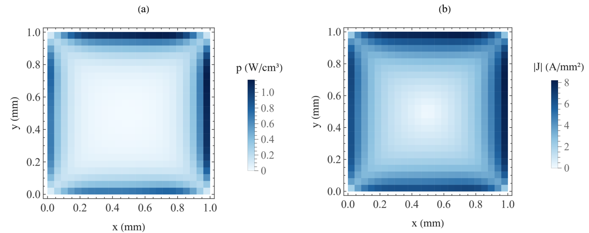
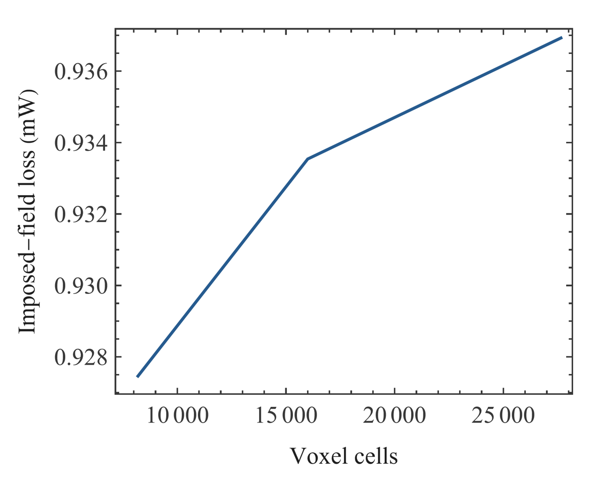

# Litz-Wire Modeling and Numerical Verification: Comprehensive Research Report · 07 RT0 Three-Dimensional Imposed-Field Example

Miao Yuxuan · Huainan Normal University

[Merged manuscript](../README.md#chapter-07)

## 07 RT0 Three-Dimensional Imposed-Field Example

The RT0 example is fixed to a homogeneous 1×1×2 mm copper cuboid at 200 kHz, an imposed Bz of 1 mT RMS, and zero net transport. Three-component current is represented by face-flux degrees of freedom; continuity, common-port conditions, and imposed-field power are checked separately. With common integration order q14, 8192, 16000, and 27648 cells yield losses of 0.927463, 0.933539, and 0.936927 mW. The final two changes are 0.655090% and 0.362916%, both below 1%. The q18 comparison on the final grid changes loss by 1.54941×10⁻⁸ and complex face flux by 1.39291×10⁻⁸, below the 0.1% integration target.

Field figures are reconstructed from saved face fluxes. Cell-center J is the mean of opposing face fluxes divided by cell area. Cell-average loss density uses the exact local RT0 overlap integral and is not replaced by center |J|²/σ. Three-dimensional arrows display only the real part at phasor phase zero, with a common length scale; the color scale uses the complex RMS vector norm. The actual section position, sparse vector samples, and full-volume integration are identified separately so that a sampled visualization is not interpreted as a whole-field integral or maximum.

The archived GMRES iteration count is 35 for each level, with true residuals meeting the 10⁻¹¹ target. Null metrics and the failed status in the original q18 summary remain unchanged; the new CSV postprocessing checks are separate evidence. Memory rejection by an older dense algorithm and successful solution by the newer matrix-free implementation belong to different implementations and must not be merged into one status. The conclusion is limited to the fixed imposed-field cuboid, without curved Litz masks, independent boundary-flux validation, or realistic transport terminals.

Fig. 13. RT0 imposed-field current and loss sections.

The 1×1×2 mm copper cuboid is excited at 200 kHz by a 1 mT RMS field with zero net transport. (a) Cell-average loss density; (b) complex RMS current norm. Current is reconstructed from opposing face fluxes, and cell-average loss uses RT0 overlap integration. Section positions and color scales follow the archived reconstruction definitions.

Fig. 14. RT0 reconstructed three-dimensional current vectors.

The 1×1×2 mm copper cuboid is excited at 200 kHz by a 1 mT RMS field with zero net transport. Arrows show the real part at a fixed phase; color represents the complex RMS norm. Vectors use a common scale and sparse cell sampling. Cell and face-flux identities correspond in the preserved reconstruction data.

Fig. 15. RT0 spatial and integration comparisons.

The 1×1×2 mm copper cuboid is excited at 200 kHz by a 1 mT RMS field with zero net transport. The q14 spatial sequence and final q18 comparison use the same imposed-field condition. The spatial sequence contains 8192, 16000, and 27648 cells. Integration is compared on the final successful grid.

## References
