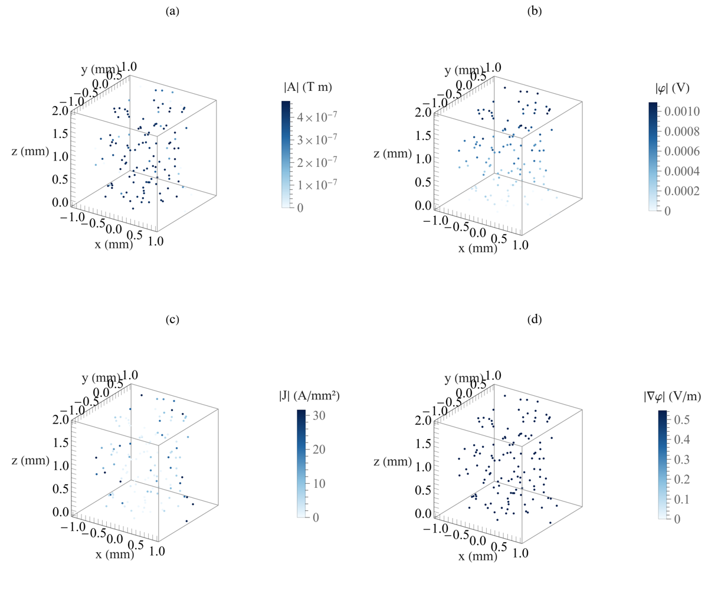
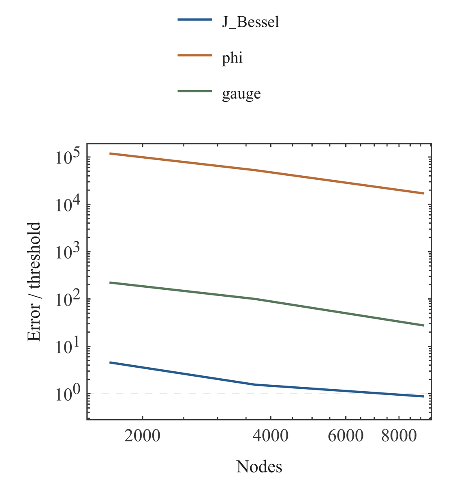

# Litz-Wire Modeling and Numerical Verification: Comprehensive Research Report · 08 Three-Dimensional A–φ Fields and Diagnostics

Miao Yuxuan · Huainan Normal University

[Merged manuscript](../README.md#chapter-08)

## 08 Three-Dimensional A–φ Fields and Diagnostics

A–φ current must be reconstructed from the actual preserved A and gradient of φ [(8)](../README.md#E07); an unsuccessful φ field must not be replaced by an analytical value. The three cylinder meshes contain 1683, 3672, and 9108 nodes. Radial J calibration on the finest level meets its threshold, while φ and gauge residuals remain unsuccessful on all three original levels; J also fails on the coarser levels. Manufactured-solution checks test the specified equations and implementation but do not automatically validate these physical cylinder solutions.

Diagnostic figures use 128 preserved field and derivative samples with explicit node identities, showing A, φ, J, and the actual gradient of φ separately. They are not inferred from a decorative surface and are not whole-field extrema. Boundary, scaling, derivative, and postprocessing diagnostics should distinguish implementation defects from approximation errors. Once the bounded revision limit is reached, failures are archived with triggers, minimal reproductions, and conditions for further research. Direct factorization, out-of-core, and iterative failures likewise retain their distinct causes.

$$
\mathbf J=-\sigma\left(j\omega\mathbf A+\nabla\phi\right).\tag{8}
$$

Fig. 16. Preserved A–φ field samples.

Panels show A, φ, J, and the actual gradient of φ. The 128 selected nodes retain their sample identities. Color scales use magnitudes of the actual saved complex fields and derivatives.

Fig. 17. A–φ cylinder calibration metrics.

Three grids and their metric targets are shown separately. The three cylinder levels contain 1683, 3672, and 9108 nodes. Errors are normalized by their respective acceptance targets, with the horizontal line indicating a unit ratio.

## References
