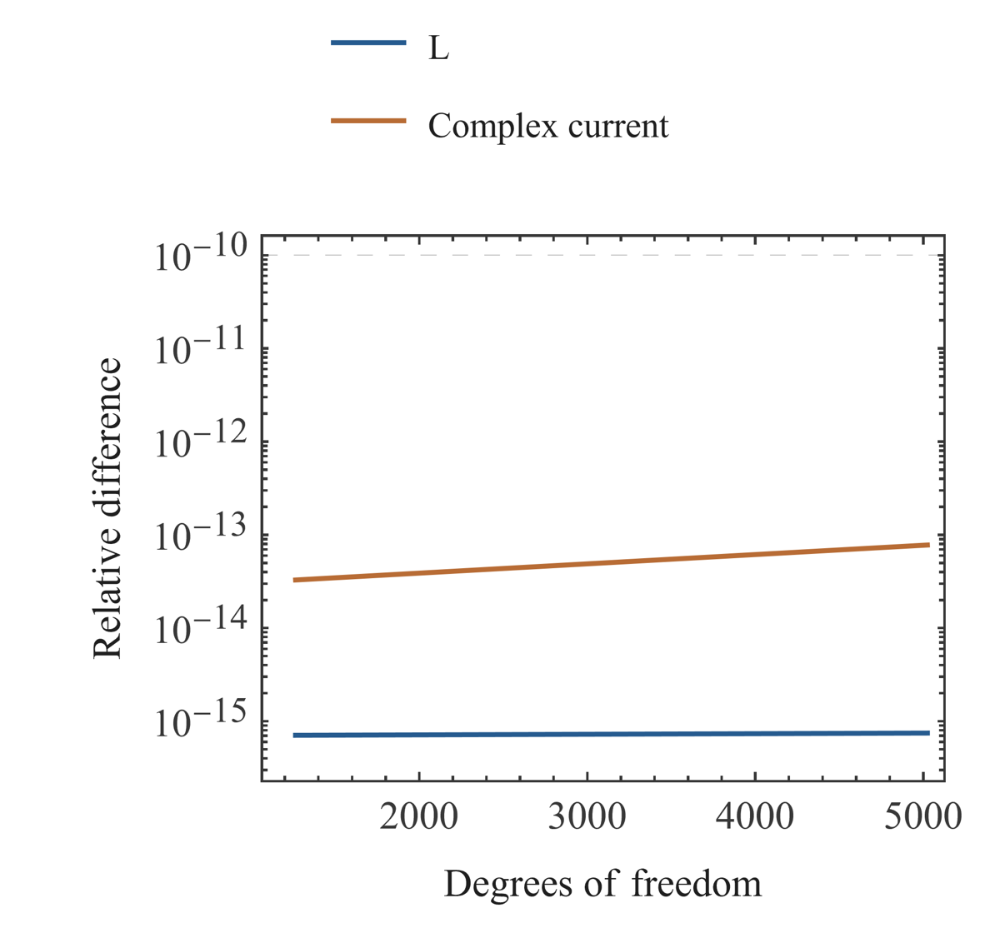
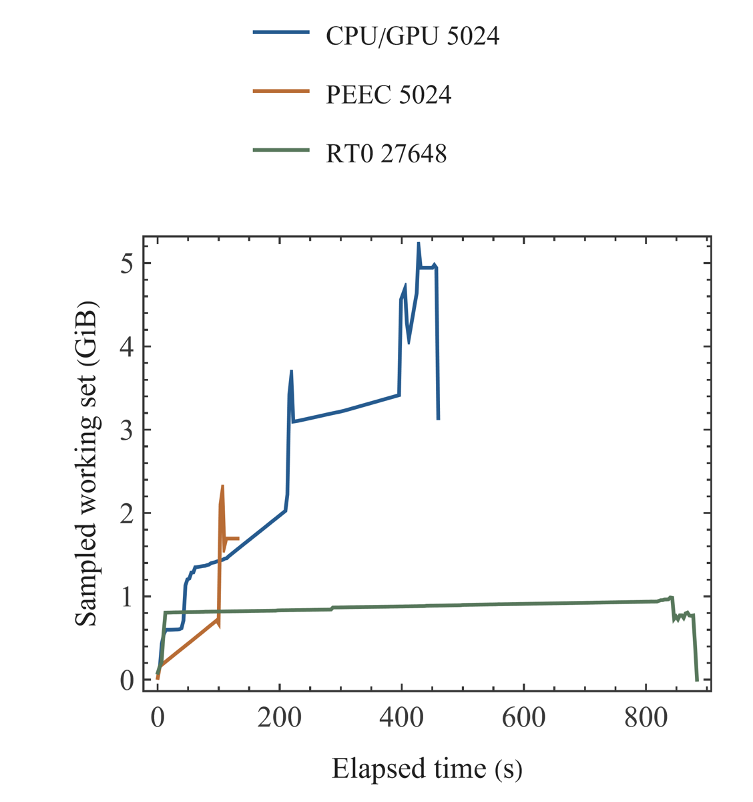

# Litz-Wire Modeling and Numerical Verification: Comprehensive Research Report · 10 Implementation, CPU/GPU Comparison, and Resources

Miao Yuxuan · Huainan Normal University

[Merged manuscript](../README.md#chapter-10)

## 10 Implementation, CPU/GPU Comparison, and Resources

### CPU/GPU Equivalence and Resource Boundaries

CPU/GPU comparisons hold the longitudinal model and discretization fixed. At 5024 degrees of freedom, relative differences are 7.48149×10⁻¹⁶ for the L matrix and 7.78082×10⁻¹⁴ for complex current, below the 10⁻¹⁰ target; the 1264 comparison also passes. This supports equivalence of the implemented CPU/GPU algorithms for the compared matrix and port solution. It adds no physical content to the model, and timings from different sizes or integration settings cannot establish a speedup.

Historical 9856-degree-of-freedom results recover only part of the available current and related data. Missing complete matrices, common voltage, or full fields prevent an upgrade to full validation. The 20108 and larger cases retain their archived resource boundaries and exits. Resource curves use attributable process-tree samples only; short peaks may be missed and records mixed with unrelated PIDs are excluded. Computational capability and physical failure are interpreted separately: unavailable resources are not acceptance, and completed execution is not physical validation.

### Workflow

Reproduction has separate entry points for research computation and publication building. The research entry reads original inputs and solver settings and performs the corresponding validation. The publication entry reads frozen data, verified independent panels, and Markdown prose to produce chapters, merged texts, and multiple formats. Each stage records input and output hashes and reuses a completed stage only when dependencies and products agree. Independent panels retain vector curves and fonts; composition manifests record panel identities and layout parameters.

Fig. 20. CPU/GPU same-model numerical comparison.

Relative matrix and complex-current differences use identical discretization and integration. Relative differences are computed separately for 1264 and 5024 degrees of freedom. The horizontal reference is the 10⁻¹⁰ algorithm-comparison target.

Fig. 21. Attributable process-tree resource curves.

Curves use archived time and memory samples. Time is measured from the start of each corresponding run. Memory is the sampled working set of the attributable process tree.

## References
