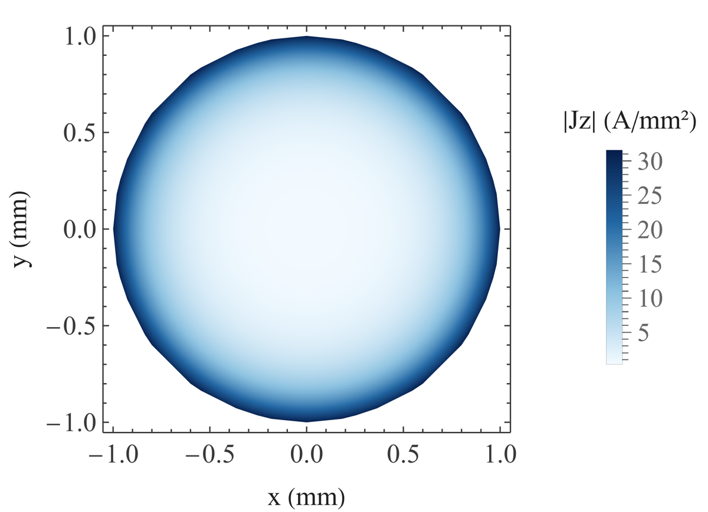
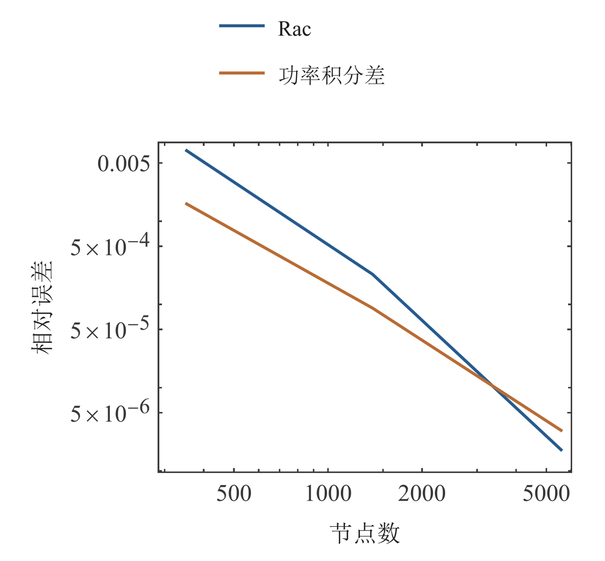

# Litz 线分层建模与数值验证：完整研究报告 · 03 单圆线解析与二维校准

缪雨轩 · 淮南师范学院

[合并稿](../README.md#chapter-03)

## 03 单圆线解析与二维校准

### 径向方程与归一化

圆线内部的轴向电流满足 (1/r) d(r dJz/dr)/dr=κ²Jz。轴心的有限性选择 I₀(κr)；使用 ∫₀ᵃ rI₀(κr)dr=aI₁(κa)/κ 和总复电流约束即可确定归一化常数。表面轴向电场与总电流之比给出内部阻抗，其实部通过独立焦耳积分复核。该推导把解析形状、归一化和功率三个检查连接起来。

### 单圆线解析与独立二维校准

长直圆线内部解采用修正 Bessel 函数 [(3)](../README.md#E03)。200 kHz 下的趋肤深度 δ=0.147771655 mm，相对 1 mm 半径已形成明显表层电流集中。解析值为 Rdc=5.488101486 mΩ/m、Rac=20.016203628 mΩ/m、Rac/Rdc=3.647199980、损耗 8.006481451 W/m。这里的内部阻抗不含由回流确定的外部电感。径向相位保留原复相量，并通过相邻半径的 360° 连续提升显示；显示解缠不修改数据。

独立二维圆盘扩散使用三档 353、1389、5573 节点，并按总复电流归一化。最细 Rac 解析相对误差为 1.79233×10⁻⁶，功率积分差为 3.06800×10⁻⁶。结果支持该孤立内场问题的离散与归一化。二维场与有限长度三维端区不具有相同边界，不能把这个误差直接用于后者。解析截面图由径向解析幅值线性插值并轴对称映射。

$$
\delta=(\pi f\mu\sigma)^{-1/2},\quad\kappa=(1+j)/\delta,\quad J_z(r)=\frac{I_t\kappa I_0(\kappa r)}{2\pi a I_1(\kappa a)},\quad z_{\mathrm{int}}=\frac{\kappa I_0(\kappa a)}{2\pi a\sigma I_1(\kappa a)}.\tag{3}
$$

图 2. 单圆线径向电流幅值与相位。

铜导体直径 2 mm，200 kHz、20 A RMS。 (a) RMS 幅值；(b) 连续显示的相位。 相位显示采用径向连续提升，幅值保留 RMS 归一化。径向样本来自保存的 Bessel 解析数据。

图 3. 单圆线解析截面幅值。

铜导体直径 2 mm，200 kHz、20 A RMS。 色标显示轴向 RMS 电流密度。 径向样本经线性插值后作轴对称映射。坐标以毫米显示，电流密度以 A/mm² 显示。

图 4. 单圆线二维校准误差。

铜导体直径 2 mm，200 kHz、20 A RMS。 三档网格与独立功率积分对应同一内场问题。 电阻参照为相同圆线的内部 Bessel 解。功率使用独立材料域积分计算。

## 参考文献
