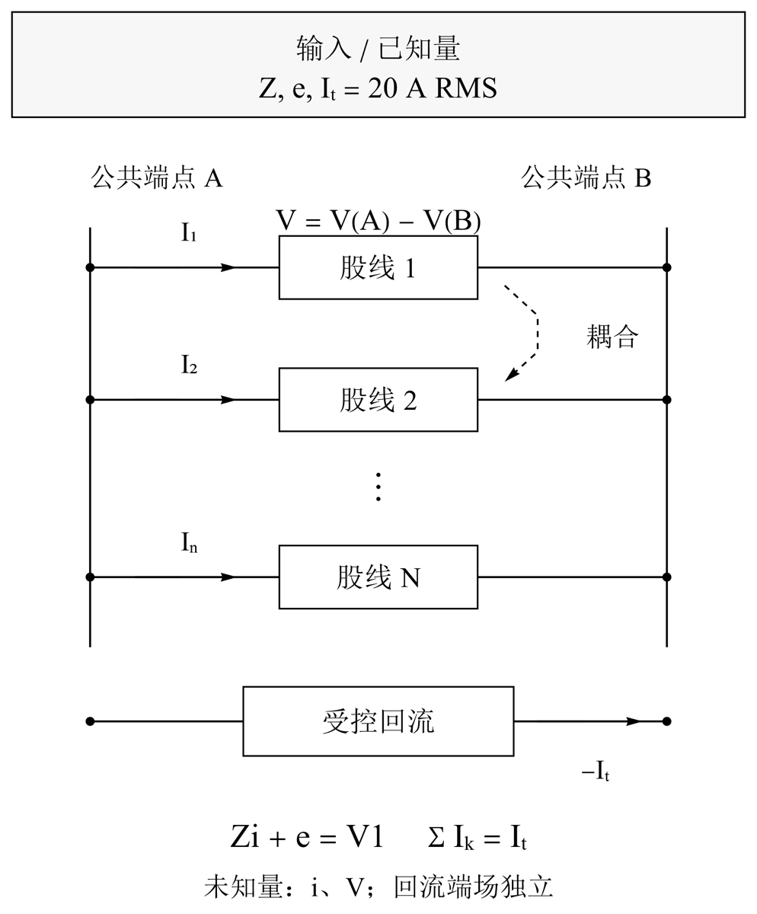
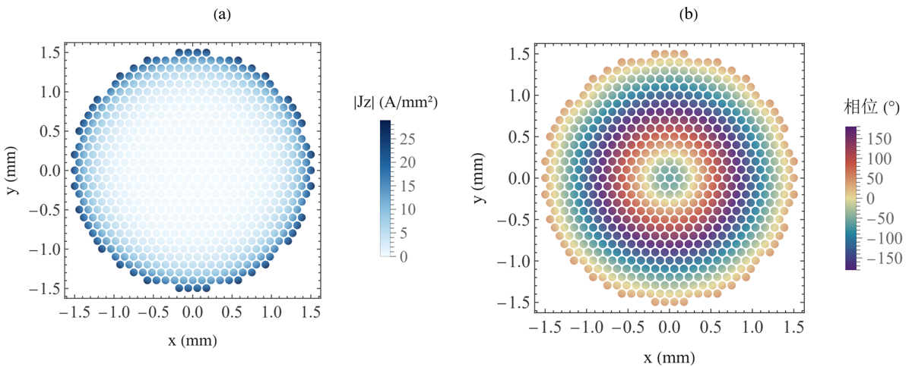
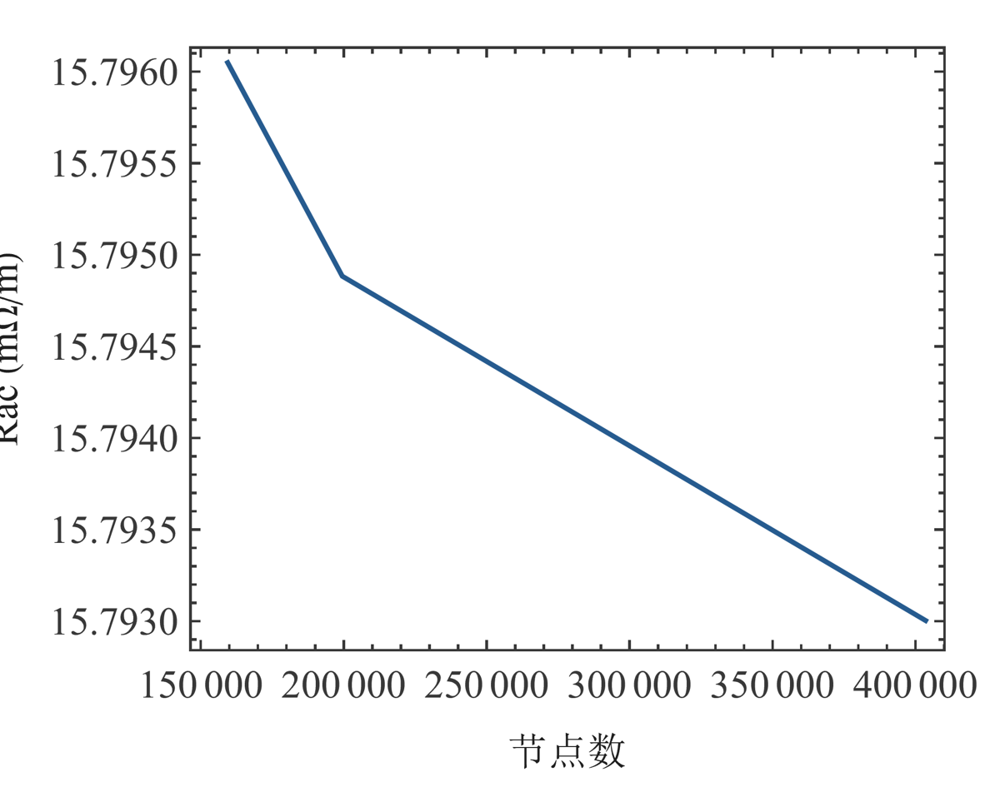

# Litz 线分层建模与数值验证：完整研究报告 · 04 多股共端场路与均流判据

缪雨轩 · 淮南师范学院

[合并稿](../README.md#chapter-04)

## 04 多股共端场路与均流判据

### 共端场路与复电流均流判据

端部并联并不要求各股预先具有相同电流。令 Z 为指定线性模型的耦合阻抗矩阵，e 为独立外场的感应项，i 为股线复电流向量，则公共端电压和总电流形成增广系统 [(4)](../README.md#E04)。实际实现求解增广系统，不依赖显式矩阵求逆。约束允许幅值和相位由场路共同决定；仅比较 |ik| 而忽略相位，会漏掉复电流和总电流之间的重要关系。

在增广系统解唯一的前提下，把 i=(It/N)1 代入端口方程，均流成立当且仅当 [(It/N)Z1+e] 落在 1 的张成空间。用投影 Q 表示即得到 [(5)](../README.md#E05)。无独立外场时，这成为阻抗行和相同的条件；外场存在时，感应项可能保持或破坏该条件。这个代数判据适用于所指定的 Z、e 和端接，不是任意连续三维换位结构的均流定理。

二维共端 FEM 将公共轴向端场与 Az 自由度一起求解。保存的 u 与端场具有 V/m 单位，Jz=σ(v−u)；回流使用自己的端场，空气不赋导体电流。图件从原节点和材料三角形恢复 Jz，按原毫米坐标缩放执行积分。独立线性三角形质量积分与各股复电流、束内损耗、回流损耗和铜面积核对，因此颜色图的来源可审查。保存的 u 不能直接当作电流密度绘制。

### 判据推导

均流判据的充分性来自端口解的唯一性。当投影条件成立时，向量 (It/N)Z1+e 的各分量相同，因此存在共同电压使等流向量满足全部端口方程及总电流约束。必要性则由已存在的等流解直接代入得到。数值计算以归一化复电流偏差评估均流程度，同时报告幅值和相位，以保持复数求和的信息。

### 640 股二维结果及其边界

640 股直束的冻结三档网格、回流与外域检查共有 23 项通过。最细网格增量的 Rac 变化为 0.011902%，回流距离变化为 0.000495%，外域变化为 0.000270%，均低于本路线 1% 门槛。它们说明指定二维共端模型在已检查扰动范围内稳定，不能代表真实绕制束的有限端区已经收敛。束内 Rac 与回流损耗分别报告，避免把回流中的热损耗算成导体自身改善。

逐股幅值与相位展示了共同端压下的电流分配，虚线 It/N 仅为参照，不是求解约束。节点电流积分与公共端条件的一致性，是均流讨论的必要前提。对这种二维直束，把单股直径减小并不等价于沿程位置已经换位。它的主要用途是验证多股场路与受控边界，作为后续换位模型的截面证据；最终结构排序仍需要保留沿程耦合、实际端接与相关数值不确定性的模型或实验。

### 束内与回流能量

640 股截面结果说明了细股自身趋肤尺度与束内集体电流分配之间的区别。外层与内层股线具有不同的磁耦合环境，共同端电压使这种差异表现为复电流的幅值和相位变化。此时直流面积给出铜利用率的基准，束内焦耳积分给出输运损耗，而回流的单独积分解释完整场路的能量分配。

640 股束内 Rac=15.793003197 mΩ/轴向m，束内损耗 6.317201279 W/轴向m，回流损耗 2.196205516 W/轴向m，实际铜截面 5.018478 mm²。共同端轴向电场为 0.411856245+j(4.064969103) V/m。归一化复电流 RMS 偏差为 1.854214，各股电流的复数和恢复 20 A RMS 总输运。

$$
\begin{bmatrix} Z&-\mathbf1\\ \mathbf1^T&0\end{bmatrix}\begin{bmatrix}\mathbf i\\V\end{bmatrix}=\begin{bmatrix}-\mathbf e\\I_t\end{bmatrix}.\tag{4}
$$

$$
Q=I_N-\mathbf1\mathbf1^T/N,\qquad Q\left[(I_t/N)Z\mathbf1+\mathbf e\right]=\mathbf0.\tag{5}
$$

图 5. 多股共同端口与回流。

各股沿途绝缘，在两端并联，逐股复电流由共同端电压及总电流约束求解。耦合矩阵 Z 与激励项 e 包含指定模型中的阻抗和场作用。受控回流承担反向总电流，并具有独立的端场。图中给出已知输入及待求复电流和电压。

图 6. 640 股共端复电流分配。

(a) 幅值；(b) 相位，按物理股线身份排列。 虚线表示 It/N 的比较参照。幅值和相位使用相同的物理股线编号。

图 7. 640 股二维截面电流密度。

(a) RMS 幅值；(b) 相位，材料标记识别各股。 电流按 Jz=σ(v−u) 从原节点场与端场恢复。独立功率使用线性三角形质量积分，显示采用单元中心采样。

图 8. 640 股网格与边界敏感性。

各试验按网格、回流和外域分别改变一个因素。 变化以相邻指定工况的电阻差归一化。网格、回流距离与外域大小各使用独立序列。

## 参考文献
